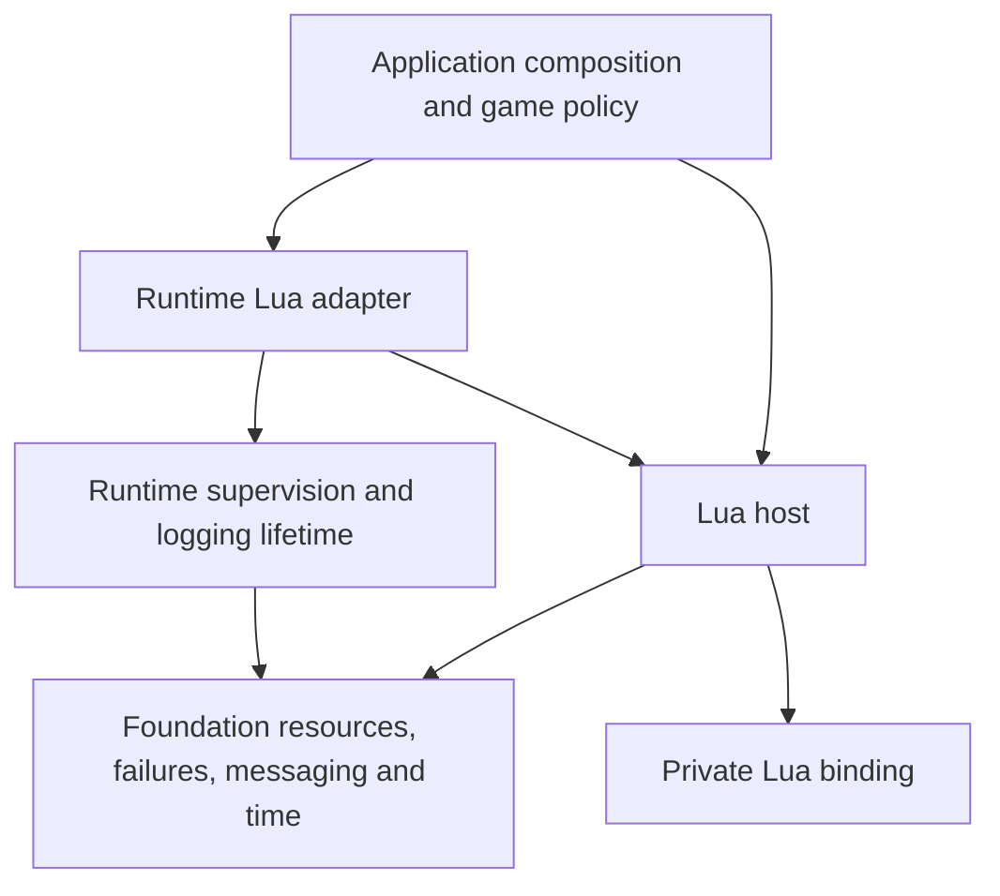
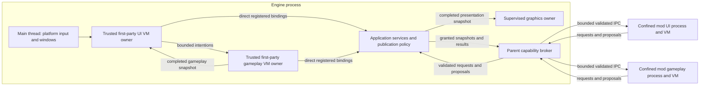

# Lua scripting runtime design

Give Lua its own scheduled execution domains so expensive gameplay does not put
UI scripts, input feedback, and engine communication behind the same callback.
Keep Lua central to authoring a game while Haskell owns execution, transport,
failure evidence, and lifetime. This is the canonical continuation of
`lua_runtime_architecture_notes.md` and the design conversation of 2026-09-16.

Design state: `ready for issue processing`

Current readiness scope: **LUA-8 only** (D-45), delivered by D-46 as LUA-29,
LUA-30, then a narrowed LUA-8, with D-47 adding the library prerequisite LUA-31
before LUA-30, with D-44 fixing its consumer, intentions,
UI-progress proof and gameplay randomness. LUA-19 (D-41), delivered by D-42 as LUA-27
(#492, PR #495), LUA-28 (#493, PR #496) and a narrowed LUA-19 (#494, PR #497),
is delivered, with D-40, D-42 and D-43 fixing the runner's clock, ending, event
source, overload and exit statuses. LUA-7 (D-37), split by D-38 into
LUA-7 (requests) and LUA-26 (subscriptions), is delivered, with D-36 and D-39
fixing when a deterministic owner's Lua sees an asynchronous result or provider
event. LUA-6 (with LUA-20 and LUA-21, D-28/D-29) and LUA-18 (with LUA-22, LUA-23,
LUA-24 and LUA-25, D-30 to D-32) are delivered too. Other unchecked slices retain
their explicit deferrals; this state does not release the confinement gate.

Owner: `coghex/hetoimasia`. Epic #145 and children #146–#149 have been
created; those children are merged. The owner accepted the two-domain direction,
required untrusted-mod isolation in the first arc, selected isolation per mod
and execution domain,
restricted capabilities and enforced limits, and chose to stop an unsafe failed
gameplay session while UI reports its state. Signed bundled macOS helpers may
be evaluated with headless command-line operation preserved (D-10).
The owner approved readiness on 2026-09-16 with separate Linux and macOS
feasibility slices (D-11). Q-3 is deliberately owned by LUA-1; Q-5 is deliberately
owned by LUA-14/LUA-15. Both successful platform proofs gate process-branch
drafting. That initial signoff permitted the preliminary proof/model work; it
did not pre-approve a confinement deployment policy.

Post-merge reconciliation, 2026-09-19, at code `master@38388f8`: LUA-1/#146
has established the binding boundary and LUA-4/#149 has delivered the pure
protocol model. LUA-14/#147 and LUA-15/#148 both delivered **inconclusive**
confinement verdicts. D-11 therefore returns this document to `exploring`.
LUA-9 through LUA-13 and their dependent integration slices remain blocked;
closing the proof issues did not prove supported confinement. D-13 now permits
trusted delivery independently of Q-5 after renewed readiness; the process
branch still requires Q-5's successful verdicts. The
[review ledger](project_review/ledger.md) also records implementation
follow-ups; processing completion is not a clean implementation verdict. The
[binding review](project_review/173.md) records stale source comments, and the
[protocol review](project_review/179.md) recorded failure-settlement and bounded
failure-detail defects. Those repairs (#193/#194) are closed at the 2026-09-22
review baseline. PR #241 subsequently corrected the binding comments. Neither
those repairs nor closed proof issues clear Q-5's confinement gate.

Owner reconciliation, 2026-09-24: D-13 permits independent trusted delivery;
D-14 fixes binding exposure for both paths. Q-8 is resolved. LUA-5 through
LUA-8 deliver trusted execution and reusable machinery; LUA-16/LUA-17 retain
confined integration and adversarial acceptance behind Q-5. This decision
approval does not renew design readiness. The document remains `exploring`.

Documentation reconciliation, 2026-10-15, at code `master@2c56edd0`, on the
owner's request (via the assistant, request
`user-het-lua-doc-reconcile-20261015`). D-15 records the owner's 2026-09-29
decision on general VM owners. D-1, P-2, LUA-2 and LUA-5 are reconciled with
it, and [Current state and evidence](#current-state-and-evidence) is refreshed.
This reconciliation does not renew readiness. Trusted-path readiness renewal
(LUA-2, LUA-3, LUA-5 through LUA-8) is still pending the owner. The document
remains `exploring`, and Q-5 still gates the process branch.

Narrow readiness renewal, 2026-10-15: the owner, via the assistant (request
`user-het-lua-narrow-ready-20261015`), approved "hetoimasia's narrow readiness
step". Trusted-path design readiness is renewed for **LUA-2 and LUA-3 only**,
so the document is ready for issue processing for those two slices.
- LUA-5 through LUA-8 are not renewed. They stay `[deferred]` until the owner
  renews them.
- The confined branch (LUA-9 through LUA-13, LUA-16, LUA-17) stays
  `[deferred]` on Q-5's successful platform verdicts.

This is not approval of the whole program, and no other gate changes.

Narrow readiness renewal, 2026-10-16: the owner, via the assistant (request
`user-het-lua5-readiness-20261016-1740`), accepted priority 1 of guide report
[2026-10-16T165532Z-edefc39](guide/2026-10-16T165532Z-edefc39.md) and approved
the narrow LUA-5 readiness renewal. LUA-5 is reconciled with the delivered
owner, module and protocol APIs at `master@21c2add5`
([LUA-5](#lua-5-integrate-trusted-vm-owners-with-runtime-supervision)) and its
trusted-path readiness is renewed, so it is ready for issue processing. Its
prerequisites LUA-2 (#460, PR #461), LUA-3 (#462, PR #463) and LUA-4 (#149)
are merged. The reconciliation needed no new owner decision.
- LUA-6 through LUA-8 stay `[deferred]` until the owner renews them. Where
  lifecycle-operation binding calls are delivered is decided when LUA-6 is
  renewed; until then they stay "not yet supported" (#462, decision A1).
- The confined branch stays `[deferred]` on Q-5's successful platform verdicts.

Readiness is not implementation approval. Processing LUA-5 into an issue and
implementing it each need their own authorization.

LUA-6 readiness discussion opened on 2026-10-17 at the owner's direct request.
LUA-5 is now delivered by #464 / PR #465, merged as `29211202`, and TIME-1/#133
is delivered. The current exploration covers LUA-6 and the dependent authoring
contract/organization under D-25; it does not revoke prior approvals or renew
the other trusted slices or the confined branch.
Q-9 through Q-17 below preserve the resolved design questions. D-16 through
D-28 record lifecycle, identity, scheduling, determinism, delivery, automatic
cleanup requirements. The [instance contract](lua_instance_contract.md) is
accepted by D-26 and strengthened by D-27. LUA-6's design-readiness check is
complete and readiness is renewed by D-28. The owner requests manager-led issue
processing and canonical issue approval. Do not request the same behavioral or
readiness approval again. No tracker item has yet been created by this session.

LUA-6 readiness check at `637d14a9`: its LUA-5/TIME-1 prerequisites are delivered;
Q-9 through Q-17 are resolved or assigned under the approved contract and D-25
organization. Its outcome, compatibility, deterministic ordering, bounded
controls and acceptance signals are explicit. Instance authoring/automatic
cleanup belongs to LUA-18, providers to LUA-7 and the runner to LUA-19, keeping
the scheduler slice bounded. The ledger matches all 19 delivery sections, and
the open tracker contains the existing epic #145 but no LUA-6 child. Recommend
renewing trusted readiness for LUA-6 alone, then processing that child under the
existing epic. This review does not renew other slices or the confinement branch.

Owner authorization, 2026-10-17: following that recommendation, the owner asked
"great, give this to the manager to process please, have it process and approve
the issue" in direct Codex session `01a14598-15ef-7241-ac4a-c3b1b490bec9`.
Handoff request: `user-het-lua6-process-20261017-0544`. D-28 records its exact
scope and endpoint; the manager must obtain the canonical independent verdict.

LUA-6 delivery, 2026-10-17: LUA-20/#466 (PR #469, `bedae710`), LUA-21/#467
(PR #470, `889c1ca2`) and LUA-6/#468 (PR #471, `65c7b725`) are merged, with
post-merge validation green for each.

LUA-18 readiness check at `master@65c7b725`, 2026-10-17, at the owner's direct
request to the hetoimasia manager ("pick the logical next slice for me and make
sure that it is ready for processing"). LUA-18 is the first non-terminal,
non-deferred-by-gate entry and the only trusted slice whose dependencies are all
delivered: LUA-6 is merged, and LUA-3/LUA-4/LUA-5 supply the boundaries it
consumes. Its behavior is fixed by the accepted instance contract (D-26/D-27);
Q-9, Q-11, Q-13, Q-15, Q-16 and Q-17 are resolved, and the integration
boundaries below are implementation work inside that contract, not product
choices. The ledger matches the delivery sections; the open tracker holds only
epic #145 and the unrelated #446, with no instance-layer child or duplicate.
The slice is larger than LUA-6 was before D-29 split it, so under D-25's
delegated organization D-30 carves engine-owned instance resources (LUA-22) and
granted Lua controls with deterministic control admission (LUA-23) out of it,
adding no scope. D-30 renews trusted readiness for LUA-18, LUA-22 and LUA-23
only. LUA-7, LUA-19 and LUA-8 stay `[deferred]` on their own renewal, and the
confined branch on Q-5. Readiness is not issue processing or implementation:
each needs its own authorization.

LUA-18 processing, 2026-10-17 (request `user-het-lua18-process-20261017-1458`,
the owner's direct "split the slices for me please, then get them processed into
issues and approve those issues"): the drafted LUA-18 issue was still the size of
LUA-6's integration PR (#471, six review rounds), so at signoff the manager took
the drafter's fallback partition and D-31 carves instance cadence (LUA-24) out of
LUA-18, adding no scope. D-30's readiness covers it.

LUA-22 review, 2026-10-17: the canonical review of #473 requested changes
(https://github.com/coghex/hetoimasia/issues/473#issuecomment-6235679552).
`Foundation.Resource.Collection` admits only the thread that created it, while
a Lua binding runs on a fresh callback thread for each call and the owner's
thread is blocked inside Lua, so D-30's "built on `Foundation.Resource.Collection`"
could not hold. The owner chose a prerequisite slice (D-32, LUA-25).

LUA-7 delivery, 2026-10-18 (request `user-het-next-slice-20261018-1235`):
LUA-7/#482 (PR #484, `895d26b1`) and LUA-26/#483 (PR #485, `4560a08b`) are
merged, with post-merge validation green for each.

Status legend: `[ ]` unprocessed · `[#N]` linked to issue N · `[no-issue]`
reviewed and deliberately not tracked separately · `[deferred]` blocked on a
concrete precondition

## Processing status

- [x] EPIC. Establish isolated UI and gameplay Lua execution — [#145]
- [x] LUA-1. Establish the Lua binding and foreign-call boundary — [#146]
- [x] LUA-14. Prove Linux confinement and resource-limit feasibility — [#147]
- [x] LUA-15. Prove macOS confinement and resource-limit feasibility — [#148]
- [x] LUA-2. Own the VM through a protected IO lifetime — [#460]
- [x] LUA-3. Add application-owned modules and bounded value bindings — [#462]
- [x] LUA-4. Model bounded script tasks and execution protocols — [#149]
- [x] LUA-5. Integrate trusted VM owners with runtime supervision — [#464]
- [x] LUA-20. Run Lua task coroutines on their VM owner — [#466]
- [x] LUA-21. Add scheduling policies, service quanta, logical time and an owned timer for Lua tasks — [#467]
- [x] LUA-6. Schedule cooperative tasks with bounded service turns — [#468]
- [x] LUA-18. Own script instances, hooks and lifecycle controls — [#472]
- [x] LUA-22. Own instance resources through engine-held leases — [#473]
- [x] LUA-23. Grant Lua lifecycle controls and inspection across owners — [#474]
- [x] LUA-24. Run instance updates on logical and elapsed cadences — [#475]
- [x] LUA-25. Lend a resource collection's ownership to synchronous Lua callbacks — [#476]
- [x] LUA-7. Add bounded asynchronous Lua requests with reserved result slots — [#482]
- [x] LUA-26. Deliver provider events through owned Lua subscriptions — [#483]
- [x] LUA-27. Run Lua sources to completion through a reusable runner — [#492]
- [x] LUA-28. Drive the runner on logical ticks and publish instance start and end events — [#493]
- [x] LUA-19. Run script instances through a headless command-line entry — [#494]
- [x] LUA-29. Compose independent UI and gameplay Lua owners in a headless sample — [#498]
- [x] LUA-31. Wait for a scheduled owner's accounting of its accepted ticks without a task slot — [#503]
- [x] LUA-30. Fail, overload and stop the two-domain sample explicitly — [#499]
- [x] LUA-8. Prove independent trusted UI and gameplay execution headlessly — [#500]
- [ ] LUA-9. Add bounded child-process transport and owned process lifetime — [deferred]: Q-5 successful Linux and macOS confinement verdicts
- [ ] LUA-10. Establish Linux mod-process confinement — [deferred]: Q-5 successful Linux and macOS confinement verdicts
- [ ] LUA-11. Establish macOS mod-process confinement — [deferred]: Q-5 successful Linux and macOS confinement verdicts
- [ ] LUA-12. Enforce parent-owned execution and resource budgets — [deferred]: Q-5 successful Linux and macOS confinement verdicts
- [ ] LUA-13. Broker scoped mod capabilities in the parent — [deferred]: Q-5 successful Linux and macOS confinement verdicts
- [ ] LUA-16. Integrate confined mod owners with the runtime — [deferred]: Q-5 successful Linux and macOS confinement verdicts
- [ ] LUA-17. Prove confined execution and adversarial isolation headlessly — [deferred]: Q-5 successful Linux and macOS confinement verdicts

The ledger records processing, not implementation. Keep it synchronized with
the delivery plan; do not infer issue numbers from these local slice IDs.
LUA-2's former #146 merge prerequisite is satisfied; its unchecked entry still
means no issue has been processed. Renewed readiness gates trusted processing;
Q-5 additionally gates the process branch under D-11/D-13.

Dependency reconciliation, 2026-09-18: the owner selected the shared-toolchain
qualification VK-1/#157 before LUA-1/#146. The amended and reapproved #146 and
its tracker comment linking #157 are authoritative. Consume its merged exact
GHC/Cabal/index baseline; do not perform a competing upgrade. This is a shared
build prerequisite, not a dependency on Vulkan rendering or native proof. The
source observations below remain historical.

## Epic contract

- **Goal:** a reusable Lua host and runtime adapter run trusted first-party UI
  and gameplay on independent in-process VM owners, with untrusted execution
  confined per mod and domain in separate sandboxed processes, without a window,
  renderer, or concrete game.
- **Done when:** a headless consumer loads application-owned Lua behavior in
  both domains; UI handles input against the last completed gameplay snapshot
  while gameplay is busy; cooperative tasks yield/wait/resume; overload is
  bounded and explicit; malicious/failed children cannot bypass capability
  checks or configured resource limits; failure and cancellation preserve
  parent-owned resource lifetime. Linux CI and local macOS verify both the
  binding and actual confinement, including denied-access tests.
  LUA-8 establishes the trusted milestone; LUA-17 establishes confined system
  acceptance. Both are required to complete the epic.
- **Users and operators:** authors of Lua-driven games/tools, engine component
  authors registering capabilities, and agents maintaining focused tests.
- **Arc label:** propose `scripting`, description “Lua hosting, execution, and
  application scripting integration”, color `7057FF`. Creation belongs to later
  issue processing, not this document edit.

## Current state and evidence

Inspection of Hetoimasia at `master@2c56edd0` on 2026-10-15. This replaces the
2026-09-16 pre-implementation baseline (`master@007c285`).

Addendum at `master@21c2add5`, 2026-10-16, for LUA-5's readiness. LUA-2/#460
(PR #461, `85bb6118`) delivered the protected owner `withVmOwner`, and
LUA-3/#462 (PR #463, `edefc398`) delivered application registrations,
per-owner policy, modules, entry points, bounded values and `BoundaryFault`
effects. The host's public modules are now `Owner`, `Registration`, `Value` and
`Bridge`, and it still depends only on foundation and the binding. No
`runtime-lua` sublibrary exists yet. The foundation and runtime facts below are
unchanged in role. The bullet below saying no owner or registration surface
exists describes the 2026-10-15 baseline.

Addendum at `master@29211202`, 2026-10-17, for LUA-6's readiness discussion:
LUA-5/#464 is merged by PR #465. The public `runtime-lua` sublibrary now exists.
`Runtime.startLuaOwner` creates one supervised worker; its dispatch runs
`withVmOwner`, publishes readiness after configured initialization, then serves
prepared finite calls in FIFO order (`Runtime/Dispatch.hs`). Submission and
outstanding results are bounded; application failures preserve their provenance
through supervision. There is no scheduled task execution or timer yet.
The protocol model already supplies service classes, quanta, task states,
segment outcomes, ordinals and session transitions; the runtime adapter
currently consumes only its cap validation. `Foundation.Time` supplies the
monotonic source and injected `scriptedSource`; TIME-1/#133 is closed. The
bridge offers no host coroutine-resume API today, and lifecycle-operation calls
still return `NotYetSupported`. These are integration boundaries for LUA-6,
not completed scheduler capabilities.

Addendum at `master@65c7b725`, 2026-10-17, for LUA-18's readiness. LUA-20
(#466) gives the host owner-thread task coroutines with typed refusal of a
scheduler yield wherever it cannot reach the scheduler, and makes `coroutine`
selectable. LUA-21 (#467) delivers `Hetoimasia.Scripting.Lua.Scheduler`: the
FIFO default and policy extension, service classes and quanta, `Looped` and
`OneShot` kinds, application-granted logical ticks, elapsed waits, one owned
timer, budgets, bounded pause/resume/stop requests by task identity with
request and application results, and diagnostics; its STM `taskPhase` reads a
task's phase. LUA-6 (#468) delivers `Hetoimasia.Scripting.Lua.Scheduled`:
supervised scheduled owners (`startScheduledOwner`, `retireScheduled`),
runtime-unique `ScheduledTaskId`s, nonblocking `admitScheduledTask` with
tickets that settle once, `requestTaskControl`, `grantScheduledStep`,
`awaitTicksComplete`, `scheduledObserve` and protected retirement that closes
every suspended coroutine, with cleanup failure fatal under any policy. Boundaries
LUA-18 builds on:

- There is no instance, hook, `self` state, invocation queue, event delivery or
  per-task inspection export yet. A scheduler task waits only for logical ticks
  or an elapsed deadline; there is no wait for a delivered event, and the only
  application code run on the owner's thread between segments is
  `scheduledObserve`. An instance layer therefore adds its own owner-thread
  admission and wake path (or extends the scheduled owner with one) inside
  `runtime-lua`.
- Lifecycle-operation bindings are still classified `NotYetSupported` (#462,
  decision A1). Determinism covers controls made at logical points only; logical
  admission of controls arriving mid-step is LUA-23's.
- `Foundation.Resource.Collection` supplies one-owner-thread, bounded,
  early-retirable members built from staged `Assembly`s and registered while
  masked (`acquireMemberThen` hands the token to an owner's bookkeeping in the
  same step); repeated retirement answers `AlreadyRetired` without releasing
  twice; a release failure poisons further acquisition and is latched as
  cleanup evidence. Its owner is the thread that created it: every other thread
  is refused with `NotOwnerThread`. A Lua binding runs on a fresh callback thread
  for each call while the owner's thread is blocked inside Lua (the host README,
  "How callbacks re-enter"), so a binding cannot use it directly. D-32 adds the
  primitive LUA-22 builds leases on (LUA-25).

- **The Lua host** (`packages/scripting-lua`, built on the `lua` binding
  `>=2.3.4 && <2.4`). Its public library exposes only
  `Hetoimasia.Scripting.Lua.Bridge`: `newVm` over an explicit library set,
  chunk loading, protected calls, error and cancellation transport across the
  C boundary, and a terminal `closeVm`. The private `bridge` sublibrary holds
  `Vm`, `Call`, `Callback`, `Fault` and `Library`. It depends only on
  `hetoimasia-foundation` and the binding. This is LUA-1/#146, merged by PR
  #173 (`8072d6ea`).
  - Later refinements: a callback's operation on its own VM is refused
    (`6a9cbb6f`).
  - Every cancelled fault runner settles, and its cancellation is proven to
    land (#369, `4449275d`).
  - There is still no protected VM owner, module or capability registration
    surface, or game binding. Those are LUA-2, LUA-3 and LUA-5.
- **The protocol model.** The private `model` sublibrary is the pure task,
  admission, request, subscription, epoch, failure and stop model under
  `Hetoimasia.Scripting.Lua.Internal.Protocol`. This is LUA-4/#149, merged by
  PR #179 (`a984985e`), with failure-settlement repairs #193/#194. Its session
  aggregate has since been split into focused private modules (`db410ccb`).
- **Confinement probes.** The package also holds the LUA-14/LUA-15 probes:
  `lua-confine-child`, `linux-confinement-probe`, `macos-confinement-helper`
  and `macos-confinement-probe`, plus the `lua-hazard` fixture. Both platform
  verdicts are inconclusive (Q-5). They gate only the process branch.
- **Foundation and runtime reuse.** These are unchanged in role and still in
  place at this baseline. `Runtime.Application` is the application runner
  beside them.
  - `Foundation.Worker` owns startup, stop, cancellation, and terminal outcomes.
    It retains borrowed dependencies until every worker and cancellation helper
    finishes. A stuck worker is not detached. It promises no OS-thread affinity.
  - `Runtime.Supervision` classifies required/optional services and finite jobs.
    `RuntimeControl` belongs to the application thread. `awaitSupervised` handles
    any pending worker outcome before committing the supplied STM transaction;
    a fatal outcome is latched. Ordinary IO is not automatically supervised.
  - `Runtime.Inbox` handles one message at a time. An escaping handler exception
    ends the service. Its context is built in `Scoped` startup and its handoff
    precedes the worker startup acknowledgement. It is not a Lua scheduler or a
    general protected-IO constructor for an interpreter.
  - `Foundation.Resource` runs ordinary releases under `uninterruptibleMask_`.
    Arbitrary script finalization or worker joins do not meet its controlled
    blocking contract. Worker draining already uses its own protected IO boundary.
  - Foundation messaging supplies prepared payloads, bounded FIFO admission,
    close/abort, and latest-value snapshots with checked cursors. `Prepared`
    forces values; it neither copies referenced mutable state nor extends a
    borrowed resource's lifetime.
  - Those worker/messaging APIs are in-process mechanisms. The repository has no
    scripting sandbox, bounded Lua IPC protocol, or isolated mod-process owner.
    OS containment and process supervision below are new work, not existing
    guarantees conferred by using `Worker` or separate Lua states.
- **The clock.** The monotonic time and deadline boundary that LUA-6 and
  LUA-12 need (Q-4) has shipped: TIME-1/#133, merged by PR #152, and
  `Foundation.Time` with its `Types` and `Arithmetic` modules (the latest split
  is `16933652`). [Runtime scheduling](runtime_scheduling_design.md) owns
  monotonic time and native wake, not Lua tasks.
- **A graphics consumer now exists.** The 2D renderer (epic #413, closed
  2026-10-14) publishes per-window scenes in the window host (#423, PR #435,
  `ebfdec98`). Its host adapter draws decoded images in a window (#424, PR
  #441, `1728868b`). These are the presentation consumers P-2 anticipated.
  The trusted milestone LUA-8 stays headless, with fake capability and
  presentation consumers and no Vulkan or GLFW dependency.
- [Window/graphics lifetime](window_graphics_lifetime_design.md) owns graphics
  retirement. [Test architecture](test_architecture_design.md) specifies
  package-owned suites, so new Lua suites start in this package.
- **Tracker.** The open items at inspection are #145 (this epic) and #446
  (deferred render-to-texture, unrelated). No other issue or pull request
  overlaps the Lua arc. The original foundation plan's FND-5 overlapped host
  construction. Its [current boundary overview](engine_foundation_design.md)
  delegates scripting to this arc; do not resurrect the historical slice or
  create a second host epic.

### Synarchy lessons to retain

Read Synarchy at `064a255f06b59e2b1f8e881dcf4c747d52967a36`; these are references
for a deliberate adaptation, not a promise to import its implementation.

| Source under Synarchy's `src/Engine/` | Retain | Change here |
| --- | --- | --- |
| `Scripting/Lua/Script.hs` | Protected module calls, explicit missing-callback behavior, stack-balance discipline, attributable diagnostics | Do not turn every callback failure into “warn and continue” after unknown mutations |
| `Scripting/Lua/Thread/Scheduler.hs` | Bounded message/update/console service opportunities, gates checked between callbacks, bounded idle wait | Separate UI and gameplay owners; a fair queue cannot preempt one long callback |
| `Scripting/Lua/TickPolicy.hs` | Validate update intervals; exclude inactive/event-only work from timer demand | Reuse Hetoimasia's clock boundary and configurable policies; do not inherit tuning constants blindly |
| `Scripting/Lua/Thread.hs` and `Core/Thread.hs` | Stop clients/producers before disposing interpreter dependencies | Retain Hetoimasia's protected drain; do not assume `forkIOWithUnmask` establishes OS affinity |
| `Scripting/Lua/Message.hs` | Batch only semantically compatible operations; reject stale session work | Component-owned epochs and explicit admission instead of indiscriminate live-queue flushing |
| `Scripting/Lua/API.hs` and `Types.hs` | Application-defined namespaces and useful call shapes | Remove `EngineEnv`, game-manager imports, native state exposure, and unrelated mutable fields from the reusable host |

## Desired experience and scope

A Lua-authored UI can react to input, update a progress indicator, or report a
script fault while a costly gameplay operation is still running. It sees a
coherent completed view of gameplay and sends intentions for later admission.
Gameplay can slow down without making UI animation depend on a simulation tick.
The renderer remains free to display the last available presentation state.

The application can describe thousands of logical tasks using shared behavior,
small state records, deadlines/events, and explicit continuation cursors. It
does not need one VM or thread per entity. The author deliberately makes long
operations resumable; the engine supplies scheduling and diagnostics.

**In scope:** independent UI/gameplay VM owners, per-mod/domain process
confinement on Linux/macOS, private binding mechanics,
application-registered capabilities, bounded copied values, task state and
cooperative service policies, component-local asynchronous request/subscription
protocols, parent-validated capabilities, bounded IPC, execution/resource
enforcement, errors, cancellation, cleanup, focused telemetry, and a headless
two-domain consumer. Plain direct host use is for trusted code only and may
remain possible without supervision; it is never an untrusted fallback.

**Out of scope:** a replacement Lua language/bytecode VM; an optimizing compiler;
automatic arbitrary-loop splitting; hard real-time or absolute immunity to
OS/interpreter vulnerabilities;
one VM per entity; multiple gameplay shards; a game-state schema, ECS, UI toolkit,
render commands, asset system, save/load implementation, hot reload, console
server, global event bus, or general broadcast/RPC framework. Vulkan and GLFW
integration is application work after the headless boundary is established.
Third-party native extensions, arbitrary filesystem/network grants, mod
marketplace/distribution, and a general permission UI are also outside this arc.

## Decisions

### D-1. Independent UI and gameplay execution is the first system milestone

The owner accepted the two-domain recommendation on 2026-09-16. Each domain
has an independently created VM and exactly one execution owner. Coroutines
inside a VM multiplex tasks; they are not the separation between UI and gameplay.
Base host tests may use one VM, but the arc does not end at a single-owner demo.
D-15 generalizes the owner: the two domains are one composition of a VM owner
that an application can create any number of. One VM cannot run Lua on two
threads, so separate VMs remain the only way to keep UI responsive.

### D-2. Keep Lua central without coupling the engine to a game

The owner wants a packaged Lua runtime that can interact consistently with
engine services. The application assembles permitted capabilities. Engine
packages do not import concrete game namespaces or gain a universal environment.
Authoritative gameplay state may live in Lua or Haskell; ownership and publication
rules apply to both. This design does not force game logic into Haskell.

### D-3. Schedule explicit work and preserve UI independence

The owner accepted a host-managed task/state-machine approach, cooperative
segments, service classes, and bounded work. UI consumes completed snapshots and
emits intentions without synchronously waiting for gameplay. Numerical OS
priority is not the correctness mechanism. Arbitrary automatic script splitting
and optimization remain future investigations.

### D-4. Reuse runtime contracts and develop alongside graphics

The owner wants this work available in parallel with Vulkan. Reuse errors,
recovery, workers, supervision, messaging, logging, and clock contracts. Native
window ownership stays on the main thread. Prove scripting headlessly, with
Hspec and package-owned tests, Linux remote CI, and local macOS evidence.

### D-5. Preserve the design beyond the conversation

The owner authorized converting the exploratory notes into this canonical
document and handing it to another session. Retain deferred ideas with their
prerequisites, distinguish proposals from decisions, and do not manufacture a
ready state or tracker approval from that authorization.

### D-6. Include untrusted-mod isolation from the start

Owner selected this explicitly on 2026-09-16. Containment is first-arc work,
not a deferred trust-model footnote. Untrusted Lua does not execute in the
engine process. A child process supplies fault separation in this design;
OS sandbox policy, bounded IPC, parent-side authorization, and resource
enforcement supply the rest. If containment cannot be installed, admission fails
closed rather than quietly using the trusted host path.

### D-7. Stop gameplay whose authoritative state cannot safely recover

Owner selected this explicitly on 2026-09-16. A script failure after possibly
partial authoritative mutation stops the affected gameplay session. UI remains
available to report the failure and last good snapshot. Optional UI tasks can
be disabled only when their effects are safely isolated. This is not a promise
to preserve the application after an unrelated fatal host/cleanup failure.

### D-8. Isolate each mod and execution domain

Owner selected separate sandboxed processes per mod and UI/gameplay domain,
with configurable admission caps. One malicious mod cannot share another mod's
interpreter heap or stop its process. A mod using both roles needs two owners;
one using only gameplay needs one. Tasks/entities still share their owning
domain's VM. Reject/defer excess domain admission explicitly; do not silently
pool mutually untrusted domains into a shared interpreter or process.

### D-9. Restrict capabilities and enforce execution/resource limits

Owner selected only explicitly granted engine capabilities: no direct
filesystem, network, process launching, or native modules. Exceeding enforced
execution or memory limits stops that mod process. The trusted parent owns
the limits and enforcement; a script-controlled hook or heartbeat is not
sufficient. This permits terminating a confined child, not detaching an
in-process worker that still borrows engine resources.

### D-10. Allow evaluation of signed bundled macOS helpers

Owner selected this explicitly on 2026-09-16. The macOS feasibility work may
evaluate a signed app bundle with sandboxed helpers while preserving headless
command-line operation. Bare Cabal executables are not a packaging requirement
for that evaluation. This permits investigating supported platform packaging;
it does not select XPC or a signing identity, establish a paid-account or
privileged-installation requirement, or prove containment. Q-5 still requires
evidence for per-mod/domain isolation, whole-process memory enforcement, and
owned lifetime before selecting the backend. D-6/D-8/D-9 remain in force.

### D-11. Gate process delivery on two preliminary platform proofs

Owner accepted this delivery change and readiness on 2026-09-16. LUA-14 and
LUA-15 follow LUA-1 and independently deliver Linux and macOS feasibility
evidence. Both must demonstrate a viable profile satisfying Q-5 before drafting
LUA-9 through LUA-13 or their dependent integration slices. Q-5 is deliberately
open for those proofs; it is no longer a prerequisite to processing the epic,
binding proof, or feasibility slices themselves.

Each proof is one PR containing its probe, tests, retained evidence, and platform
verdict. The initial gate returned the design to `exploring` on a failed or
inconclusive verdict. D-13 supersedes that document-wide pause: such verdicts
continue to stop process-branch drafting while separately approved trusted
delivery can proceed. They cannot weaken the accepted isolation or limit
contracts. Any required change to scope, trust boundary, supported deployment,
or public lifetime contract returns to the owner for a design decision and
renewed readiness. Routine mechanism selection within the accepted contracts
is the proof's responsibility.

### D-12. Run first-party scripts trusted and in-process

Owner selected this explicitly on 2026-09-22. The game's own first-party
scripts are trusted code. They run in-process in the application's UI and
gameplay VM owners (D-1) and call application-registered bindings directly,
without IPC serialization. Untrusted mods keep the confined-process pipeline of
D-6, D-8 and D-9 unchanged. Both paths share one module and capability
registration layer: a binding is defined once, and each path exposes the subset
its trust level permits. The trusted path is never a fallback for a mod whose
confinement cannot be installed. D-13/D-14 resolve the delivery and binding
exposure questions recorded in Q-8.

### D-13. Deliver trusted execution independently of confinement qualification

Owner approved this explicitly on 2026-09-24. LUA-2, LUA-3, and the trusted
in-process portions of LUA-5 through LUA-8 may proceed before Q-5 is resolved,
after their design/dependencies are reconciled and readiness is explicitly
renewed. LUA-5 through LUA-8 deliver the trusted path and reusable machinery;
LUA-16/LUA-17 preserve confined runtime integration and adversarial system
acceptance as required later slices.

Q-5 still blocks LUA-9 through LUA-13, LUA-16, and LUA-17 until both platform
verdicts are successful. Required mod isolation remains in this epic; trusted
completion neither completes the epic nor permits mod admission. A failed
confinement setup never selects the trusted path. This supersedes the earlier
document-wide processing pause without weakening D-6, D-8, or D-9.

Trusted scripts can hang or exhaust application memory. Cooperative service
budgets are not hard execution or memory limits. Protected teardown retains
dependencies until the VM actually finishes; a stuck owner cannot be detached.
Direct bindings preserve service ownership, coherent snapshots, and bounded
intentions; they do not permit synchronous calls into another VM owner.

### D-14. Register once with explicit exposure for each execution path

Owner approved this explicitly on 2026-09-24. Both paths share one binding
definition with explicit eligibility for each execution path. Registration
defaults to no mod exposure. A confined binding requires an explicit grant
and supported bounded transport semantics; not every direct binding needs an
IPC equivalent. P-4 records the permitted behavior by binding kind.

On the confined path, snapshot queries read granted local snapshots. Owned state operations mutate
only child-owned state; changes to parent state use validated commands.
Commands and UI intentions use bounded authorized requests, asynchronous
native requests use brokered admission and result delivery, and lifecycle
operations request permitted transitions while the parent retains authority.

### D-15. Make the VM owner a general primitive created at runtime

Owner decision 2026-09-29, recorded here on 2026-10-15. The engine's unit is a
general **VM owner**. An application may create and retire any number of
independent VM owners at runtime. Each one has its own binding set and
capability policy (D-14), and each VM still has exactly one execution owner
(D-1). Concurrently live owners are independent: none reads another's mutable
state or calls its VM synchronously, and the failure or retirement of one does
not stop another. The game's two-domain UI and gameplay arrangement is one
composition of this primitive, not a fixed pair the engine hard-codes. The
owner's reasons were later uses: throwaway validation VMs, tool panels,
background jobs and hot reload. These are not added to this arc's scope; hot
reload stays out of scope here.

There is no VM pool, cross-VM scheduler or sharding framework until a concrete
consumer needs one; P-10's caution about sharding stands. D-1's reasoning is
unchanged.

### D-16. Expose lifecycle control to Lua-authored code

Owner direction, 2026-10-17: scripts should be able to control lifecycle,
including pause, resume and stop. Application-only controls are not the desired
endpoint. The owner also proposed IDs, control from Lua elsewhere, and a game
terminal `ps` command listing scripts and status. Those proposals are retained
under Q-9/Q-11; D-17 subsequently settles task identity and permitted cross-owner
control. Detailed lifecycle behavior and delivery scope still need clarification.
This decision does not choose
forced interruption, a global registry, a terminal implementation or readiness.

### D-17. Identify script tasks by TID and expose owner, name and status

Owner accepted the proposed task identity and permitted cross-owner control
direction on 2026-10-17. The display/API vocabulary is **TID** (thread ID),
**owner** (a string), **name** and **status**, as in the proposed `ps` listing.
TID identifies one logical running script task, with an engine-issued identity
and an application-assigned readable name. It does not expose an OS thread,
Haskell `ThreadId` or a raw Lua coroutine. Several tasks may share one VM owner.
The owner string is its readable label; the existing internal owner identity
and capability checks still establish identity and authority.

Permitted Lua code elsewhere can request lifecycle changes by task ID, including
across VM owners in the application's runtime. Requests remain nonblocking and
the target owner applies them at safe boundaries. Whole-owner control is
distinct from controlling one task. Neither the TID nor a readable label grants
authority. Q-11 retains the question of delivering the terminal command itself.

### D-18. Select scheduling schemes per VM owner

Owner direction, 2026-10-17: FIFO is the default, but different owners must be
creatable with different scheduling schemes. UI and gameplay may choose
different schemes; the design must leave room for more sophisticated schedulers
as the engine matures. This selects per-owner policy, not a global scheduler or
a requirement that the engine hard-code UI/gameplay owners.

These policies choose the next logical Lua task within an owner at cooperative
boundaries. They do not select OS/Haskell thread scheduling or preempt a segment
or blocking callback. D-19 settles the default semantics and extension scope;
Q-10 retains compatibility with LUA-5's finite-call interface. No new algorithm
beyond FIFO has been selected, and LUA-6 readiness is not yet renewed.

### D-19. Default to FIFO service at segment boundaries with a policy extension

Owner explicitly accepted the presented default and extension scope on
2026-10-17 ("yes that's right"):

- The supplied default is FIFO among ready peers within a service class. A
  task that yields rejoins at the tail, giving round-robin service at segment
  boundaries; waiting or paused tasks do not occupy a running turn.
- Control/events, ordinary and background classes each receive bounded
  opportunities under configured finite quanta (P-5).
- Each owner selects its scheduling policy at creation. LUA-6 supplies the
  default and an extension interface for alternative policies.
- The runtime retains responsibility for lifecycle handling, capacity limits
  and ownership guarantees under every policy. Alternative selection policy
  does not authorize bypassing these guarantees.
- Sophisticated additional built-in algorithms and changing policies while
  an owner is running are deferred.

This resolves Q-12's product choice. Detailed implementation must demonstrate
the extension with a small test policy, preserve cooperative execution and
provide observable bounded service without introducing OS-thread scheduling,
cross-owner scheduling or forced interruption. It does not alone renew LUA-6
readiness or authorize implementation.

### D-20. Admit looped scripts and one-shot commands through the selected scheduler

Owner direction, 2026-10-17: preserve existing callers and support scripts that
can be loaded/unloaded and run in the round-robin loop, with one-shot scripts
appended to the FIFO queue. Both looped scripts and scripted commands are
desired. The scheduler contract must retain the distinction so another policy
can treat one-shots differently; their FIFO placement must not be hard-coded
outside the selected policy. Existing runtime safety and capacity constraints
continue to apply to both kinds.

The owner approved developing the inspection/control API and a runnable entry
point now. They proposed command-line options selecting a VM, its scheduler and
a Lua source path, with headless or windowed use. D-21 corrects the original
"group" wording: it meant instances inside one VM, not groups of VMs.
Exact syntax and lifecycle behavior remain Q-13/Q-14;
this direction does not silently authorize a game terminal UI or change the
module lifetime contract. One-shot means one execution to completion, not
necessarily one unyielding segment: that execution distinction is to be made
explicit when resolving Q-13.

### D-21. Instance removal and no VM-group abstraction

Owner clarification, 2026-10-17: removing a running instance removes that
instance, not other instances using its module or the containing VM. The owner
asked us to distinguish verified sharing behavior from a proposed design;
Q-13 records that evidence and the remaining state-ownership proposal.

"Group" meant the collection of script instances inside a single VM. Do not
add VM groups or a group CLI flag. The expected production composition is a
gameplay VM and a UI VM; this is an application arrangement, not a hard-coded
two-owner limit. Possible future VM grouping is not current scope.

The owner requires initialization, repeated updates and shutdown behavior,
alongside Lua-authored callbacks connected to engine events, and explicitly
asked to design that authoring contract before proceeding with LUA-6 readiness.
The subsequent authoring approval is D-22; it does not renew delivery readiness.

### D-22. Lifecycle hooks with instance state and owned event connections

Owner approval, 2026-10-17: "i like this design ... its what we will do."
Accept the Q-13 authoring direction presented in the preceding discussion:
`init(self, api)`, optional `update(self, dt)`, `shutdown(self, reason)`, and a
separate one-shot `run(self, api)`; fresh per-instance state with shared module
code; explicit Lua-function event connections owned by the instance; serialized
callback/lifecycle execution on its VM; automatic disconnection and runtime
cleanup on removal, including when the Lua shutdown hook faults. Coroutines
remain available for yielding sequences. Narrow granted services replace any
universal environment. This approves the authoring model, not every spelling
in the illustrative API or a delivery expansion into LUA-7.

The owner's follow-up emphasizes Synarchy's per-instance startup intervals:
e.g. UI at 0.01 seconds and unit AI at 1.0 seconds. Preserve this requirement
in the timing discussion, rather than interpreting every `update` as a render
frame or every scheduling round. D-23 settles the gameplay timing direction;
detailed interval and pause rules remain Q-15.

### D-23. Deterministic simulation is a design requirement

Owner approval, 2026-10-17: "done right means deterministic simulation ... mark
it as a design requirement." Deterministic authoritative gameplay is required,
not an optional future optimization. The first qualification target is identical
gameplay results for identical initial state, content, seed, tick-assigned input
sequence and scheduling configuration on the same build and supported platform.
UI and presentation remain independently paced by elapsed/frame time.

Gameplay uses logical ticks and explicitly granted durations. Independently
chosen script cadences remain supported on that logical timeline. Stable
execution/effect ordering, owned seeded random streams, ordered external input
admission and deterministic incorporation of asynchronous results are necessary
parts of the contract. Real CPU delays may slow completion but must not change
the authoritative work performed, skip required decisions or enlarge gameplay
`dt`. Publish only completed logical state; keep UI responsive while gameplay
is behind real time. UI randomness must not consume gameplay randomness.

Initially qualify one gameplay VM and scheduling configuration. Alternative
schedulers remain supported, but result equivalence across policies, worker
counts, platforms or versions is not part of this first guarantee. Cross-platform
bitwise identity, cross-version replay, network lockstep and a complete replay
product remain separate scope. Required evidence includes repeat executions
comparing canonical authoritative state at logical boundaries while real delays
and UI activity vary and the tick-assigned inputs remain identical.

The application owns game rules, logical input/commit policy and simulation
state; engine scheduling and service contracts must support this requirement.
This decision does not claim the machinery is implemented or renew LUA-6
readiness before the remaining lifecycle and delivery details are settled.

### D-24. Pause callbacks and isolate initialization failure

Owner direction, 2026-10-17: a paused instance must not process callbacks. The
owner prefers callbacks to queue and execute in order on resume; "probably
silent failure" was tentative, not approval to silently lose accepted work.
The concrete bounded retention and overflow recommendation is in the
[instance contract](lua_instance_contract.md), subsequently approved by D-26.

If initialization fails, fail that instance, run none of its later hooks/loop,
and warn the user with how the script failed. Isolate failure from other
instances wherever safe. D-7/P-8 still apply if shared authoritative state is
partially mutated or the host fails; instance-local state alone is no rollback
of shared module tables or native side effects. The owner wants stop to cease
work and would like shutdown to run, but explicitly requested a recommendation
because the loop may be incomplete. D-26 accepts the safe-boundary shutdown
rules; D-27 clarifies that engine cleanup must not depend on this Lua hook.

### D-25. Delegate delivery organization

Owner authorization, 2026-10-17: "i leave it up to split or not however you feel
... you handle the organization." Delivery partitioning and sequencing are
delegated; do not keep asking the owner to organize PRs. Under that authority,
retain LUA-6 for scheduler machinery, add LUA-18 for instance lifecycle and
inspection/control, retain LUA-7 for providers/subscriptions, add LUA-19 for the
headless runner, then integrate and qualify in LUA-8. Stable existing IDs remain.
The scope and dependencies below record this organizational choice; it does not
approve new behavior, file tracker items, or renew readiness for these slices.

### D-26. Accept the instance contract

Owner approval, 2026-10-17: "i approve this" in response to the complete
[instance contract](lua_instance_contract.md) and its presented defaults.
Accept bounded FIFO paused-event retention with explicit overflow, safe-boundary
cancellation, shutdown once after successful init, finite non-suspending
init/shutdown, the specified cadence/pause baselines and bounded control results.
Q-17 and the detailed portions of Q-9/Q-13/Q-15 are resolved. D-27 records the
owner's accompanying clarification; it replaces any suggestion that script
authors must successfully implement partial-resource cleanup themselves.

### D-27. Engine-owned cleanup independent of script correctness

Owner requirement, 2026-10-17: the system must be scripting-friendly and clean
up gracefully even when Lua is bad or shutdown commands error; authors should
not need to track which resources exist to make cleanup correct. Every resource
acquired through the instance scripting interface therefore has an engine-owned
scope/lease obligation established before its handle is exposed to Lua.
Partial construction is guarded by the binding. Failed init, lost/overwritten
handles, absent/throwing shutdown and Lua closing errors do not bypass cleanup.

Shutdown is an optional application notification. Engine ownership records and
release actions cannot depend on mutable Lua tables, Lua finalizers or successful
script disposal. Early release is safe against double destruction; cleanup
continues across independent registered holdings after a release error and
retains primary/cleanup evidence. Shared resources lose only the instance's
lease, not another user's ownership. Native/provider/GPU retirement retains
dependencies until actual safe completion; cleanup failure is reported rather
than falsely claimed complete. A binding requiring manual Lua cleanup is not
qualified for this interface.

This requirement covers Lua errors and partial lifecycle execution; it does not
promise arbitrary rollback or forced preemption of non-yielding trusted Lua.
The existing confined-process requirement handles hostile-code containment,
and D-7/P-8 retain unsafe shared-state and fatal host failure behavior. Keep
these boundaries explicit without burdening ordinary authors with ownership
bookkeeping. Qualification belongs to LUA-18, provider retirement to LUA-7 and
the integrated failure examples to LUA-8.

### D-28. Renew LUA-6 readiness and delegate issue processing through approval

Owner authorization, 2026-10-17, direct session
`01a14598-15ef-7241-ac4a-c3b1b490bec9`: "great, give this to the manager to process
please, have it process and approve the issue." This follows the completed
LUA-6 readiness check and explicitly releases that slice for issue processing.
The manager is to process exactly LUA-6 under existing epic #145, keep its spec
within the accepted contract/scope and obtain fresh canonical opposite-agent
issue approval. The requested endpoint is an approved issue, not implementation
or merge. Canonical reviewers may require in-scope spec corrections; new product
choices return to the owner. LUA-18/LUA-7/LUA-19/LUA-8 readiness and Q-5's
confined branch remain separately gated. Handoff request:
`user-het-lua6-process-20261017-0544`.

### D-29. Split LUA-6 into three ordered slices

Owner grant, 2026-10-17T05:47Z, in the manager pane for request
`user-het-lua6-process-20261017-0544`: "it doesnt have to be one issue, if you
think it warrants an epic, that is fine, i approve." Under that grant and D-25's
delegated organization, the hetoimasia manager decided to deliver LUA-6 as three
ordered slices rather than one issue, with no tracking sub-epic: each is a child
of epic #145 with its own ledger cursor. Grounds: LUA-5 (PR #465, +3.3k lines)
used all five review rounds and LUA-3 (PR #463, +7.5k lines) needed seven, while
LUA-6 spans three separate review surfaces: coroutine execution across the
foreign-call boundary, the scheduling contract, and supervision integration.

- LUA-20 runs task coroutines on their VM owner, in the host and bridge.
- LUA-21 delivers the reusable scheduling machinery, independent of LUA-20.
- LUA-6 keeps its ID and title and integrates both on supervised owners.

LUA-20 and LUA-21 are carved out of LUA-6 with no added scope, so D-28's LUA-6
readiness covers LUA-20, LUA-21 and LUA-6. LUA-18, LUA-7, LUA-19 and LUA-8
readiness and Q-5's confined branch stay separately gated. This decision files
no tracker item.

### D-30. Renew LUA-18 readiness and split it into three slices

Owner request, 2026-10-17, direct to the hetoimasia manager: "pick the logical
next slice for me and make sure that it is ready for processing." The manager
selected LUA-18 (the next trusted slice in dependency order, with every
prerequisite delivered) and completed its readiness check at `master@65c7b725`.
Under D-25's delegated organization it is delivered as three slices, each a
child of epic #145 with its own ledger cursor and no tracking sub-epic:

- LUA-18 keeps its ID and title: instances, hooks, the invocation queue,
  cadence, pause, failure, stop and shutdown, and the application's Haskell
  control and inspection API.
- LUA-22 makes Lua-exposed instance resources engine-owned leases (D-27's
  qualification).
- LUA-23 makes lifecycle controls and inspection callable from granted Lua,
  across owners, with deterministic logical control admission.

Grounds: LUA-6 alone needed three slices and up to six review rounds, and
LUA-18's accepted contract spans three separate review surfaces: the instance
lifecycle and invocation machinery, staged resource ownership on foundation
collections, and authority and logical ordering of cross-owner controls. LUA-22
and LUA-23 are carved out with no added scope and both follow LUA-18; they are
independent of each other. LUA-7 consumes LUA-22's leases for provider
interests, and LUA-8 integrates all three. This renews trusted readiness for
LUA-18, LUA-22 and LUA-23 only; LUA-7, LUA-19 and LUA-8 readiness and Q-5's
confined branch remain separately gated. It files no tracker item and does not
authorize issue processing or implementation.

### D-31. Carve instance cadence out of LUA-18

Manager decision at the LUA-18 signoff, 2026-10-17, under D-25's delegated
organization and the owner's request `user-het-lua18-process-20261017-1458`
("split the slices for me please, then get them processed into issues and approve
those issues"). The drafted LUA-18 issue carried ten requirements, close to the
size of LUA-6's integration PR (#471, +3.5k lines, six review rounds). Its
drafter named cadence as the most separable part, so LUA-24 takes periodic update
demand from LUA-18:

- LUA-18 keeps instances, hooks, the invocation queue and event delivery, pause,
  failure, stop and shutdown, and the application's Haskell control and
  inspection. Its instances are event-only or one-shot; the `update` hook is part
  of the authoring model, but nothing makes an update due until LUA-24.
- LUA-24 adds logical and elapsed update intervals, `dt`, refresh coalescing,
  pause baselines and the rule that a continuous event producer cannot starve a
  due update.

LUA-24 is carved out with no added scope, depends only on LUA-18 and is
independent of LUA-22 and LUA-23. LUA-19's looped examples need it, and LUA-8
integrates it. D-30's readiness covers LUA-24. This decision files no tracker
item.

### D-32. Lend collection ownership to synchronous callbacks through a prerequisite slice

Owner decision, 2026-10-17, in the hetoimasia manager pane, answering the
manager's question after #473's canonical review requested changes
(https://github.com/coghex/hetoimasia/issues/473#issuecomment-6235679552): the
"Prerequisite slice" option. `Foundation.Resource.Collection` accepts calls
only from the thread that created it, but a Lua binding runs on a fresh
callback thread for each call while its owner's thread is blocked inside Lua,
so LUA-22's leases cannot be registered from a binding as D-30 assumed.

LUA-25 adds, before LUA-22, an additive foundation primitive: a resource
collection owned by an explicit, unforgeable owner capability instead of a
thread, with the existing collection's guarantees. The scheduled owner holds
that capability and lends it to its VM's synchronous binding callbacks for
exactly their duration. The existing `Collection` API and contract stay
unchanged. LUA-22 then builds instance leases on LUA-25 and keeps its other
scope. Rejected alternatives: delivering the primitive inside LUA-22 (a second
review surface in one PR), and handing acquisition to the owner's thread after
the invocation yields (no acquisition in the non-suspending `init` or
`shutdown`, and changed authoring). D-30's readiness covers LUA-25, which adds
no behavior beyond making LUA-22's accepted behavior implementable. This
decision files no tracker item.

### D-33. Due points passed during an active logical update are no-ops

Owner answer, 2026-10-17, in the hetoimasia manager pane, to the LUA-24 drafter's
question about a logical update falling due while the instance's previous
update is still active (suspended on its own logical wait for longer than its
interval): "since the simulation cant tick unless all the updates are done
(right?) then a wait(5) should act the same as 5 ticks worth of noops, hanging
the simulation until the work is done."

A waiting update has finished its work for each tick it waits through, so ticks
keep advancing (otherwise its own wait could never end) and each one is a no-op
for that instance. The rule LUA-24 implements:

- Cadence points stay on the instance's fixed phase. A point that passes while
  the instance's update is active adds no invocation: there is no catch-up and
  no queued backlog.
- The next update is due at the first cadence point after the active update
  finishes.
- Its `dt` is the logical duration granted since the previous update finished
  (since successful `init` for the first update). The duration of the waiting
  update's own wait is reported to the application on the owner's thread when it
  resumes (`scheduledObserve`); a resumed coroutine receives no value, so a
  script learns it only through a binding the application grants. Either way
  every granted tick is accounted to the instance exactly once.

This is the elapsed (UI) rule's "no catch-up burst" applied to logical time. It
is deterministic, because only the script's own logical waits can cause it.

D-34 extends this rule from a waiting update to any active invocation of the
instance.

Owner's future idea, recorded and not scheduled: intercept a script's wait in
Haskell and keep wait counters in an engine data system that mimics what the
author expects. It needs its own design and issue.

### D-34. Any active invocation makes passed cadence points no-ops

Owner decision, 2026-10-17, in the hetoimasia manager pane ("Any invocation"),
after #475's canonical review found a deadlock D-33 did not cover
(https://github.com/coghex/hetoimasia/issues/475#issuecomment-6236027558): an
event callback waits five ticks at tick 0 with an update interval of 2. The
update due at tick 2 cannot start behind the active callback (one invocation at
a time), and if tick 2 could not complete until it started, the callback's own
wait could never end.

D-33's rule applies to every invocation of the instance (`update`, `run` or an
event callback): while any one is active, including suspended on a wait,
cadence points that pass are no-ops for that instance. Ticks keep advancing,
and an instance whose invocation is waiting has finished its work for those
ticks. The next update is due at the first cadence point after that invocation
finishes, with `dt` the logical duration granted since the previous update
finished. There is no catch-up, no backlog, and no update overtakes an active
invocation; queued events keep their admission order. A cadence point that
finds the instance paused, stopping or terminal adds no invocation either, as
the contract's pause rule already says. Rejected: letting a due update start
alongside the active invocation (breaks one invocation at a time), and refusing
waits in event callbacks (contradicts the accepted contract).

### D-35. `dt` reaches Lua in seconds, and logical `dt` excludes pause

Owner decisions, 2026-10-18, in the hetoimasia manager pane, on two choices
#475's implementation found the issue left open (PR #479):

- **Unit.** "Seconds as a float." `update(self, dt)` receives `dt` as a Lua
  float number of seconds, for logical and elapsed intervals alike. Inside the
  engine `dt` stays an exact `Duration` (granted ticks times the application's
  tick duration, or the elapsed difference); it is converted to seconds only at
  the Lua boundary, and that conversion is the only rounding. Rejected: integer
  nanoseconds (every script divides by 1e9) and integer ticks (no unit for
  elapsed intervals).
- **Pause.** "Exclude pause." A logical instance's `dt` excludes logical time
  granted while the instance was intentionally paused, as the elapsed `dt` is
  rebased at resume. It is the logical duration granted since the previous
  update finished (since successful `init` for the first), less any duration
  granted while the instance was paused. Ticks that pass while an invocation is
  active and the instance is not paused still count (D-33, D-34), so every
  granted tick while the instance is live is accounted to it exactly once.
  A resumed instance's first update therefore receives about one interval of
  `dt`, not the whole pause. Rejected: counting paused ticks, which makes a
  resumed instance integrate the whole pause in one update.

### D-36. A gameplay request's result reaches Lua at its assigned due tick

Owner decision, 2026-10-18, in the hetoimasia manager pane ("Assigned due
tick"), on the one open product choice the LUA-7 readiness check found: at which
logical tick a deterministic owner's Lua sees an asynchronous request's
settlement. D-23 requires deterministic incorporation of asynchronous results,
and arrival time depends on real CPU and provider delays.

- When a request is admitted on an owner driven by logical time, the
  application's policy, through the binding that admits it, assigns the logical
  tick at which its settlement is due. The default is the next tick.
- The settlement (result, failure or cancellation) reaches Lua at that tick's
  boundary, in canonical (tick, sequence) order, and never earlier. A settlement
  that arrives earlier stays in its reserved result slot without resuming Lua.
- That tick does not begin until the request has settled: the scheduler holds the
  grant that reaches it, as LUA-23 holds a tick for its tick-assigned controls. A
  slow provider stalls gameplay only at the due tick. Real delays change when a
  tick completes, never what it computes. A provider that never settles stalls
  gameplay at that tick until its own stop or failure contract ends the request.
- A readiness query from Lua on that owner answers from logical state: pending
  before the due tick, settled from it on.
- Events a provider delivers to that owner's connections are admitted by
  application-assigned tick and sequence, as LUA-23 admits controls, never in
  arrival order.
- Owners on elapsed time (UI) take settlements and events on arrival, at their
  next safe boundary.

Rejected: holding every tick from the moment a gameplay script waits on a
request (one slow provider stalls the whole owner at once, and it departs from
D-33, where ticks advance through waits); and forbidding waits on requests in
gameplay, so results arrive only as later tick-assigned events (a script could
not await its own request).

### D-37. Renew LUA-7 readiness and delegate it through merge

Owner request, 2026-10-18, in the hetoimasia manager pane: "pick the logical next
slice for me, help me continue", then "Through merged" (request
`user-het-next-slice-20261018-1235`). The readiness check at `master@9ae8c867`:

- LUA-7 is the only unprocessed trusted slice whose dependencies are delivered:
  LUA-18 (#472, PR #478, `d8afb442`) and LUA-22 (#473, PR #480, `9ae8c867`).
  LUA-23 (#474), LUA-24 (#475) and LUA-25 (#476) are merged too. LUA-19 depends
  on LUA-7, and LUA-8 on LUA-19.
- P-7, the accepted contract (D-26/D-27) and D-36 fix its behavior; D-36 settles
  the one open product choice the check found. It builds on delivered seams:
  LUA-18's per-instance invocation FIFO and instance-owned connections, LUA-22's
  retained retirement obligations (`retireAsynchronously`) and LUA-23's
  tick-assigned admission (`instanceControlAdmission`).
- The open tracker holds epic #145 and the unrelated #446, with no LUA-7 child or
  duplicate.

D-37 renews trusted readiness for LUA-7 only. The owner asks for it to be
processed into issues, canonically approved, solved and merged. Splitting it, if
the drafted issue is too large for one PR, is delegated (D-25) and adds no scope.
LUA-19 and LUA-8 stay `[deferred]` on their own renewal, and the confined branch
stays on Q-5. Readiness is not implementation approval beyond that request.

### D-38. Carve owned subscriptions out of LUA-7

LUA-7's drafted issue (request `user-het-next-slice-20261018-1235`, drafter's
signoff package at `master@3c9a82b1`) held two separate review surfaces, each
with its own failure paths: asynchronous requests (a callable binding kind,
reserved slots, settlement on every path, a new wait, D-36's tick-held
settlement, cancellation and retained provider retirement) and owned
subscriptions (instance-owned delivery into the invocation FIFO, per-endpoint
overload, unsubscribe, tick-assigned event admission and epochs). LUA-18 (#478,
nine review rounds) and LUA-22 (#480, six) spent most of their rounds on failure
handling, so one PR was unlikely to review soundly within five rounds. Under
D-25's delegated organization and D-37, the manager takes the drafter's
recommended partition:

- **LUA-7** keeps its ID for requests: "Add bounded asynchronous Lua requests with
  reserved result slots". It carries the provider service grant, the guard every
  provider call goes through, epoch cancellation of requests and the shared
  plumbing.
- **LUA-26** (new): "Deliver provider events through owned Lua subscriptions",
  after LUA-7, reusing that plumbing, with epoch invalidation of subscriptions.
- LUA-19, LUA-8 and LUA-16 also depend on LUA-26.

The split adds no scope; D-37's readiness covers both slices.

### D-39. On a logical owner, a cancel before the due tick wins

Owner decision, 2026-10-18, in the hetoimasia manager pane ("Cancel wins"), on
the open decision #482's canonical review raised
(https://github.com/coghex/hetoimasia/issues/482#issuecomment-6250181463): a
request admitted at tick 0 with its settlement due at tick 2, cancelled by Lua
at tick 1. LUA-4's model installs the first settlement physically
(`Request.hs`), so an early provider reply would make the cancel fail while a
late one would let it succeed: identical admissions, grants and script actions
with different outcomes, which D-23 forbids.

- On an owner driven by logical time, nothing is logically settled before the
  due tick. A provider reply that arrives early is a held provider completion,
  not a settlement.
- A cancel before the due tick always settles the request `Cancelled`, whatever
  the provider has done. Any held value is discarded without reaching Lua, the
  due tick's hold is released, and the provider's work is retired through the
  usual retained obligation.
- At the due tick, a request not cancelled settles with what the provider
  delivered, as D-36 says.
- Owners on elapsed time keep first-settlement order: a reply that has settled
  the request before a cancel wins.

Rejected: refusing cancellation before the due tick (a script could not abandon
a slow request), and recording a cancel to take effect at the due tick (the tick
would still wait for the provider). Relaxing the determinism promise was not
considered: D-23 is a requirement.

### D-40. The headless runner's clock, ending, event source and exit statuses

Owner decisions, 2026-10-19, in the hetoimasia manager pane (request
`user-het-lua19-20261019-1356`), on the four product choices the LUA-19
readiness check found at `master@b130ccab`:

- **Clock ("Real time default, game ticks opt-in").** A looped script's
  interval is given on the command line. By default it is elapsed time
  (`--every SECONDS`). An option (`--tick SECONDS`) switches the VM to logical
  ticks that the runner grants at that real-time rate, and a looped script's
  interval is then given in ticks (`--every-ticks N`). Both D-23 clocks are
  reachable from the command line.
- **Ending ("Controls, limits and Ctrl-C").** A run ends when every instance has
  ended, including through granted Lua lifecycle controls (LUA-23: a script
  stops itself or another); when a run limit is reached (`--for SECONDS`, or
  `--ticks N` on the logical clock); or on SIGINT/SIGTERM. Every one of these
  stops the remaining instances in order, so their `shutdown` hooks run under
  the usual contract. No stdin command console: the game terminal stays out of
  scope.
- **Event source ("Instance start/end events").** The runner delivers
  "instance started" and "instance ended" events (TID, name, and on an end the
  outcome) through an event source scripts may connect to under LUA-26's owned
  subscriptions. The event-only example is a watcher reacting to the other
  instances finishing or failing. Events reach only connections that exist when
  they are produced. Rejected: stdin lines (no need for terminal input), a timer
  source (overlaps looped updates), a script-to-script channel (a general
  message bus), dropping the event-only example.
- **Exit statuses ("0 / 1 / 2 / 130").** 0 when every instance completed or was
  stopped by a control or a limit; 1 when an instance failed or a source did not
  load; 2 for invalid command-line usage; 130 when a signal ended the run, after
  the orderly stop. 1 and 130 are the console's existing mapping
  (`Hetoimasia.Console.Exit`); 2 is new, and D-42 applies it to every usage
  error (corrected: this line first said all four matched the existing mapping,
  but a usage error exits 1 today). Rejected: a separate status for source
  errors, and 0 for a signal-ended run.

The readiness check also found two statements that disagree with the merged
API, corrected here:

- **Source loading.** Q-14 put file loading at task admission. The merged
  library loads application-supplied modules only when a VM owner starts and
  reads no files itself (`bridge/Hetoimasia/Scripting/Lua/Internal/Module.hs`).
  The runner reads each file and supplies it as a module; admission selects it.
  A source that does not load fails the VM's start, not an instance, so its
  bounded report names the file, the VM, the error and the traceback, with no
  TID. No later hook runs.
- **`--headless`.** There is no windowed mode. `--headless` is accepted, is the
  default and is the only mode; leaving it out is not an error.

Organization the manager takes under D-25 (not product decisions):

- The runner is a reusable module of the Lua runtime library; `app/Main.hs`
  only parses the `lua` subcommand, so a future windowed application can run
  the same runner.
- `--script` may be repeated. Options after a `--script` apply to that script
  (`--name`, its interval), so one VM can run instances at independently chosen
  intervals (Q-15).
- An instance's kind follows the module's entries: `run` is a one-shot,
  `update` a looped instance that needs an interval, neither an event-only
  instance. A module with both `run` and `update` is refused as usage.
- Lua's base `print` is replaced by a binding that writes bounded lines through
  Haskell; raw C stdout is not used.
- The runner prints the TID/OWNER/NAME/STATUS table (D-17) at start and at end.
  The examples demonstrate pause, resume and stop through LUA-23's granted Lua
  controls.
- `--scheduler` accepts `fifo`, the only built-in policy, and the runner uses
  the library's default bounds.

### D-41. Renew LUA-19 readiness and delegate it through merge

Owner request, 2026-10-19, in the hetoimasia manager pane: "go, those 4 steps
are right, please do this with me" (request `user-het-lua19-20261019-1356`),
after the manager proposed renewing LUA-19's readiness, settling its open
choices with the owner, then processing, approving, solving and merging it. The
readiness check at `master@b130ccab`:

- LUA-19's dependencies are delivered: LUA-18 (#472), LUA-24 (#475), LUA-7
  (#482, PR #484, `895d26b1`) and LUA-26 (#483, PR #485, `4560a08b`). The test
  fixes #486–#488 are merged too.
- The merged library supplies every engine API the runner needs: scheduled VM
  owners with a policy (`startScheduledOwner`), instance admission of looped,
  one-shot and event-only kinds (`admitInstance`), inspection
  (`inspectInstances`), control (`requestInstanceControl`), settlement with
  bounded failure records (`waitInstance`), logical tick grants
  (`grantScheduledStep`) and LUA-26's event endpoints. The runner layer itself
  is new: file reading, option mapping, the tick driver, bounded script output,
  rendering and exit statuses.
- D-40 settles the product choices the check found. The accepted contract
  (D-26/D-27) and D-17/D-20 to D-25 fix the rest.
- The open tracker holds epic #145 and the unrelated #446, with no LUA-19 child
  or duplicate.

D-41 renews trusted readiness for LUA-19 only. The owner asks for it to be
processed into an issue, canonically approved, solved and merged, with the owner
consulted along the way. Splitting it, if the drafted issue is too large for one
PR, is delegated (D-25) and adds no scope. LUA-8 stays `[deferred]` on its own
renewal, and the confined branch stays on Q-5. Readiness is not implementation
approval beyond that request.

### D-42. Deliver LUA-19 as LUA-27, LUA-28 and a narrowed LUA-19

LUA-19's drafted issue (request `user-het-lua19-20261019-1356`, drafter's sizing
package at `master@a67a847c`, sha256 `c2e9e17b`) held 23 requirements, about
twice a delivered sibling's, and three separate proof obligations, each heavy in
the failure handling that took #478 nine review rounds and #480 six: the runner's
failure reports and ordered stop, the logical clock with deterministic instance
events, and the executable's signals and exit statuses. Owner decision,
2026-10-19, in the hetoimasia manager pane ("Take the 3-way split"), on the
manager's recommendation under D-25:

- **LUA-27** (new): "Run Lua sources to completion through a reusable runner",
  the runner library on the elapsed clock.
- **LUA-28** (new): "Drive the runner on logical ticks and publish instance start
  and end events", after LUA-27.
- **LUA-19** keeps its ID, outcome, acceptance signals and out-of-scope list for
  the `lua` subcommand, its usage validation, signals, exit statuses tested by
  running the executable, the examples and documentation, after LUA-27 and
  LUA-28.

The split adds no scope; D-41's readiness covers all three. Two further owner
decisions on readings the drafter took:

- **Every usage error exits 2** ("Every usage error"): the `lua` subcommand's and
  the existing top-level unknown argument's, so the program follows one
  convention. The drafter's reading, 2 for the `lua` subcommand only, is
  rejected.
- **A second signal forces exit 130** ("Force exit 130"): a SIGINT or SIGTERM
  that arrives while the orderly stop after the first is still running exits at
  once with 130, skipping the shutdown hooks that have not run; the operating
  system reclaims the process. A script stuck in non-yielding Lua (D-27 promises
  no preemption) can then always be ended from the terminal. Rejected: ignoring
  it (only `kill -9` would end a stuck run) and a fixed stop deadline.

Readings the manager takes from the package (organization under D-25, not
product decisions): the instance events use a LUA-26 provider endpoint that
every instance is granted, with the one request endpoint the subscription
service requires left unreachable by scripts; the library gains a read-only
query of which hooks a module defines, running none of its code; the runner
defines its own documented scheduler bounds, since the library has no public
default; signal handling lives in the executable, which hands the runner a stop
request, because the runtime library's dependencies are pinned by a test;
scripts are admitted one at a time in `--script` order, each after the previous
instance's `init` has finished, so instance numbers and event order are
deterministic; when several outcomes apply, a failure (1) outranks a signal
(130), which outranks success (0); `io`, `os`, `package` and `debug` stay closed
to runner scripts, and `print` and `warn` are rebound to the bounded output.

### D-43. An accepted instance event that overflows fails its watcher

Owner decision, 2026-10-19, in the hetoimasia manager pane ("Keep LUA-26's
rule"), on the open decision #493's canonical review raised
(https://github.com/coghex/hetoimasia/issues/493#issuecomment-6270280724). The
drafted LUA-28 said an overloaded watcher's events are refused and counted and
fail nothing. LUA-26's merged contract has two cases on a logical owner: an
ordered event refused when it is offered (queue or staging full) is refused and
counted, and an event already staged for a tick that finds the subscriber's
queue full at that tick fails the subscribing instance with a delivery error,
with no second answer to the producer (`packages/scripting-lua/README.md`,
owned subscriptions).

- The runner's `instances` endpoint keeps LUA-26's rule unchanged. A refusal
  when offered is counted in the run report by kind and fails nothing. A staged
  event that cannot enter its subscriber's queue at its tick fails that watcher
  instance, which is reported once like any instance failure and makes the run's
  status a failure.
- LUA-28 does not change LUA-26's provider or subscription contracts.

Rejected: a runner capacity invariant that makes the post-staging overflow
impossible under every permitted subscription pattern (hard to prove, and it
would limit what scripts may subscribe to), and changing LUA-26 to count the
post-staging overflow instead (reopens #483's merged contract).

### D-44. The two-domain consumer, its intentions, progress proof and randomness

Owner decisions, 2026-10-19, in the hetoimasia manager pane (request
`user-het-lua8-20261019-2029`), on the four design gaps the LUA-8 readiness
check found at `master@d9c4bc5d`:

- **Consumer ("Separate example program").** LUA-8's consumer is a small
  application-owned sample under `samples/` (as the graphics samples are), with
  its own executable, tests and reproduction command. It composes a UI VM owner
  and a gameplay VM owner directly from the library's public APIs. No engine
  library or the `hetoimasia` executable depends on it (D-2, P-1). Rejected: a
  consumer only inside `lua-runtime-tests` (no runnable program), and extending
  the LUA-19 runner to two VMs (new runner scope near D-21's VM-group exclusion,
  and demo-game concepts in the engine's command).
- **Intentions ("Accepted when queued, applies next tick").** A UI intention is
  answered "accepted" only once the gameplay owner's bounded intention queue
  has taken it for the next unstarted gameplay tick. A full queue answers
  `full` at once; an accepted intention is never dropped afterwards
  (exactly-once). At its tick, gameplay revalidates it against the current
  authoritative state (P-2); a stale intention is rejected there, and the
  rejection is visible in the next committed snapshot. Rejected: a pending
  handle whose acceptance is known only after application.
- **UI-progress proof ("Barrier binding + CPU run").** Two proofs, with no new
  host mechanism: a test binding holds gameplay inside a running segment while
  the UI must complete a set number of updates (deterministic), and a separate
  pure-Lua CPU-bound gameplay run must still let the UI make progress before
  gameplay reports completion. The verification strategy's instruction-hook
  latch is not used: the host removed `debug.sethook`. Rejected: reintroducing a
  host instruction-count hook.
- **Randomness ("App-owned seeded stream").** The gameplay VM gets an
  application-owned random binding seeded per gameplay session (D-23's "owned
  seeded random streams"); `math.random` and `math.randomseed` are removed from
  the gameplay VM so nothing bypasses it. The UI VM keeps `math.random`.
  Rejected: seeding `math.random` at session start (a script that reseeds breaks
  determinism).

### D-45. Renew LUA-8 readiness and delegate it through approval

Owner request, 2026-10-19, in the hetoimasia manager pane: "help me get LUA-8
turned into issues" (request `user-het-lua8-20261019-2029`), after LUA-19's
delivery (D-41/D-42). The readiness check at `master@d9c4bc5d`:

- Every dependency is delivered: LUA-6, LUA-18, LUA-22, LUA-23, LUA-24, LUA-7,
  LUA-26, LUA-27, LUA-28 and LUA-19 (#468, #472–#475, #482, #483, #492–#494).
- The merged library supplies the engine side: binding kinds including
  `commandIntention` and `snapshotQuery` with per-path exposure (D-14),
  per-owner policy, latest-value snapshots with revisions
  (`Foundation.Messaging.Snapshot`), the per-segment observation point
  (`scheduledObserve`), explicit grants (`grantScheduledStep`), tick-assigned
  provider events (D-36/D-39), cross-owner lifecycle grants and failure
  escalation. The consumer's game state, staging and commit, intention queue
  and revalidation, canonical digest, failed-session status and fake input are
  new application code.
- D-44 settles the four open choices. Readings the manager takes as organization
  (D-25), not new product decisions: D-7 is realized as a quiescent failed
  gameplay session, as P-8 prefers (the owner stays alive with grants and
  intentions closed, publishing the failure beside the last good snapshot), and
  any gameplay instance failure fails the session; D-23's qualification replays a
  scripted, tick-assigned input log while execution delays and UI activity vary,
  comparing canonical state digests at tick boundaries; profiling workloads are
  an optional probe group, never a CI timing gate (P-11); the macOS record is the
  solver's local acceptance run recorded in the PR, with Linux CI as the
  evidence for race windows.
- The open tracker holds epic #145 and the unrelated #446, with no LUA-8 child or
  duplicate.

D-45 renews trusted readiness for LUA-8 only. The owner asks for it to be
processed into issues and canonically approved; splitting is delegated (D-25)
and adds no scope. The confined branch stays on Q-5. Readiness is not
implementation approval beyond that request.

### D-46. Deliver LUA-8 as LUA-29, LUA-30 and a narrowed LUA-8

LUA-8's drafted issue (request `user-het-lua8-20261019-2029`, drafter's package
at `master@93938d60`, sha256 `e90f82c0`) held 30 requirements and an estimated
8–11k added lines, well past the largest merged slice of this arc (#484), with
three separate proof obligations. Under D-25 and the owner's standing grant of
2026-10-19 (the manager signs off issue drafts, revisions, splits and order;
design gaps go to the owner), the manager takes the drafter's partition:

- **LUA-29** (new): "Compose independent UI and gameplay Lua owners in a headless
  sample": the `samples/` package, both owners, one registration with per-owner
  exposure, the small authoritative world with staging, explicit grants with one
  commit and snapshot per completed tick, the intention contract and its
  explicit-tick admission seam, exactly-once with revalidation, coherent
  per-segment views, both UI-progress proofs, the seeded stream, the runnable
  headless session, tests and docs.
- **LUA-30** (new): "Fail, overload and stop the two-domain sample explicitly":
  the D-7 failed session, no implicit retry, exactly-once on every path,
  overload as evidence (including D-43's post-staging failure), stop paths with
  cleanup evidence, D-27's integrated failure examples, UI failure isolation,
  pause and resume of gameplay as UI intentions through a lifecycle grant, the
  executable's failure status.
- **LUA-8** keeps its ID, outcome, acceptance signals and out-of-scope list for the
  closing slice: the canonical state digest, the tick-assigned input log and its
  replay, D-23's qualification, reproduction commands, the optional profiling
  probe and the milestone record. The trusted milestone is complete when it
  merges.

The split adds no scope; D-45's readiness covers all three. Readings the manager
takes from the package: the authoritative world of the sample is Haskell-owned
and committed after a tick completes while gameplay Lua stages effects (D-2
allows either; P-8's staged first example and the failed-session and digest
slices need a canonical state a failed tick leaves untouched); one sample package
holds library, executable and tests; the barrier binding is test-only; the
executable is a bounded scripted session whose usage errors exit 2 (D-42's
convention); the epic lists the carved children under Phase 8.

### D-47. A slot-free accounting wait before commit and after stop (LUA-31)

LUA-30's review (#499, PR #502, five rounds) traced most of its findings to the
sample's **fence**: after `awaitTicksComplete` the driver admitted a no-op task
and awaited it, so as to decide a tick's commit only after the owner had
accounted for the tick's last segment. The fence takes a scheduler task slot and
a ticket, so saturated or cancelled callers deadlocked it. The guide's audit
(`master@a1cd65ee`, request `user-het-lua8-solve-20261019-2212`) confirmed the
gap and found the fence insufficient even when it runs:

- `TicksCompleted` is scheduler progress, as the detailed contract defines it
  (`Scheduler.hs` grant completion; README's scheduled-owner and cadence
  sections): every task the grant woke stopped being ready or running, including
  by a wait that was refused or a failure. Its one-line summary ("the work it
  made due has finished") overstates this. A grant can leave the queue before
  the owner's boundary action has run the closes it owes (a task stopped by a
  control, or ended when a grant is applied) and before the instance layer has
  settled the endings of the tick's work. (A refused wait reported by a segment
  is closed before its grant completes, `closeOwed` in `runSegment`; corrected
  by LUA-31's drafting.)
- An ending's settlement is readable before the escalation callback is called
  and returns, and an ending held by asynchronous retirement (D-27) notifies
  only once its pending obligations are done. A no-op task proves passage
  through earlier synchronous boundaries, not that every failure of the tick has
  been told.
- No public observation supplies this today (inspection, receipts,
  `scheduledObserve`, diagnostics, the runner's internal gate).

The owner decided (2026-10-20, request `user-het-lua8-solve-20261019-2212`)
that the library supplies it first, as a **new explicit wait**, and that
`awaitTicksComplete` keeps its meaning:

- **LUA-31** (new, library): a supervised wait on a scheduled owner that captures
  the accepted grants and returns once that prefix has completed, its final
  boundary work has been accounted, and every ending that work caused has run
  `shutdown` (or skipped it), drained its leases and requests, completed its
  retirement and had its escalation callback called and returned. It is usable
  when no grant is outstanding (after a stop's instances settle). Its endings are
  every one begun by the end of the captured grants' final boundary, whatever
  began it, a later grant applied in that same boundary included. It is called on
  the application thread, one at a time, like every supervised wait. It uses no task,
  control or result slot and retains no per-waiter ticket; cancelling it abandons
  only the wait; an owner exit or fatal supervision ends it and never as a false
  success. It does not wait for healthy instances' future ticks or for idle
  peers, and ordinary task faults stay ticket results the application consumes.
  `awaitTicksComplete`'s summary is corrected to say what it is.
- **LUA-30** then uses the new wait before every commit decision and after the
  stop's settlement, with no fence, and fixes in the sample what an observation
  cannot: task and instance capacity, cancellation-safe handoff of admitted
  tasks and stop requests, and quiescing surviving instances at failure. #499
  resumes on PR #502 with a fresh review budget once LUA-31 merges.

This adds a library prerequisite to D-46's split and no new product behavior:
failure-before-commit (P-6, P-8, D-7), the failed session's quiescence and
cleanup that cannot be skipped (D-27) are already required. A preliminary
failure notification ahead of cleanup, automatic rollback, peer stopping, a
wall-time timeout and preemption are not part of it. D-45's readiness covers
LUA-31; the manager processes it through merge under the owner's request.

## Design

P-1 through P-13 record the accepted contracts, with proof and delivery gates
scoped by D-13. P-14 links the accepted instance contract and cleanup requirement.
Q-3 is resolved; Q-5 gates the confined process branch.
Symbol and component names below are descriptive until their owning slice fixes
the API.

### P-1. Package and ownership boundaries

Use `packages/scripting-lua/` for a `hetoimasia-scripting-lua` package:

- A host library owns interpreter mechanics, values, modules, capabilities, and
  local task contracts. It depends on foundation and the selected binding, with
  no dependency on runtime, GLFW, Vulkan, or game packages.
- A `runtime-lua` sublibrary, in a separate source directory, depends on the
  host and runtime. It composes trusted VM worker ownership and, once qualified,
  confined parent worker/process ownership, readiness,
  transport, and task service. Keeping integration in the same package avoids
  a package dependency cycle when tests exercise both layers, a lesson from GLFW.
- Host and adapter suites have separate source directories and targets. Pure
  model tests need no interpreter initialization; integration tests explicitly
  acquire VMs. Production libraries do not depend on test suites or examples.
- Applications register their own namespaces through a bounded capability
  interface. The host does not perform global service discovery.
- A headless child executable hosts one confined mod/domain. Its Lua-facing
  engine bindings encode requests to the parent; they do not import or borrow
  live engine services, native window handles, or graphics resources. Keep its
  trusted bootstrap small and its wire schema independent of game implementation.
  Platform confinement/launch code belongs in private platform modules with
  separate tests, not in the generic foundation worker API.

The dependency diagram is also the intended direction of imports:

LUA-1 selected `lua-2.3.4`, its bundled Lua 5.4.8, and the private C/Haskell
bridge documented in the [package contract](../packages/scripting-lua/README.md).
Use that qualified boundary and the binding settings in `cabal.project.common`;
`lua` is the HsLua project's raw binding layer; its higher-level `hslua-core`
layer was evaluated and not selected. Binding selection is complete. Q-3 records
the supported FFI, callback, cancellation and close contracts. A need for a different
execution or trust model returns to design; it is not an incidental solver choice.

### P-2. VM owners and coherent application boundaries

The diagram shows the game's composition: two trusted first-party VM owners,
UI and gameplay (D-1), each an instance of the general VM owner of D-15. An
application may run more owners, created and retired at runtime, under the
same rules: one execution owner per VM, its own binding set and policy, and no
synchronous call into another owner.

Graphics consumes application-published presentation data on its separate owner;
the GLFW process main thread owns platform events and windows. This does not
make rendering a dependency of the headless Lua milestone: fake capability and
presentation consumers establish the same boundary there. Simulation and the
commit policy remain application-owned. This follows the accepted
[V-5 ownership boundary](vision.md#v-5-bounded-communication-and-responsive-ownership).

The trusted owners use direct application-registered bindings under D-12/D-14;
this does not allow a callback to access another owner's mutable state or call
its VM synchronously. UI reads completed snapshots and submits bounded intentions.
The confined branch illustrates one mod's two roles; repeat the child boundaries
per admitted mod/domain. No mod shares a first-party VM. All cross-mod
communication is brokered by the parent. A child
report is untrusted input, not authority to commit a game step or allocate an
unbounded presentation tree. The parent validates schema, quota, identity,
permissions, and the application's commit rule before publication.

This is data flow, not permission to call another VM or the window system.
Each independent VM is created, used, and closed by its owner. Native modules
with process-global state or thread affinity require a separate audit; separate
Lua heaps do not isolate such modules. Initially expose only audited bindings.

The UI captures a completed gameplay snapshot for each execution segment and
retains a coherent view throughout it. It may use a newer version at the next
segment. UI actions include relevant session/version/entity identity; gameplay
revalidates them when admitted. A stale view does not authorize a stale action.
Publishing a newer view does not drop ordered clicks or accepted commands.

Simulation/session status is separate from its last good data. After a failure,
the UI can show the last good world together with an explicit failed status;
it must not misrepresent that world as continuing to advance.

### P-3. Protected VM lifetime and component readiness

The host offers a bracket-shaped **IO lifetime**, not an ordinary
`allocResource` release wrapping unrestricted `lua_close`. Short bounded native
resources underneath it may still use the existing resource primitives.

The following is the **local VM boundary**, inside the confined child or a
trusted embedding. A trusted supervised worker owns its local VM lifetime.
For confined execution, the engine's supervised worker owns the child process
and its IPC, as specified in P-13; it never owns an untrusted Lua heap.
The local execution owner covers the complete managed VM lifetime:

1. Initial construction creates only bounded control/transport resources.
2. The execution action constructs the VM, registers permitted bindings, and loads
   initial modules inside its protected IO lifetime.
3. It publishes one component-ready result before admitting application work.
   The adapter exposes the endpoint only after observing that result.
4. On every exit, it closes admission before destroying callable state,
   invalidates task/request epochs, and settles or explicitly discards pending
   work. It stops callback producers and retains their required dependencies.
5. It unwinds task references and closes the VM on the execution owner; callback
   trampolines, userdata support, and diagnostic storage stay alive through
   any finalizers that can use them. Only after closure does it release those
   dependencies and reports normal interpreter completion. A forced child exit
   follows P-13 instead and never claims that finalizers ran.

The worker startup acknowledgement means its `Scoped` construction finished;
it does **not** mean the interpreter is ready or, for a child, confined.
`startSupervised`
does not accept a caller-composed startup wait. The adapter therefore needs one
explicit component-readiness wait through `awaitSupervised`, composing readiness
with terminal completion so a failed initializer cannot leave a hanging waiter.
An untrusted child's “ready” frame alone cannot attest confinement: trusted
launch/bootstrap evidence and parent-owned permissions/limits are prerequisites.
This is intentionally different from `Runtime.Inbox`'s already-initialized
startup handoff; do not hide a second wait inside that adapter or weaken its
contract. At handoff, check that admission is still live. If the owner abandons
the wait, request stop/cancellation as appropriate; the existing worker group
still owns and drains the worker. No detached initialization helper is allowed.

Startup failure, body failure, cancellation, and close failure retain their
original context and secondary cleanup evidence. In a trusted embedding, a
cleanup failure must remain visible as cleanup to supervision, including when
cancellation was primary;
simply throwing a new script error could incorrectly classify it as a normal
stop. LUA-2 must identify the public evidence-composition seam or supply a
minimal additive foundation seam with tests; it must not import hidden resource
internals or duplicate incompatible failure precedence.
Across IPC, send a bounded diagnostic record instead of serializing exception
objects. Preserve the distinction between child-reported failure and trusted
parent exit/enforcement observations as specified in P-8/P-13.

Repeated cancellation must not abandon a live VM or free callback dependencies
under it. The protected boundary records pending cancellation and propagates it
only after safe teardown. It must not retry a possibly half-completed native
close. Establish exactly where cancellation can be delivered without corrupting
interpreter state, including Haskell callbacks and partial initialization. This
is a mandatory LUA-1/LUA-2 proof, not “put `mask_` around it and assume”. If safe
completion cannot be established in a trusted in-process embedding, retain
dependencies and wait under the existing worker policy. In-process detachment
is not recovery. For an untrusted child, the parent may terminate and reap it
under P-13's enforced policy, because no borrowed parent address/resource is
released by abandoning the child's finalizers. Parent workers still obey the
existing protected-drain rule.

The library/finalizer allowlist and shutdown phase prevent finalizers from
starting new asynchronous work, waiting for another stopping service, or
reentering the scheduler. Trusted scripts can still fail or fail to terminate;
cooperative finalization alone is not a termination guarantee. The parent
enforces the child's shutdown deadline independently. Diagnostic callbacks use
bounded capture, not arbitrary sink IO under a native callback.

### P-4. Cross-language errors, values, and capabilities

No public endpoint exports a raw Lua state, stack index, registry reference,
coroutine, closure, or native address. Host-local handles carry/check VM identity
and lifetime; calls are owner-only. Cross-domain values are bounded copies with
explicit schemas, then prepared on the producer before publication. Define
byte/depth/element limits, integer/number rules, byte strings versus UTF-8 text,
and rejection of cycles/unsupported values. Validation must itself stop at its
limits. `NFData` alone is not an immutability or authority proof.

Engine identities crossing Lua are opaque application capabilities with checked
type, lifetime/generation, and session as appropriate. Every operation validates
them at use. Identifiers never acquire native ownership by being copied.

Classify each registered binding:

| Binding kind | Permitted behavior |
| --- | --- |
| Snapshot query | Read the segment's immutable, versioned view |
| Owned state operation | Mutate only the domain's documented state; make fault consequences explicit |
| Command or UI intention | Validate and admit to a bounded owner queue; return acceptance/rejection |
| Asynchronous native request | Reserve bounded result capacity, enqueue, return a request identity |
| Lifecycle operation | Request a controlled boundary transition; no recursive scheduler entry |

D-14 adds explicit execution-path eligibility to that shared definition.
Registration defaults to no mod exposure. Direct bindings need no IPC
equivalent; exposure to a mod requires both a supported bounded representation
and an explicit grant. LUA-3 defines this metadata and the trusted bindings;
LUA-13 implements broker enforcement and transport exposure.

| Binding kind | Confined-path behavior |
| --- | --- |
| Snapshot query | Read a granted, bounded local snapshot; no synchronous parent query |
| Owned state operation | Mutate child-owned state only; parent state changes require validated commands |
| Command or UI intention | Submit a bounded, authorized request |
| Asynchronous native request | Use brokered admission and result delivery |
| Lifecycle operation | Request a permitted transition; the parent retains authority |

The parent authorizes every wire request using its launch-bound mod/domain
identity and explicit grants; a fabricated child-side handle grants nothing.
Untrusted Lua gets application-approved sources/data and a small standard-library
allowlist. Do not call `openlibs` and subsequently hide a few names: no unrestricted
`io`, `os`, `debug`, native module searcher/loader, arbitrary path loading, or
unvalidated precompiled bytecode. A package resolver serves only that mod's
approved source bundle or explicitly granted shared modules. P-13 adds OS
enforcement to these language-level restrictions.

Registration carries only the capabilities that binding needs. No synchronous
cross-worker queries, nested VM execution from a callback, or blocking engine
operations are part of the ordinary callback contract. Work that can be slow
must be segmented or submitted asynchronously.

Loading/calling produces an explicit result: successful value(s), an optional
function being absent, or a fault. Missing required entry points are faults.
Fault evidence includes domain/session, behavior/module and version, task,
operation/binding, source/traceback when available, and whether recovery is safe.
Bounded fallback formatting handles non-string errors and failed error handlers;
diagnostic rendering must not depend on running another arbitrary Lua method.

Protected Lua calls and Haskell callback trampolines contain each language's
exceptions on its own side of the C boundary. Unexpected Haskell exceptions and
asynchronous cancellation are not converted into ordinary recoverable Lua errors
that `pcall` can silently swallow. The bridge records them and returns control
to a safe host boundary for propagation with evidence. Prove stack/ref cleanup
on every supported path; stack restoration itself may execute closing behavior.
Do not assume arbitrary C unwinding through Haskell is safe.

### P-5. Tasks and explicit service policies

A logical task consists of identity, session epoch, shared behavior identity,
application state/cursor, service class, readiness/deadline, and optional pending
request/subscription. Its state is `Ready`, `Running`, `Waiting`, `Paused`, or a
terminal `Completed`, `Cancelled`, or `Failed`. Waiting records its exact cause.
There is one owner for each transition and one terminal outcome; invalid/stale
resumes cannot run it again. Task admission reserves terminal-result storage.

Author-facing work supports explicit segments such as
`runBatch(context, cursor, limit) -> Completed | Yielded cursor | Waiting request`.
Lua coroutines can implement transient sequences inside the VM. Authoritative
long-lived progress uses explicit state; no promise is made to serialize or
migrate coroutine stacks. Shared code is reused across many small task records.

Start with fixed service classes and configurable finite quanta, rather than an
unrestricted priority-number API: control/events, ordinary ready tasks, and
background tasks. Lifecycle stop is checked between segments and before waits;
user-generated “high priority” work cannot bypass quotas. Each live class gets a
bounded opportunity when its tasks and peers yield. Within a class, stable FIFO
or round-robin order plus a monotonic insertion ordinal breaks ties. A yielded
task joins behind ready peers, not at the head forever.

Bound active tasks, queued admissions, registered subscriptions, outstanding
requests, payload size, and retained terminal results. Define when an observed
terminal result releases its quota; do not create an unbounded ticket history.
External retained immutable results are caller-owned memory, not an engine cache.

### P-6. Time, budgets, and actual concurrency

UI deadlines use monotonic elapsed time. “Wall time” in the exploratory note
means real elapsed time, not civil/calendar time. Gameplay logical step numbers
and granted durations come from the application. A scheduler slice does not
advance simulation time simply because its wall budget expired.

D-23 requires gameplay updates to use logical durations, independently of real
execution delays. Cadences may differ by instance, but required logical updates
and authoritative AI decisions are not coalesced because the machine is late.
Presentation-only refreshes may coalesce under their separate timing contract.

Clock identities remain local to their owner/process. IPC carries logical
grants and validated durations, not raw clock samples to compare across origins.
The parent computes enforcement deadlines from its own clock; child timestamps
and claimed elapsed time cannot relax a limit.

Reuse TIME-1's clock/duration/deadline boundary. LUA-6 is gated on its implemented
API; do not create a second foundational clock to remove that dependency.
LUA-1 through LUA-4, LUA-9 through LUA-11, and LUA-13 through LUA-15 can proceed
before it; the enforced parent limits in LUA-12 also need TIME-1. TIME-2 remains an optional
application pacing policy: dropping unissued wall-clock catch-up debt must not
pretend an already admitted gameplay step completed or discard its accepted
effects. The first example permits only a bounded number of outstanding grants
(one is sufficient), publishes a completed snapshot only at its explicit commit
boundary, and keeps UI outside that barrier.

Per-turn segment/message quotas are deterministic service bounds. Elapsed-time
budgets stop starting another segment after a deadline; they cannot preempt the
one already running. Long callbacks need author-chosen safe yields/batches.
Measure overruns by domain/behavior. Instruction hooks may support diagnostics
or a separately validated abort policy, but are not automatic semantic splitting
or a hard CPU limit. No slice promises hook-driven arbitrary preemption.

Deadline/event waiting composes stop, new work, response readiness, and the next
deadline. Use a cancellable STM-compatible timer adapter with owned lifetime;
no polling spin, unbounded timer creation, or blocking cross-domain read. Fake
time drives model tests. GHC timer granularity/overflow handling belongs in the
adapter; it is not a new clock definition.

Native execution capable of running Lua must use binding/FFI paths that allow
other owners and Haskell work to progress with the threaded RTS. Audit long
`unsafe` calls, callbacks, garbage collection interactions, and process-global
locks. Two `forkIO`s or an RTS capability count alone are not proof. A bound OS
thread is needed only if an adopted dependency requires that affinity; do not
silently replace the existing worker owner with an untracked helper thread.

### P-7. Transport, subscriptions, and overload

Use foundation FIFOs for ordered intentions/events and snapshots for replaceable
state. Ordinary send reports `Full` or `Closed`; the UI never blocks waiting for
gameplay admission. The application may show a rejected/busy action or retry an
explicitly unaccepted intention later. It must not resend an accepted action
because completion is slow. Snapshot versions allow coalescing stale views, not
ordered effects. Input gaps follow the input component's reset contract rather
than silently dropping clicks.

Asynchronous requests are a component-local protocol, not a new engine RPC bus.
Reserve a bounded single-assignment result slot before accepting a request.
Responses fill that slot without waiting for the requesting worker to drain a
shared result queue. Quotas include ready but unconsumed results. Notification
may coalesce because the authoritative slot remains readable. This avoids the
deadlock where a worker blocks publishing a full result queue while its owner
waits for that worker to finish.

Carry session/domain/request identity and generation. Each admitted request
settles once with result, failure, or cancellation; duplicate/late/stale replies
cannot overwrite it. Cancellation revokes interest and settles the local waiter,
but it is not proof that native work ended. Any borrowed dependencies remain
owned until that operation's actual completion. Native providers must state and
prove their own stop/join protocol; the Lua runtime does not free their resources.

Subscriptions are owned records with bounded delivery, unsubscribe, and task/
session invalidation. Producers never directly invoke a Lua closure on their
threads. The VM owner looks up the still-live callback when servicing an event.
Specify ordered-event overload versus replaceable-state coalescing per endpoint;
there is no universal lossy event stream. This arc supplies mechanics with fake
providers; it does not implement every engine service or broadcast subscriptions
in foundation messaging.

### P-8. Fault containment and authority

Distinguish an expected script/task result from a broken host or worker.
Handled task failures remain inside the component, with one attributable report
at the policy boundary. An exception escaping a worker follows existing
supervision rules; a required failure latches fatal shutdown for the group.
Do not claim UI survives such a fatal failure by ignoring `checkRuntime`.

D-7's policy: an unsafe authoritative gameplay failure moves its session
to a terminal failed state, closes mutation admission, invalidates pending work,
and publishes failure alongside the last good snapshot. The VM-owning service
may remain alive in a quiescent failed-session state to report and await stop;
the fault is deliberately handled before it becomes a fatal worker outcome.
There is no implicit retry, restart, or continuation of partially mutated state.
For confined execution, the parent records that session failure after the child
reports it or is terminated. It can keep its supervision service alive to expose
status without keeping the failed interpreter alive. Parent host invariants and
parent cleanup failures still reach supervision. Child-originated error/cleanup
text is bounded untrusted evidence; it cannot impersonate a parent Haskell
exception or clear an enforcement violation. A child crash, limit violation, or
invalid protocol ends that domain; gameplay follows D-7 without automatic replay.

Optional UI tasks may be disabled only when their state/effects are isolated
and retaining the previous presentation is a proven safe fallback. Lua module
globals/upvalues may be shared by tasks: separate coroutines alone provide no
such proof. Unknown damage to shared UI state requires failing/reconstructing
that domain according to an explicit application policy, not blanket logging.
Recoverable validation/admission failures may be returned to scripts as data.

Withholding a new snapshot is not rollback of Lua tables, Haskell state, or an
already-issued native side effect. A consumer that wants recoverable gameplay
failure must stage effects or establish a real rollback boundary. The first
example stages its small output batch before commit; the reusable runtime does
not promise transactions for arbitrary registered bindings.

### P-9. Closing and session invalidation

Ordinary stop closes admission and aborts queued work, then unwinds the in-flight
segment when it returns or cancellation can safely reach it. It does not claim
accepted work drained. The exit record retains task/request dispositions and
discard counts separately from worker cleanup evidence. No in-flight effect is
automatically retried. A cooperative scheduling deadline is distinct from the
parent's enforced execution/shutdown limit, which may terminate the child.

Do not add a general “finish all scripts” operation: an event subscription or
infinite coroutine may never finish. Finite task completion is observable; an
application needing a graceful session boundary stops admitting new grants and
awaits its explicit outstanding batch while providers are still available,
then requests worker stop. This finite protocol must not wait for an immortal
subscription to disappear by itself.

Epoch change invalidates tasks, callbacks, pending requests, and queued old
work before a replacement domain can publish. Check identity at consumption as
well as admission because native responses race invalidation. For this arc a
replacement can mean constructing a new domain; live reload and save migration
are deferred. Checked snapshot cursors remain tied to their originating snapshot.

### P-10. Determinism and future simulation scaling

D-23 requires deterministic authoritative simulation, initially on the same
build and supported platform with identical initial state, content, seed,
tick-assigned inputs and scheduling configuration. Guarantee the scheduler's
documented local ordering for admitted inputs and explicit grants. The application
must define canonical input admission, effect/commit order and owned seeded
randomness; racing producer arrival order is not a reproducibility contract.
UI randomness must not consume gameplay's stream. Order-sensitive traversal,
external events (including lifecycle requests) and asynchronous result admission
must obey the same logical contract. Real-time service budgets may postpone
work, but cannot choose which authoritative effects happen.

Qualify a single gameplay VM/configuration first through repeated headless
simulation with canonical state comparisons at logical boundaries, varying real
delays and UI activity while holding assigned inputs fixed. Do not claim result
equivalence across different scheduling policies, worker counts, machines or Lua
versions without further evidence. UI and presentation need not be repeatable.

For a later sharded simulation, preserve these prerequisites from the notes:

- Stable logical shard identity separate from physical VM/worker placement;
  exactly one mutable owner for an entity at a time.
- Fixed phase membership/inputs, staged cross-owner effects, explicit commit
  order such as epoch/step/phase/source/sequence, and ownership transfer only
  at a completed boundary. A sorted command list alone does not undo partial
  local mutations after failure.
- No shard coupling through accidental VM globals/upvalues, shared native
  state, iteration-order assumptions, or a schedule-dependent random stream.
  Application-owned explicit random streams and task schemas need a contract.
- First prove logical shards on one gameplay owner, then compare with multiple
  owners under a selected determinism policy. Do not build a worker pool before
  there is a workload and an authority/commit design that justify it.

Persistence stores versioned gameplay/task data and behavior identity; VMs,
coroutines, transport, clocks, and subscriptions are reconstructed. Save/load,
schema migrations, hot reload, and in-flight-effect reconciliation need a later
application design. This arc avoids making VM internals a public persistence API.

### P-11. Useful optimizations and diagnostic evidence

Start with event/deadline wakeups, shared behavior plus compact task records,
bounded batches across the language boundary, and replaceable snapshots. Cache
queries only against an explicit immutable snapshot/version and capability set.
Coalesce only operations whose contract permits replacement. Do not rewrite
arbitrary script loops or memoize effectful callbacks based on apparent repetition.

Expose bounded counters/gauges for admitted/rejected work, queue/task high-water,
completed/yielded/waiting/failed/cancelled work, stale replies, discarded work,
and segment overruns. Attribute failures and measured cost to domain/behavior;
measure UI progress separately from gameplay throughput. Aggregate or sample
costs; no mandatory timestamp allocation/log line for every task or ever-growing
per-task history. Detailed latency/GC/memory profiling is opt-in evidence, not a
new CI timing threshold. Choose shipping budgets from measurements later.

### P-12. Tests, build delivery, and parallel work

Use separate package-owned Hspec host and runtime-adapter suites, with pure
protocol/scheduler models independent of native VM fixtures. The host's repeated
construction/failure cases get fresh VMs; compatible examples may share an
explicit fixture only where it preserves isolation and owner affinity. Never
share one mutable VM across concurrently executing Hspec examples.

Add CPU validation groups for the new Lua suites, non-optional and required when
affected. Their input maps include native/binding/build inputs, host/adapter
dependencies, and test support. Preserve the existing mandatory floor and its
evidence rules. Define small correctness checks in those groups; repeated stress
and performance measurements are optional. Package targets must be runnable
independently; integration duplication in root tests is unnecessary. Python is
only for a boundary Hspec cannot reasonably exercise, with a stated reason.

Use the project's pinned build environment. LUA-1 records whether the binding
supplies Lua or needs provisioning, cache identity, and clean-build behavior.
Do not add a second native library from the developer's PATH accidentally or
unconditionally rebuild Lua on every CI job. Changes to the existing CI image,
if required, must preserve its pinned descriptor/toolchain identity contract.
No macOS remote CI is introduced.

All first-arc acceptance is headless and needs no desktop interaction. If a later
integration test opens windows or changes focus/display state, ask for the human
user's explicit approval before that local session (superseded on 2026-09-26: the owner gave standing approval for desktop-disrupting native runs an issue or pull request needs; see [AGENTS.md](../AGENTS.md)). No Vulkan API or graphics
completion token belongs in these Lua tests.

### P-13. Untrusted processes, permissions, and enforced limits

**Threat boundary.** Treat mod source, its generated values, Lua errors, logs,
and every child protocol frame as untrusted. Protect the engine process, host
files/network/credentials, other mods' state, and bounded parent resource use.
Confinement does not prove that a mod granted gameplay authority behaves fairly
or implements correct game rules. It also does not promise protection against
every kernel/hardware vulnerability or side channel.

Each admitted `(mod identity, execution domain, session generation)` receives a
fresh confined process and an independent VM. Nothing enters the engine through
a shared address, raw engine pointer, inherited game file descriptor, arbitrary
FFI, or direct native callback. Trusted, bounded IPC connects it to a parent
broker. Shared mutable memory is outside this arc. A successful sandbox launch
is a prerequisite to loading **any** untrusted module, including initialization
and dependency imports; time/memory limits cover that phase too.

**Platform policy.** Q-5 must select mechanisms that really work in Linux CI and
local macOS, including distribution/launch requirements. Linux likely needs a
restricted filesystem/namespace view plus syscall restrictions and enforceable
resource limits; seccomp alone is not a sandbox. macOS needs a supported,
verified helper confinement/signing arrangement. Do not assume sandbox
inheritance from an unrestricted engine works, or that an App Sandbox container
shared by all helper instances isolates mods from each other. Runtime-loader
access needed by the trusted executable must not become mod access to user data.
No ambient home directory, credentials, uncontrolled inherited descriptors,
network access, or ability to launch arbitrary executables is granted. A private
disposable working area, if the runtime requires one, contains no game/host data
and has bounded storage. No direct mod filesystem API is exposed.

Launch reports a typed unsupported/confinement failure if prerequisites are
missing; it never falls back to a plain child process. A container used for CI
is not proof that the same application launch is confined on a user's machine.
Native probes must attempt forbidden access from the helper, not merely check
that Lua's `io` global is absent. Record the supported OS/deployment baseline and
known residual limits before the untrusted entry point can ship.

**Parent-owned wire boundary.** Use private inherited IPC endpoints with explicit
framing, protocol version, maximum frame/collection/string sizes, and launch-bound
identity. Validate length before allocation, bound incremental parsing, and
handle partial frames, EOF, malformed data, and inconsistent ordinals as explicit
domain failures. Child-supplied identity is not trusted to select another mod's
capabilities. Do not expose a listening network port or use executable Haskell
serialization. Bound queued frames and diagnostic output; slow consumers cannot
cause unlimited parent memory or block unrelated domain service. Close/interrupt
owned readers/writers during exit and drain their helpers before returning.

Module sources/data are supplied from application-approved bundles through this
boundary with finite size limits and normalized module names. A child's `require`
request cannot choose an arbitrary host path or traverse outside its bundle.
Engine capability requests are checked independently in the parent for mod,
role, session, handle generation, schema, quota, and operation permission. Grant
only narrow snapshot fields/resources. The parent never supplies its full
environment or a general “run IO” handler. Revocation applies to queued and
in-flight requests at their next permitted effect boundary; already committed
effects are not undone by deleting a token.

**Limits.** Configuration distinguishes cooperative turn budgets from enforced
startup, granted execution, and shutdown limits. The parent uses monotonic time
and OS enforcement/observations; a malicious child cannot extend a deadline by
emitting heartbeats or repeatedly claiming tiny yields. Legitimate asynchronous
waiting is a parent-recorded state: it does not give unlimited running CPU while
waiting. Limit active processes, total admitted memory/CPU load, per-child memory,
Lua heap, outstanding requests, IPC/log output, and parent-side broker work.
Lua allocator accounting supplements whole-process limits; it does not cover the
Haskell RTS, C buffers, stacks, or OS allocations by itself. A periodically sampled
RSS warning is not an enforced memory cap. Verify what each selected OS limit
actually measures, including RTS virtual-memory reservations and inherited limits.
Q-5 blocks process-branch drafting until LUA-14/LUA-15 demonstrate viable
profiles on both platforms; D-11 permits processing the preliminary proofs.

On violation, reject further effects, mark the domain failed, terminate its
owned process through the platform's escalation path, and reap it. Parent quota
releases follow observed termination, not a successful signal-send. Preserve exit
status, the parent's enforcement reason, and bounded child diagnostics. Bound
restart policy is explicit; first arc does not automatically restart or replay
work. A process that cannot yet be reaped retains its bookkeeping and parent
leases; no deadline licenses unsafe disposal or PID-reuse-based signaling.

**Parent resource lifetime.** Process death frees the child's address space; it
does not undo commands already accepted by engine services or prove GPU/native
completion. The broker owns every parent-side lease/request created for a mod,
invalidates admission before cleanup, then cancels interest and waits for each
actual provider completion/retirement contract before release. No engine resource
depends on an untrusted Lua finalizer for essential cleanup. This preserves the
resource/graphics policy without inventing GPU waits in the Lua host.

The parent supervised worker's run action owns this process/IPC lifetime. A
worker-group stop requests child shutdown, then escalates at its configured
limit and reaps; it drains local IPC helpers and retained provider obligations
before its own terminal completion. Owner cancellation cannot skip that cleanup.
Untrusted child termination is an expected component outcome with D-7's authority
consequences; failure of trusted parent cleanup still follows runtime supervision.

This is a larger first arc than a trusted in-process host. The platform
confinement proof and adversarial tests are mandatory, not optional performance
probes. A future sandbox relaxation or native-mod API needs a new design review.

### P-14. Script-instance lifecycle contract

[Lua instance contract](lua_instance_contract.md) is accepted by D-26 and
strengthened by D-27. It fixes initialization, pause/resume, ordered event
retention, stop/shutdown, engine-owned resource cleanup, cadence and control
results. Behavioral signoff is complete; implementation evidence and slice
readiness remain separate gates.

## Open questions and gates

### Q-1. Trust scope of the first runtime

Resolved by D-6: untrusted-mod isolation is required in this arc. P-13 records
the added process/OS boundary. Do not reduce this to separate in-process VMs or
defer it while claiming the first arc is complete. Q-5 remains a real technical
gate for meeting this choice on both supported platforms.

### Q-2. Unsafe authoritative gameplay failure

Resolved by D-7: stop the affected gameplay session while UI reports its last
good state. There is no implied transactional rollback. Isolate optional UI
failures only with proven safe effects; parent invariants and cleanup retain
normal supervision semantics.

### Q-3. Binding feasibility and exact supported execution boundary

Resolved by LUA-1/#146, merged in PR #173, on the shared #157 toolchain:
`lua-2.3.4` with bundled Lua 5.4.8 and the project's private C/Haskell bridge.
The [package contract](../packages/scripting-lua/README.md) records safe FFI
paths, registry/stack ownership, callback transport, close/finalizer behavior,
and the selected flags. `hslua-core` was evaluated and not selected.

The owner-approved cancellation boundary targets the VM execution owner; an
internal foreign-export callback thread is not a cancellation endpoint and
trusted callbacks must not publish its identity. Arbitrary running Lua still
needs a consulted hook or the later process boundary for enforced limits.
Carry this qualified contract into LUA-2/LUA-3; do not infer broader callback
cancellation or confinement guarantees from the binding proof.

### Q-4. Clock prerequisite and delivery coordination

LUA-6 and LUA-12 require TIME-1/#133, which is merged. Use the existing
[foundation monotonic time boundary](time.md) and link that prerequisite when
drafting either slice. Do not absorb TIME-1 into this epic or make Vulkan,
GLFW scheduling, or a completed game loop artificial prerequisites.

### Q-5. Verified platform confinement and resource-enforcement profile

**Result reconciled 2026-09-23:** both preliminary proofs are merged and
`inconclusive`; no production deployment profile is selected.

- [Linux verdict](lua_linux_confinement_verdict.md), LUA-14/#147, PR #177:
  the candidate enforces the tested boundary where unprivileged user
  namespaces are usable. Stock Ubuntu 24.04 restrictions and the current CI
  container prevent that setup. The successful reference experiment required
  an administrative restriction change; this is not an approved deployment
  requirement. [Retained runs](lua_linux_confinement_evidence.md) distinguish
  all three environments/outcomes.
- [macOS verdict](macos_confinement_verdict.md), LUA-15/#148, PR #176:
  the candidate uses unsupported confinement and memory-limit interfaces.
  Its named residual limits and missing Lua-side network-denial evidence
  remain part of the result. The [#176 review](project_review/176.md) also
  identified an optimization defect in the intended native-buffer growth.
  #228/PR #243 repaired it and refreshed the retained evidence on 2026-09-22;
  the corrected workload checks distinct native buffers after a major
  collection. That repair does not establish a supported deployment baseline,
  which the owner has not selected.

Return the concrete deployment obstacles to the owner under D-11. Further
mechanism experiments may preserve the existing requirements; any material
change to the trust boundary, required privileges, supported platforms, or
isolation/limit contract needs an explicit design decision. No weaker fallback
has been selected by this reconciliation.

Q-5 remains an open technical gate after LUA-14 (Linux) and LUA-15 (macOS).
Before processing the process branch, select the exact Linux and macOS
confinement, process launch/signing, memory
enforcement, and parent watchdog mechanisms against the supported deployment
baseline. Explain how each enforces P-13 and how it runs unprivileged in local
development and the existing Linux CI environment. A cgroup mechanism requiring
delegation is not automatically available in hosted/container jobs; a macOS
entitlement or documented limit is not automatically effective for a standalone
CLI helper. Follow-up experiments and verdicts must resolve the concrete
obstacles above under D-11; merged preliminary proofs are not a reason to
repeat their completed scope.
No solver should invent a weakened fallback to make acceptance green. If no
viable profile meets D-6/D-8/D-9, bring the constraint back to the owner before
implementation; do not reclassify memory exhaustion as an optional probe.

This gate affects LUA-9 through LUA-13 and their dependent integration slices.
LUA-1's binding proof can inform it, but native-mod support, a WebAssembly
interpreter backend, or requiring an externally managed VM/container would be
material alternatives requiring a new recorded decision.

#### Q-5 feasibility follow-up, 2026-09-16

**Verified evidence, not a selected backend:**

- The repository's `.github/workflows/validation.yml` runs Haskell validation
  inside the pinned image with `options: --init`; it declares no cgroup
  delegation or per-mod controller setup. This establishes no usable delegated
  memory controller, but does not prove the runner cannot provide one.
- Linux documents `memory.max` as a cgroup memory limit, with possible temporary
  overshoot and allocation-specific failure behavior. Delegation needs explicit
  permissions. A proposed backend must describe swap and accounting scope too;
  a configured value is not an absolute instantaneous RSS ceiling. See the
  [kernel's cgroup v2 contract](https://docs.kernel.org/admin-guide/cgroup-v2.html).
- On the inspected macOS 26.6 host (build `25G5065a`), the active SDK's
  `usr/include/sandbox.h` marks `sandbox_init` as “No longer supported” and warns
  that the header may be removed. Its availability is not a supported deployment
  contract. This inspection neither selects a minimum macOS version nor proves
  that the API fails on this host.
- Apple documents [sandbox inheritance](https://developer.apple.com/library/archive/documentation/Miscellaneous/Reference/EntitlementKeyReference/Chapters/EnablingAppSandbox.html)
  and separately sandboxed [XPC services](https://developer.apple.com/library/archive/documentation/MacOSX/Conceptual/BPSystemStartup/Chapters/CreatingXPCServices.html).
  Inference: XPC is a candidate to investigate, not a drop-in implementation of
  P-13. Its system-managed lifetime and possible restart need reconciliation
  with explicit domain generations, no replay, and observed termination. The
  cited documentation does not establish separate storage and process identity
  for every dynamic mod/domain instance.
- Apple's published [XNU resource-limit implementation](https://github.com/apple-oss-distributions/xnu/blob/f6217f891ac0bb64f3d375211650a4c1ff8ca1ea/bsd/kern/kern_resource.c#L1560)
  routes `RLIMIT_AS` through `vm_map_set_size_limit`; an accepted numeric limit
  alone therefore cannot settle its useful coverage or compatibility here.
  This source revision is not proof of the running kernel's behavior. Test
  the supported OS and actual threaded Haskell child, including existing virtual
  reservations, instead of assuming either Linux-equivalent semantics or that
  macOS has no enforcement mechanism.

**Accepted bounded feasibility work:** D-10 permits evaluating signed bundled
macOS helpers with headless command-line operation. Evaluate a minimal helper
and identify remaining signing/setup requirements before committing the process
branch's public launch/transport API. Keep this evidence with its eventual code PR;
this design-only follow-up ran no native sandbox or exhaustion experiment.

| Proof | Required result before selecting the platform profile |
| --- | --- |
| Launch and isolation | Two simultaneous mod/domain instances have distinct owners; neither can access the other's test sentinel, IPC, or state. Deny fixture filesystem/network/process operations from native helper code before loading mod source. |
| Whole-process memory | Under a small, externally bounded experiment, account for Lua, native allocations, and the RTS; demonstrate enforced allocation failure or termination and explain how a violation becomes terminal. Failure to install the limit refuses admission. |
| Lifetime and identity | Initialization failure, cancellation, and forced exit leave no live admitted owner; observed termination governs quota release. An XPC candidate must map system-managed exit to this contract without pretending the parent can `waitpid` a process it did not spawn. |
| Deployment and CI | Reproduce from the ordinary local launch and Linux CI worker, recording OS/kernel, signing, controller permissions, and required setup. Missing prerequisites produce the documented refusal. |

An XPC candidate that cannot satisfy per-domain instance isolation, bounded
transport allocation, or explicit lifetime observation is rejected under the
existing decisions; adapting P-13 would require a recorded design change.
Likewise, namespace/syscall restrictions plus cgroups remain a Linux candidate,
not an assertion that the current CI container supports nested confinement.

**Packaging choice: Resolved by D-10.** Signed bundled macOS helpers may be
evaluated while preserving headless command-line operation. Q-5 remains open
for backend selection and verified enforcement. Record any required signing
account, installation privilege, or CI host setup before accepting that platform
profile; the packaging answer alone does not establish those requirements.

#### Readiness and processing gates after D-13

Q-3's binding selection and Q-4's external clock prerequisite are recorded
above. Q-5 remains open under D-11: LUA-14/LUA-15 delivered evidence, but both
verdicts are inconclusive. There are seventeen slices and no accepted production
confinement profile. The document is exploring; issue processing cannot resume
until the owner renews readiness. D-13 permits readiness for trusted delivery
with Q-5 deliberately open and the process branch explicitly blocked.

Once readiness is renewed, resume the existing ledger one child per invocation.
Keep the completed preliminary issues linked and scope any follow-up proof to
its remaining obstacle. Do not draft LUA-9 through LUA-13 or dependent
integration/acceptance slices LUA-16/LUA-17 until both platform verdicts are
successful and recorded here with their evidence references. Completing or closing a feasibility issue
alone is not a successful verdict. If either proof fails or remains inconclusive,
keep process drafting blocked and return the concrete obstacle to the owner.
That does not revoke separately approved trusted readiness. A material change
to the design returns it to `exploring`; do not silently defer required
containment or weaken D-6/D-8/D-9. A successful
mechanism selection within the agreed contract resolves Q-5 without reopening
settled preferences; a material design change requires fresh readiness signoff.

### Q-6. Mod isolation granularity

Resolved by D-8: separate processes per mod and UI/gameplay domain, with bounded
admission. Do not pool different mods into one process to save memory silently.

### Q-7. Permissions and enforcement policy

Resolved by D-9: explicitly granted engine capabilities only, no direct
filesystem/network/process/native-module access, and terminate the offending
mod process on enforced execution or memory limit violations. Q-5 chooses the
verified mechanisms; P-13 distinguishes child termination from parent cleanup.

### Q-8. Reconciling the trusted in-process path

Resolved by D-13 and D-14, explicitly approved on 2026-09-24. Trusted delivery
(LUA-2, LUA-3, LUA-5 through LUA-8) may proceed independently of Q-5 after
renewed readiness. LUA-9 through LUA-13 and confined integration/acceptance
(LUA-16/LUA-17) remain gated on both successful platform verdicts. P-2 now
shows first-party VM owners as well as separate mod processes. P-4 records
binding eligibility and the confined subset, with no mod exposure by default.
Required confinement remains part of epic completion. Approval of these choices
does not itself renew readiness or approve issue processing.

### Q-9. Lifecycle-operation calls in LUA-6

**Resolved by D-16/D-17/D-24/D-26/D-27.** LUA-3/#462 decision
A1 and LUA-5 deliberately leave lifecycle bindings classified but not callable;
their delivery placement was reserved for LUA-6's readiness renewal.

LUA-6 supplies bounded safe-boundary control machinery. LUA-18 exposes granted
script-instance controls and their inspection/results, including permitted
cross-owner submission (the Lua-callable and cross-owner part is LUA-23 under
D-30). The instance contract specifies accepted capacity,
admission versus application results, ordering, stale targets, self-control and
closing behavior. No synchronous cross-owner Lua entry or rollback is implied.
Whole-owner controls remain distinct from an individual instance's TID.

### Q-10. Scheduled tasks beside LUA-5's finite-call owners

**Resolved by D-20.** Leave the existing finite-call owner creation
and submission API working exactly as delivered. Applications explicitly opt
into a scheduled-task owner and its selected policy. This avoids changing the
meaning or ordering of existing calls. Scheduled owners admit all executable
work through their task scheduler; finite work there is a task that completes
in one segment, not a bypass. Reuse lifetime and supervision machinery rather
than duplicating it. This is an API compatibility choice, not two schedulers
running the same VM at once.

The earlier alternative of converting every finite-call owner into a scheduled
owner was not selected. Public names and private factoring remain implementation
choices; ordinary Lua function calls do not become separately admitted tasks.

### Q-11. Script identity, inspection and control across owners

**Identity and permitted cross-owner control resolved by D-17; terminal delivery
scope remains open.** The owner suggested an ID system, an API
to request/set script IDs, pause/resume/stop from Lua elsewhere, and precise
game-terminal control including `ps` to list scripts and their status.

Verified prerequisite: LUA-5 already issues opaque, never-reissued `OwnerId`s
within a `LuaRuntime`, with distinct identities across runtime instances and
separate application labels (`packages/scripting-lua/README.md`, Identity).
LUA-4 has scoped task IDs, but they are not yet a public scheduled-task API.
Neither an owner ID nor a task ID should be confused with a source-file name,
OS thread ID or Lua coroutine pointer.

Accepted direction (D-17): target individual scheduled script tasks with
engine-issued opaque IDs and optional application-assigned display names. A
task ID identifies one running instance, even when several instances use the
same source. Keep whole-owner control explicitly distinct. Expose bounded
inspection snapshots and nonblocking control requests through an
application-granted interface, potentially across owners of that application's
runtime; the target owner applies requests at safe boundaries. Knowing an ID
does not itself grant control. A terminal can build `ps` on the inspection API;
D-25 assigns the headless consumer to LUA-19 and leaves a game terminal outside
this delivery proof.

API/example direction accepted with D-20 and partitioned under D-25: LUA-18
delivers bounded inspection/control APIs (Lua-callable and cross-owner in
LUA-23 under D-30) and LUA-19 a headless example displaying TID/OWNER/NAME/STATUS and
demonstrating pause/resume/stop. The actual game's interactive terminal and its
command parser remain application work. This makes the requested `ps` behavior
testable without adding a game UI to the engine slice. The owner proposed a
command-line entry point; Q-14 records its delegated delivery scope. VM groups
were excluded by D-21.

The accepted instance contract specifies grant/request results consistent with
D-14/D-17; Q-17 is resolved by D-26/D-27.
Self-pause needs another permitted controller to resume it. Stop ends future
execution rather than becoming a resumable pause; completed effects are not
rolled back. These distinctions must be visible in the eventual contract.

### Q-12. FIFO default and the scheduler extension contract

**Resolved by D-19, 2026-10-17.** In a cooperative scheduler,
FIFO must not accidentally mean that a resumable task monopolizes its owner
until completion. Accepted default: FIFO among ready peers within each service
class, with a yielding task rejoining at the tail; fixed classes receive bounded
service under P-5's configurable finite quanta. This is round-robin service at
segment boundaries, with stable ordering for the same admitted inputs.

Accepted LUA-6 scope: an owner selects its scheduling policy at creation, with
this default supplied and a documented extension boundary for alternative
policies. No live policy swapping or additional sophisticated built-in algorithm
is implied. Runtime ownership, grants, admission/result caps, stop handling and
the cooperative execution boundary remain runtime responsibilities rather than
optional policy features. The detailed design must state how an alternative
policy preserves bounded opportunities and cannot starve lifecycle handling.

The owner signed off this precise default and extension scope. D-20 accepts
finite-call compatibility and API/example delivery; Q-13/Q-14 retain the new
script-loading and runner questions. Implementation factoring and public symbol
names are not additional product decisions.

### Q-13. Loaded script instances, repetition and unloading

**Resolved by D-21/D-22/D-24/D-26/D-27.** The owner wants
`init`, `update` and `shutdown` behavior plus engine-event callbacks, and asked
whether this is the right authoring model after inspecting Synarchy. Instance
removal and fresh instance state are accepted; module eviction is not approved.
None of this new instance machinery is implemented yet.

Verified source evidence, 2026-10-17:

- Synarchy's `src/Engine/Scripting/Lua/API/Core.hs` loads a module, calls
  `init`, deduplicates loads by path, and calls `shutdown` and unrefs the script
  on `killScript`. Its `Thread/Scheduler.hs:runDueScripts` calls due `update`
  functions; interval zero supports event-only scripts.
- Synarchy's `Util.hs:broadcastToModulesReportingErrors` scans loaded scripts
  for named callbacks. `Thread/Dispatch.hs` uses this for engine events and
  named UI callbacks. `scripts/autosave.lua` deliberately caches its singleton
  table in `package.loaded`; dropping a script reference does not clear that
  table. This is not evidence of multiple independently stateful instances of
  the same script: the current loader deduplicates by path.
- Hetoimasia's `packages/scripting-lua/README.md` (Modules and entry points),
  `bridge/Hetoimasia/Scripting/Lua/Internal/Module.hs` and
  `bridge/cbits/hetoimasia_lua_values.c` establish one retained environment per
  loaded module. Calls to that module can share its globals and closure state;
  different modules have separate environments. There is no public unload or
  independently owned script-instance state API yet. The earlier suggestion
  of evicting a module when its last instance disappears was a proposal, not a
  verified reference-counting facility. Different VMs do not share Lua tables.

**Accepted direction (D-22):** keep named lifecycle hooks and add explicit
instance-owned state and event subscriptions. A module supplies reusable code;
each admitted instance gets its own TID and fresh `self` state. Initialize once,
invoke optional `update` when due, and invoke `shutdown` during orderly removal.
An instance without `update` can remain alive for events without polling.
One-shots execute a separate `run` entry to completion rather than being
silently restarted. Coroutines remain useful for yielding sequences, without
requiring authors to implement every ordinary update loop themselves.

Connect Lua function values to explicitly granted event sources, with each
connection owned by the instance. Avoid broadcasting a function-name string
across every loaded module to locate a targeted callback. Route delivery
through the owning VM's bounded scheduling machinery; never enter Lua directly
from an arbitrary producer thread. No per-handler Haskell glue is required
once the event source is exposed. Serialize callbacks and lifecycle hooks for
one instance, and revoke its subscriptions on removal. Runtime-owned cleanup
must still happen if a Lua shutdown hook faults. An instance's state is distinct
from intentionally shared module state; a fresh `self` table does not isolate
mutable module globals or captured upvalues.

Cadence and scheduling are separate: application time/ticks make an update
eligible; the selected VM scheduler orders ready work. A scheduler round is
not itself a gameplay timestep. Gameplay and UI may supply different cadences.
The authoring API must use narrow granted services, not a universal engine
environment or service locator. Returned hook tables versus declared entry
exports and concrete adapter symbols remain implementation details under the
accepted authoring model. The accepted instance contract supplies yield,
init failure/shutdown, pause/event, cadence and automatic cleanup rules.

Professional precedent supports retaining the hook model: [Defold's script
contract](https://defold.com/manuals/script/) combines instance `self`, lifecycle
hooks and event handlers; [Godot's signals](https://docs.godotengine.org/en/stable/getting_started/step_by_step/signals.html)
connect functions explicitly to event sources. These are references for the
design, not authority for project decisions.

Delivery ownership is now explicit under D-25: LUA-6 scheduler machinery,
LUA-18 instance authoring, LUA-7 provider integration, LUA-19 runner and LUA-8
integrated qualification. Q-17 is resolved; organization remains delegated.

### Q-14. Command-line runner

**Delivery delegated by D-25; runner organization selected below.** The owner suggested a command-line runner
selecting a VM, scheduler and script, for example
`--luavm test --luavm-scheduler fifo --lua ./testscript.lua`, usable headlessly
or with a window. D-21 resolves the grouping ambiguity: multiple instances
belong to a VM, with no additional VM-group abstraction.

Verified current entry point at `29211202`: `app/Main.hs` accepts only the
console smoke/resource-smoke/help paths. It has no Lua runner, VM group
configuration or windowed application launch. Existing `LuaRuntime` scopes
owners within a supervision boundary; it is not a named VM-group API.

Use the following CLI shape in LUA-19, with final option validation documented
in that slice:
`hetoimasia lua --vm test --scheduler fifo --script ./testscript.lua --headless`.
A `lua` subcommand scopes its flags; scheduler
selection belongs to the VM and file loading belongs to task admission. D-40
corrects the loading half against the merged API: the runner reads each file,
the VM loads its modules when it starts, and instance admission selects one. Useful
defaults can shorten the common case once those semantics are settled.

LUA-19 delivers a headless runner using reusable APIs available to a future
windowed composition. Actual window creation and a game terminal are outside
this proof. This organization uses the owner's delegation; it does not remove
the requirement that the library support use by a windowed application.

### Q-15. Per-instance update intervals, delta time and late updates

**Resolved by D-23/D-26.** The owner wants concurrent scripts at independently chosen
intervals supplied when starting them (examples: 0.01-second UI refresh and
1.0-second unit AI). This is compatible with one VM's FIFO policy: timers make
instances eligible and the selected policy orders their ready work. Alternate
policies remain useful but are not required for different intervals.

Verified Synarchy behavior: `Thread/Scheduler.hs:runDueScripts` passes the
configured interval as `dt`, not measured elapsed time. `TickPolicy.hs:advanceTick`
keeps the original phase for lateness below one full interval; for larger
lateness it drops missed executions and schedules the next deadline one interval
after the observed time. Thus one call after a multi-second stall still receives
the configured interval. That is a defined tick-size convention, not evidence
that only that much time elapsed.

**Accepted direction:** authoritative gameplay instances run at their due logical
ticks, with `dt` an explicitly granted simulation duration. Real execution
lateness does not enlarge it or remove a required update. This includes AI target
selection: a decision can alter future gameplay without integrating movement.
Bounded service preserves logical steps and their effects under P-6; overload
may slow simulation relative to real time. UI/presentation updates retain
elapsed/frame-time pacing and may coalesce obsolete presentation refreshes.

The accepted instance contract fixes interval conversion/validation, first
update and phase rules, pause/resume baselines and presentation `dt` sampling
and coalescing. Logical tick resolution is application configuration; no example
rate is a selected production default. Callbacks for one instance do not overlap.
The application owns gameplay clock pause/speed policy. Concrete public symbols
are implementation choices within this contract. The earlier nondeterministic
gameplay-default proposal is superseded by D-23.

### Q-16. Deterministic gameplay target

**Resolved by D-23.** The owner explicitly requires deterministic simulation
with the proposed first qualification boundary. P-10 now requires the application
contract in addition to local scheduler ordering; the foundation design retains
application ownership without treating determinism as optional. The existing runtime
`UpdatePolicy` is a pacing helper, not a game simulation driver: its bounded
fixed-step policy can discard wall-time debt. Discarding that debt must never
be interpreted as skipping numbered authoritative simulation steps.

Design the gameplay path now for repeatability with identical
initial state, content, seed, tick-assigned input sequence and scheduling
configuration on the same build and supported platform. Leave presentation
updates on elapsed/frame time. This is a useful first qualification target;
cross-platform bitwise identity, cross-version replay, network lockstep and a
complete replay product are separate work, not implicit LUA-6 scope.

Different script rates remain supported: represent gameplay cadence as integer
logical ticks (with a documented conversion policy), and run an instance only
on its due ticks. Slower AI does not need a callback every base tick. Stable
phases/ordering or explicit staged commits settle interacting updates. Real
elapsed budgets may delay completion but may not select which authoritative
effects occur. Under overload, finish admitted logical work across bounded
service turns and let simulation lag real time while UI stays responsive.

Required application disciplines include seeded, explicitly owned random
streams isolated from UI; ordered traversal where order affects results;
tick/sequence-assigned external commands, events and lifecycle requests; and
deterministic incorporation of asynchronous results. A fixed timestep alone
does not establish determinism. Scheduler choices remain supported, but changing
their order can change results unless effects are isolated or committed in a
canonical order. Initially qualify one fixed gameplay policy/configuration;
do not promise replay invariance across policy changes or worker counts.

Required evidence is repeated headless execution of a small representative
simulation with canonical authoritative-state digests at logical boundaries,
varying wall-time delays and UI activity while holding assigned inputs fixed.
This is prospective acceptance work, not a result obtained in this discussion.
Q-15 and P-10 are reconciled with this decision. The engine/application delivery
boundary is recorded by D-25, and D-26/D-27 settle cadence, pause, event retention,
shutdown and cleanup. Slice readiness remains to be renewed.

### Q-17. Accept the concrete instance contract

**Resolved by D-26/D-27.** The owner approved
[the instance contract](lua_instance_contract.md) and clarified mandatory
engine-owned cleanup. The accepted behavioral groups are:

1. Bounded FIFO retention while paused, explicit refusal/reporting on overflow,
   preserved event timestamps and deterministic admission; no silent loss.
2. Cancellation at safe boundaries, one shutdown after successful init even
   when ordinary work was partial, automatic engine-owned cleanup, finite
   non-suspending init/shutdown, and runtime cleanup regardless of hook failure.
3. Configurable integer gameplay periods with exact conversion, first update
   after one interval, no periodic catch-up for intentional pause, elapsed UI
   updates with coalesced refresh demand, and explicit bounded control results.

Failed initialization runs no subsequent script hooks. Failure isolation is
required where safe; shared authoritative damage still follows D-7/P-8. This
constraint is not a new blanket permission to continue after corruption.
This resolves the detailed portions of Q-9/Q-13/Q-15. Readiness
then requires the selected slices' final reconciliation, not more owner choices
about their organizational split. No tracker artifact has been created.

## Verification strategy

The design requires observable contracts rather than one happy-path Lua call:

LUA-8 proves the trusted milestone using the applicable binding, protocol,
failure, and two-domain checks below. LUA-17 adds confined system and
adversarial acceptance after Q-5; trusted evidence cannot satisfy containment.
Both milestones are required for epic completion.

1. **Binding/lifetime:** creation and partial-initialization faults; repeated
   loading/calling without stack/ref growth; callback exceptions in both
   directions; non-string/formatting faults; cancellation around native calls;
   body-plus-close failure precedence; finalizers invoking permitted callbacks;
   no callback/dependency use after terminal completion; repeated cancellation
   cannot abandon live interpreter state.
2. **Task/transport models:** capacity boundaries, stable fair opportunities,
   exact fake-clock deadlines, no inactive-task spin, stale/duplicate responses,
   terminal storage quotas, invalid handles, unsubscribing in flight, cancellation
   versus completion races, and full result storage without a join deadlock.
3. **Failure authority:** a staged batch commits once; a failing gameplay task
   publishes no false completion; a partial mutation cannot be retried merely
   because no snapshot was published; failed-session/UI behavior follows Q-2;
   unexpected host or cleanup failures retain runtime fatal behavior.
4. **Two-domain system:** actual independent VMs, no accidental shared globals;
   UI progress before busy gameplay completes; coherent old/new snapshots;
   accepted intentions handled once; pause/overload/stop remain explicit.
5. **Containment:** malicious source and hostile protocol fixtures attempt
   filesystem/network/process/native-loader access, another mod's capability,
   oversized/partial/flooded frames, infinite execution, allocation exhaustion,
   forged identity/readiness/completion, diagnostic floods, and hanging close.
   Verify denied access and enforced termination on Linux/macOS, no parent
   memory growth beyond quota, unaffected UI/other-domain progress, and correct
   parent lease retirement after child death. Test missing sandbox prerequisites
   and require a typed refusal, never unconfined fallback.

Concurrency correctness uses handshakes and controlled barriers, not timing
sleeps. A barrier in a deliberately safe test callback proves ownership/wait
isolation but does **not** alone prove CPU-bound Lua responsiveness. Also run
both real interpreters with substantial finite Lua work and verify UI progress
before the gameplay work is allowed to report completion. A binding-level
instruction-hook latch can establish overlap for that test, but may itself
change progress; retain a separate no-hook CPU-work experiment when assessing
latency. (D-44: the host removed `debug.sethook`, so LUA-8 uses a barrier
binding and the separate no-hook CPU-bound run instead of a hook latch.) Use generous outer test timeouts only as deadlock guards and put
performance distributions in optional probes, not fragile millisecond CI gates.
Record threaded-RTS flags, binding/version, workload, and what each check proves.

If an adversarial bridge/teardown test can hang or crash the process, run that
case in a controlled child process from Hspec and retain its exit/evidence. It
must not wedge the whole suite or execute an unkillable foreign loop in-process.
No stress experiment establishes hard real-time behavior or proves absence of
security vulnerabilities. Containment claims must state the enforced boundary
and verified policy, with adversarial regression coverage.

## Delivery plan

### LUA-1. Establish the Lua binding and foreign-call boundary

- **Outcome:** a pinned, buildable private bridge with evidence for the selected
  interpreter/callback/concurrency contract.
- **Scope:** P-1/P-4/P-6 binding mechanics; package skeleton and a focused host
  Hspec target; safe call/error trampolines; reproducible native inputs and its
  initial affected CI group. Record supported/rejected paths and resolve Q-3.
- **Phase:** binding foundation.
- **Depends on:** external VK-1/#157 merged with the shared-toolchain
  qualification required by #146.
- **Ordering:** critical path after that qualification; independent of Vulkan
  rendering/native proof and TIME-1.
- **Relevant decisions:** D-1, D-2, D-4, D-6, D-9.
- **Acceptance signals:** pinned Linux/macOS builds; callback/error evidence;
  independent interpreter execution; verified cancellation/close assumptions.
- **Out of scope:** public module API, supervisor, task scheduler, game bindings.
- **Open questions:** Q-3 is this slice's explicit outcome; D-6/D-9 constrain
  library exposure. Q-5 remains required for the process branch.

### LUA-14. Prove Linux confinement and resource-limit feasibility

- **Outcome:** a reproducible Linux platform verdict establishes whether the
  accepted containment contract is viable before production process APIs exist.
- **Scope:** one minimal private headless probe using LUA-1's selected Lua and
  threaded RTS; native denied-access and two-instance isolation checks; bounded
  whole-process memory and execution-limit experiments; launch, forced exit,
  and termination observation. Exercise the ordinary local launch and actual
  Linux CI environment. Retain commands, environment/setup requirements,
  evidence, and verdict with the probe/tests in the same PR.
- **Phase:** platform feasibility.
- **Depends on:** LUA-1.
- **Ordering:** critical path; can run alongside LUA-15 and host/model work.
- **Relevant decisions:** D-4, D-6, D-8, D-9, D-11.
- **Acceptance signals:** a supported profile passes Q-5's proof matrix,
  including missing-prerequisite refusal and accounting/limit semantics, or a
  reproducible failed/inconclusive verdict identifies the concrete obstacle.
  Only a successful verdict opens the platform's gate; both platforms must pass.
- **Out of scope:** production transport/broker/scheduler, public untrusted
  admission, a replacement foundational clock, and changes to the trust model.
  Test timeouts bound experiments; production deadlines still belong to TIME-1.
- **Open questions:** deliberately resolves Q-5's Linux portion. A failure,
  inconclusive result, or required material contract/deployment change stops
  dependent drafting and returns to design under D-11.

### LUA-15. Prove macOS confinement and resource-limit feasibility

- **Outcome:** a reproducible local macOS platform verdict establishes whether
  the accepted containment contract is viable with headless operation.
- **Scope:** one minimal private signed helper/bundle candidate under D-10 using
  LUA-1's selected Lua and threaded RTS; native denied-access, two-instance
  storage/process isolation, bounded whole-process memory and execution-limit
  experiments, and observed termination without restart/replay. Record the OS
  baseline, signing/setup requirements, ordinary CLI launch, and any XPC lifetime
  mapping. Keep probe, Hspec checks, retained evidence, and verdict in one PR.
- **Phase:** platform feasibility.
- **Depends on:** LUA-1.
- **Ordering:** critical path; can run alongside LUA-14 and host/model work.
- **Relevant decisions:** D-4, D-6, D-8, D-9, D-10, D-11.
- **Acceptance signals:** the candidate passes Q-5's proof matrix with actual
  native denial and enforced limits, or a reproducible failed/inconclusive
  verdict identifies the obstacle. A bundle or entitlement alone is not a pass;
  both successful platform verdicts are required before process-branch drafting.
- **Out of scope:** remote macOS CI, production transport/broker/scheduler,
  public untrusted admission, and an assumed paid signing account or privileged
  installation. Test timeouts do not replace TIME-1's production clock boundary.
- **Open questions:** deliberately resolves Q-5's macOS portion. A failure,
  inconclusive result, or required material contract/deployment change stops
  dependent drafting and returns to design under D-11.

### LUA-2. Own the VM through a protected IO lifetime

> The former Q-3/#146 prerequisite is satisfied. Reuse the selected binding's
> package contract rather than repeating its proof. D-13 permits this slice
> independently of Q-5, and the owner renewed its readiness on 2026-10-15
> (narrow renewal: LUA-2 and LUA-3). LUA-4 has already been processed and
> implemented independently.

- **Outcome:** a VM owner constructs, uses, and closes its VM while preserving
  primary/cleanup evidence and callback dependencies on every supported exit.
  Any number of independent VM owners can exist at once (D-15).
- **Scope:** P-3 host boundary, partial construction, protected cancellation,
  finalizer allowlist/phase, opaque ownership, and any minimal evidence seam
  proven necessary in foundation. Each VM has exactly one owner. Owners are
  independent: none shares a VM, global state, or registry with another.
  Include its contract and focused tests.
- **Phase:** host ownership.
- **Depends on:** LUA-1.
- **Ordering:** critical path after readiness resumes; the independent LUA-4 model is already delivered.
- **Relevant decisions:** D-1, D-2, D-4, D-12, D-13, D-15.
- **Acceptance signals:** failure/cancellation matrix including close callbacks;
  no ordinary uninterruptible Lua release; no leaked/public native handles;
  cleanup evidence still classifiable by runtime. Several owners created and
  closed in arbitrary order stay independent: closing or failing one leaves
  the others' VMs, state and evidence intact.
- **Out of scope:** module namespaces, worker adapter, scheduler, hard deadlines.
- **Open questions:** Q-3 is resolved, and readiness was renewed on 2026-10-15.
  Q-5 does not gate this trusted slice.

### LUA-3. Add application-owned modules and bounded value bindings

- **Outcome:** an application registers a narrow capability, loads its own
  module, and calls it through bounded values and attributable results.
- **Scope:** P-4 public API, required/optional entry points, stack/ref discipline,
  marshalling limits and invalid handles, module identity, error formatting, and
  per-domain namespace/library policy. Define shared registration with explicit
  execution-path eligibility and no mod exposure by default (D-14); implement
  trusted direct bindings here. Tests live beside the host.
- **Phase:** host consumer boundary.
- **Depends on:** LUA-2.
- **Ordering:** trusted critical path after LUA-2; LUA-4 is already delivered.
- **Relevant decisions:** D-1, D-2, D-4, D-6, D-9, D-12, D-13, D-14.
- **Acceptance signals:** independent module state; no concrete game imports;
  bounded validation/copying; missing versus failed calls distinct; no reentrant
  native owner access or leaked stack/registry references; default registration
  exposes nothing to mods and a direct binding need not have an IPC equivalent.
- **Out of scope:** asynchronous providers, live reload, coroutine scheduler,
  IPC implementation and mod admission (LUA-13/LUA-16).
- **Open questions:** None; Q-8 is resolved, and readiness was renewed on
  2026-10-15.

### LUA-4. Model bounded script tasks and execution protocols

- **Outcome:** a pure, independently testable task/admission/disposition model
  fixes the contract that adapter and scheduler implementations consume.
- **Scope:** P-5/P-7/P-8/P-9 identity, transitions, epochs, quotas, terminal-result
  ownership, segment outcomes, and session failure; no timer or interpreter IO.
- **Phase:** protocol model.
- **Depends on:** LUA-1 (package boundary only).
- **Ordering:** independent of LUA-2/LUA-3; can run alongside them.
- **Relevant decisions:** D-1, D-2, D-3, D-4, D-7, D-8.
- **Acceptance signals:** exhaustive representative transition/overload cases;
  no stale resume or duplicate terminal; no implied rollback/replay; bounded
  storage even when completed results are not promptly observed.
- **Out of scope:** ready-queue selection policy, VM workers, native providers.
- **Open questions:** None; D-7 fixes failure policy and D-8 scopes identities.

### LUA-5. Integrate trusted VM owners with runtime supervision

> Readiness renewed on 2026-10-16 for this slice only (request
> `user-het-lua5-readiness-20261016-1740`), reconciled with the delivered APIs
> at `master@21c2add5`. LUA-6 through LUA-8 stay deferred.

- **Outcome:** supervised in-process VM owners expose ready trusted Lua
  endpoints and retain VM/callback dependencies through close without a new
  supervisor. An application creates and retires any number of them at runtime
  (D-15).
- **Scope:** public runtime sublibrary integration and its Hspec/CI target;
  P-3 component readiness, bounded admission, P-8 failure composition, and P-9
  shutdown evidence. Readiness includes registration and VM initialization.
  Reuse LUA-4's protocol model with explicit first-party owner identity; identity
  alone must never confer trust or grants. Each owner has its own binding set
  and capability policy (D-14). Creating and retiring owners at runtime needs
  no pool or cross-owner scheduler. Start with finite call dispatch.
  Reconciled with the delivered APIs:
  - **Package.** The public `runtime-lua` sublibrary (P-1) lives in its own
    source directory and depends on the host library, the private `model` (and,
    where it must, `bridge`) sublibraries, runtime and foundation. It has its own
    Hspec suite in a non-optional CPU validation group (P-12). The host library
    gains no runtime dependency.
  - **One owner is one supervised worker.** Its `Scoped` construction
    (`workerDefinition`, `Foundation/Worker/Types.hs:208`) creates only bounded
    control and its admission channel (P-3 step 1). Its execution action runs
    `withVmOwner` (`Owner.hs:249`) on the worker thread, which is therefore the
    VM's execution owner. `withVmOwner` installs the registration's granted
    bindings and loads the initial chunks and configured modules before its body
    runs. The body publishes component readiness first, then serves admitted
    calls. Readiness is awaited through `awaitSupervised`
    (`Supervision.hs:640`), composed with the worker's terminal outcome; the
    startup acknowledgement `startSupervised` waits for (`Supervision.hs:543`)
    is not readiness (P-3). `Runtime.Inbox` is neither reused for this startup
    nor changed.
  - **Configuration per owner.** Each owner is created from its own host
    configuration (`VmConfig`, `Owner.hs:216`: libraries, registration, policy,
    value limits, modules) and a `WorkerPolicy` the application chooses. One
    `Registration` may be shared by any number of owners (D-14, D-15). The
    adapter grants nothing beyond the configured policy.
  - **Owner identity.** The adapter issues each created owner an identity that is
    unique within its runtime boundary and never reissued after that owner
    retires. Its endpoint, faults and exit record carry it beside the
    application's label (`vmOwnerName`). Neither the identity nor the label
    confers trust or grants. LUA-4's model names an owner by mod and one of the
    two D-1 domains (`Protocol/Identity.hs:93,101`). That two-valued domain is
    D-1's composition for LUA-8 and must not limit how many first-party owners
    exist. Whether the private model's identity is generalized or wrapped is the
    solver's choice, provided LUA-4's scoping and staleness invariants still
    hold.
  - **Finite call dispatch.** An endpoint submits a call to an entry point of a
    module the owner has loaded, with bounded values, under #462's `callEntry`
    contract. Submission never blocks: it answers accepted, full or closed (P-7;
    foundation `SendResult`). The call's result is reserved before it is
    accepted, and each owner bounds both its queued calls and its unobserved
    results. Those bounds are validated when the owner is created and tested at
    the bound and one past it (P-5). Each accepted call settles exactly once:
    - with its `CallResult`;
    - with a `BoundaryFault` or `LuaFault`, returned to that caller as data
      (P-8's handled failure, never a worker failure);
    - or as discarded at stop, counted in the exit record.

    Calls run one at a time and to completion on the owner thread, in admission
    order. LUA-5 has no coroutine yield, task, deadline or provider (LUA-6,
    LUA-7).
  - **Host failures.** A Haskell failure raised by a binding's action, which #462
    re-raises unconverted, or any other exception escaping the owner, ends that
    owner's worker with the failure as its primary outcome. It then follows
    normal supervision under the owner's `WorkerPolicy`. The adapter neither
    converts nor retries it. Close failures stay cleanup evidence (P-3, #460).
  - **Stop and retire.** Stop closes admission, discards queued calls, lets the
    in-flight call return, and then closes the VM through `withVmOwner` (P-9).
    Retiring an owner means stopping its worker. Owners are created and retired
    while others run, with no pool and no cross-owner scheduler (D-15).
  - **No synchronous cross-owner call (D-13).** A binding may submit a call to
    another owner's endpoint, since submission never blocks. A thread that is
    running a binding or other Lua callback may not wait for any owner's reply,
    including its own owner's: the wait is refused with a typed reason, never
    left to deadlock.
- **Phase:** trusted runtime ownership.
- **Depends on:** LUA-3, LUA-4. Delivered: LUA-2 (#460), LUA-3 (#462) and
  LUA-4 (#149), with runtime supervision, worker definitions and bounded
  foundation channels already in place. No TIME-1 dependency.
- **Ordering:** trusted critical path, independent of Q-5.
- **Relevant decisions:** D-1, D-2, D-3, D-4, D-7, D-12, D-13, D-14, D-15.
- **Acceptance signals:** readiness cannot hang on dead initialization;
  abandoned startup remains owned; full backlog then stop; original failure and
  cleanup preserved; fatal host failures follow normal supervision;
  a stuck VM retains its dependencies; VM ready
  is not confused with the worker's earlier startup acknowledgement. Owners
  created and retired while others run, with different binding sets and
  policies, stay independent: retiring or failing one neither stops another
  nor widens its bindings. Also:
  - readiness is observed only after the configured modules have loaded, and a
    failed module load fails readiness, never leaving it pending;
  - a full queue answers full without blocking, and a closed one answers closed;
  - every accepted call settles exactly once, and calls discarded at stop are
    counted;
  - a script fault returns to its caller and the owner goes on serving;
  - a binding's Haskell failure ends only that owner, under its policy;
  - waiting for a reply from inside a binding is refused, not a deadlock;
  - a retired owner's identity is never reissued;
  - `Runtime.Inbox` is unchanged.
- **Out of scope:** deadline scheduling, request/subscription providers, UI/game
  composition, confined process integration (LUA-16), replacement of
  Runtime.Inbox or the application runner. Also:
  - loading further modules through the endpoint after readiness: modules come
    from the owner's configuration;
  - lifecycle-operation and asynchronous-request binding calls, which stay
    "not yet supported" (#462, decision A1). Where lifecycle calls are delivered
    is decided when LUA-6 is renewed.
- **Open questions:** None.

### LUA-20. Run Lua task coroutines on their VM owner

> Delivered by #466 (PR #469, `bedae710`); carved out of LUA-6 under D-29.

- **Outcome:** a VM owner runs a module entry point as a protected Lua coroutine
  on its own thread, resumes it across explicit yields and waits, and closes it
  safely, with faults and cancellation transported as for finite calls.
- **Scope:** owner-thread start, resume and close of a task coroutine answering
  completed, yielded or waiting; error, value-refusal, memory-exhaustion,
  cancellation and binding-failure transport matching `callEntry`; yields that
  never `longjmp` through a Haskell frame; idempotent close that runs pending
  to-be-closed variables and retains their errors; handles usable only on the
  owner's thread and never a `Value`; unchanged stack and registry discipline;
  policy-granted yield and wait operations refused as typed call faults wherever
  they cannot reach the scheduler (finite calls, initial chunks and module loads,
  finalizers, another VM, script-created coroutines); the standard `coroutine`
  library made selectable with existing library sets unchanged. Host and bridge
  only; the host library gains no runtime dependency.
- **Phase:** execution policy.
- **Depends on:** LUA-2, LUA-3 (delivered).
- **Ordering:** critical path; can land first; independent of LUA-21; precedes
  LUA-6.
- **Relevant decisions:** D-12, D-13, D-22, D-28, D-29.
- **Acceptance signals:** start, yield, resume and complete; typed faults during
  resumed segments; a binding's Haskell failure re-raised unconverted; close runs
  to-be-closed variables and reports their errors; double close is harmless and
  resuming a closed or completed coroutine is refused; foreign-thread use is
  refused; stack and registry stay unchanged across repeated cycles and
  failures; a scheduler yield is refused with a typed fault from every context
  that cannot reach the scheduler; `coroutine` is selectable while coroutines
  stay refused as values.
- **Out of scope:** scheduling policy, classes, time, timers, control and
  diagnostics (LUA-21); scheduled owners, settlement and owner stop (LUA-6);
  instance hooks (LUA-18); providers (LUA-7).
- **Open questions:** None.

### LUA-21. Add scheduling policies, service quanta, logical time and an owned timer for Lua tasks

> Delivered by #467 (PR #470, `889c1ca2`); carved out of LUA-6 under D-29.

- **Outcome:** reusable machinery chooses the next ready task under a per-owner
  policy with bounded service classes, tracks application-granted logical time
  and monotonic deadlines through one owned timer, applies control at safe
  boundaries and reports aggregate diagnostics, testable without a VM.
- **Scope:** a policy fixed at owner creation with the FIFO default and an
  extension interface whose choices are checked and cannot starve control, stop
  or any live class; control/events, ordinary and background classes with
  validated finite quanta per turn and yield-to-tail `Ordinal` order; looped and
  one-shot admission kinds visible to the policy; application-granted logical
  ticks with bounded outstanding grants, deterministic logical wake order and
  observable tick completion; elapsed waits on TIME-1's monotonic source; one
  owned, cancellable, STM-composable timer registration per owner with
  injected-clock tests; elapsed service budgets that end a turn without
  preemption or reordering, with attributed overruns; nonblocking, bounded
  pause/resume/stop requests by task identity applied at safe boundaries with
  request and application results; bounded aggregate counters. Lives in
  `runtime-lua`; Lua lifecycle-operation bindings stay "not yet supported".
- **Phase:** execution policy.
- **Depends on:** LUA-5; external TIME-1 (Q-4).
- **Ordering:** critical path; independent of LUA-20; precedes LUA-6.
- **Relevant decisions:** D-3, D-16, D-17, D-18, D-19, D-20, D-23, D-28, D-29.
- **Acceptance signals:** peers get bounded opportunities at safe yields; a
  starving test policy cannot block control, stop or another live class;
  one-shot placement belongs to the policy; logical time advances only on
  explicit grants; elapsed waits wake exactly at injected deadlines; one timer
  per owner, cancelled at stop; expired budgets never preempt or reorder and
  cannot be sold as a hard limit; control answers and safe-boundary rules hold
  without resurrecting a terminal task or reaching one through a stale
  identity; counters match a scripted workload. Tests use injected clocks and
  fake wakes, not sleeps.
- **Out of scope:** coroutine execution (LUA-20); scheduled owners, settlement,
  owner stop and the real-VM determinism proof (LUA-6); further built-in
  policies or changing a policy while an owner runs; instance hooks (LUA-18);
  Lua controls and deterministic logical control admission (LUA-23).
- **Open questions:** None.

### LUA-6. Schedule cooperative tasks with bounded service turns

> Delivered by #468 (PR #471, `65c7b725`), integrating LUA-20 and LUA-21 (D-29).

- **Outcome:** one trusted VM owner services resumable tasks fairly, wakes for
  events/deadlines, and reports real budget overruns without fake preemption.
- **Scope:** opt-in scheduled owners in `runtime-lua` composing LUA-20's
  coroutine execution with LUA-21's machinery under supervision: creation and
  readiness as for LUA-5, whose finite-call API stays unchanged; task identities
  unique within the runtime and never reissued; bounded nonblocking admission
  with reserved results and exactly-once settlement, script faults returned as
  data; idle owners that do not spin; protected owner stop that closes suspended
  coroutines; host failures under the owner's `WorkerPolicy`; the deterministic
  ordering proof; end-to-end runs of LUA-21's policy, class, time, budget and
  control behavior with real VMs; package documentation. Keep existing
  task/disposition contracts and reusable scheduling machinery independent of
  process transport. LUA-18 owns author-facing instance hooks and
  inspection/control bindings.
- **Phase:** execution policy.
- **Depends on:** LUA-20, LUA-21; through them LUA-5 and external TIME-1 (Q-4).
- **Ordering:** critical path; after LUA-20 and LUA-21; precedes LUA-18, then
  LUA-22 and LUA-23, then LUA-7.
- **Relevant decisions:** D-1, D-3, D-4, D-12, D-13, D-16, D-17, D-18, D-19, D-20, D-21, D-22, D-23, D-24, D-25, D-26, D-27, D-28, D-29.
- **Acceptance signals:** with real VMs, peers get bounded opportunities at safe
  yields; paused/event-only work does not spin; stop wakes waits; logical time
  advances only on explicit completion; elapsed budget cannot be sold as a hard
  limit; every accepted task settles exactly once; LUA-5's finite-call examples
  pass unchanged. For identical logical inputs and configuration, real delays
  cannot change gameplay update durations, required work or committed effect
  order (D-23).
- **Out of scope:** automatic code rewriting, arbitrary priority API, simulation
  coordinator, CPU affinity/niceness tuning, performance pass/fail thresholds;
  coroutine execution (LUA-20) and scheduling machinery (LUA-21) beyond their
  integration.
- **Open questions:** None; Q-17 is resolved by D-26/D-27 and D-28 renews readiness.
  Q-16 is resolved by D-23: deterministic simulation is required.
  Q-10's compatibility and Q-11's API/example direction are accepted by D-20;
  their new runner/lifetime questions are tracked under Q-13/Q-14.
  Q-12 is resolved by D-19.
  Q-4's TIME-1 prerequisite is satisfied; consume
  its existing clock API.

### LUA-18. Own script instances, hooks and lifecycle controls

> Ready for issue processing under D-30. LUA-6 is delivered and the contract is
> accepted (D-26/D-27). D-30 carves LUA-22 and LUA-23 out of this slice, and
> D-31 carves cadence (LUA-24).

- **Outcome:** reusable code admits separately owned script instances on a
  scheduled owner, runs their lifecycle hooks in order on that owner, and lets
  the application inspect, pause, resume and stop them with bounded results.
- **Scope:** instance admission on a scheduled owner with an engine-issued TID,
  owner label, optional name and the contract's lifecycle phases; fresh `self`
  per instance over shared module code; the `init(self, api)`, optional
  `update(self, dt)`, `shutdown(self, reason)` and one-shot `run(self, api)`
  adapter, with a missing `run` refused before start; finite, non-suspending
  `init`/`shutdown` (a wait or yield there is a reported hook fault); at most
  one active invocation per instance; one bounded per-instance FIFO of
  invocations shared by due updates and delivered events, with stable admission
  sequence, retention while paused, explicit queue-full refusal and an
  attributable counter, fed through a bounded event-delivery seam with
  instance-owned connections (test events only); instances that are event-only
  or one-shot, with periodic update demand left to LUA-24; init-failure and
  ordinary-failure
  rules, isolation where safe and an application-decided escalation seam for
  unsafe shared-state failure (D-7/P-8); stop with request and completion
  results, precedence over queued work, closing the cancelled continuation
  before `shutdown`, `shutdown` once after successful init with a bounded
  reason, and its failure retained; revocation of the instance's connections
  and unstarted invocations on every termination path, with disposition counts
  (LUA-24 adds and cancels periodic timer demand); the application's Haskell pause/resume/stop and bounded
  inspection snapshots (TID, owner, name, status) for the owner it holds. The
  instance layer adds its own owner-thread admission and wake path, or extends
  the scheduled owner with one, inside `runtime-lua`; LUA-6's documented
  scheduler and settlement guarantees stay intact.
- **Phase:** script authoring and lifetime.
- **Depends on:** LUA-6; consumes LUA-3/LUA-4/LUA-5 boundaries.
- **Ordering:** after LUA-6; precedes LUA-22, LUA-23 and LUA-24 (independent of
  each other), then LUA-7 and LUA-19.
- **Relevant decisions:** D-7, D-16, D-17, D-20, D-21, D-22, D-23, D-24, D-25,
  D-26, D-27, D-30, D-31.
- **Acceptance signals:** failed init runs no later hook and reports TID, owner,
  source, phase, error and traceback; safe failure leaves peers running; an
  unsafe shared-state failure reaches the application's escalation; pause
  during a yielded callback freezes it and paused callbacks do not run; retained
  events resume in admission order ahead of new ones and overflow is refused
  explicitly; stop while paused and stop of partial or suspended work clean up
  once; cancellation before a callback or `run` finishes still runs `shutdown`
  once; shutdown failure is retained and
  runtime cleanup still happens; repeated controls never resurrect an instance;
  references shared with live instances remain valid; identical logical inputs
  retain ordering. Tests use injected clocks and barriers, not sleeps.
- **Out of scope:** engine-owned leases on Lua-exposed resources (LUA-22); Lua
  lifecycle-operation bindings, Lua inspection, cross-owner control and
  deterministic logical control admission (LUA-23); periodic update cadence
  (LUA-24); module eviction/hot
  reload, real event providers (LUA-7), CLI/window assembly, forced preemption,
  transactions for arbitrary game bindings.
- **Open questions:** None; contract accepted (D-26/D-27), readiness renewed by
  D-30.

### LUA-22. Own instance resources through engine-held leases

> Linked to #473 under D-30. D-32 makes LUA-25 its prerequisite: #473 is
> revised to build on it and re-reviewed.

- **Outcome:** every resource a binding exposes to an instance is owned by the
  engine, so cleanup is correct however the script behaves.
- **Scope:** an engine-controlled scope per instance created before `init` and
  out of reach of Lua tables, built on LUA-25's capability-owned collection; a
  binding-author API that reserves capacity, acquires through a staged
  `Assembly` and registers the obligation before the handle reaches Lua; leases
  that make instance versus application ownership explicit, so a shared asset or
  world object loses only the instance's interest; explicit early release with
  repeated release answering already-released; draining every recorded holding
  on failed init, stop, a faulted callback and a failing or absent `shutdown`,
  continuing past a release failure with primary and cleanup evidence retained
  and reported under supervision; retained retirement obligations until the
  owning resource proves completion, shown with a fake provider; binding-author
  documentation for qualifying an instance-lifetime binding.
- **Phase:** script authoring and lifetime.
- **Depends on:** LUA-18, LUA-25.
- **Ordering:** after LUA-18 and LUA-25; independent of LUA-23; precedes LUA-7.
- **Relevant decisions:** D-7, D-24, D-26, D-27, D-30, D-32.
- **Acceptance signals:** acquire-then-error before storing a handle, overwritten
  and lost handles, partial constructor failure, missing and throwing
  `shutdown`, a closing-handler failure, early and double release, one failing
  native release while independent holdings are still released, a shared asset
  surviving one instance's exit and a retained fake-provider obligation all keep
  correct engine ownership and cleanup evidence. No Lua cleanup code is needed to
  pass them.
- **Out of scope:** real providers and their retirement (LUA-7), GPU or native
  game bindings, rollback of committed effects, longer-lived ownership APIs
  beyond the explicit lease boundary.
- **Open questions:** None; D-27 fixes the requirement.
- **Delivered (#473).** `Hetoimasia.Scripting.Lua.Lease` in `runtime-lua`; the
  binding author's view is `packages/scripting-lua/README.md`, "Instance leases".
  How the scope maps onto LUA-25's collection was the solver's choice (issue
  requirement 1), and is this: one collection for the owner, held with the
  owner's capability, with a scope of bookkeeping for each instance in the
  owner's `Leases` handle. A scope is opened before the instance's first hook,
  closed when its holdings are drained after `shutdown`, and dissolved when the
  instance settles; a slot is made for each reservation and its key is the key
  of the handle Lua is given, issued in order and never again. The instance's
  capacity counts the resources it holds and the released ones whose provider
  has not completed their retirement (the bound the issue asks for on pending
  obligations). A provider's retirement is recorded by the assembly's release
  (`retireAsynchronously`) as an STM reading that never retries; the owner
  services the readings at its boundaries and from its one wait, parks the
  instance's end until they complete, and waits uninterruptibly for them on its
  exit. Two bridge additions carry the rest: an engine refusal an action asks
  for (`BindingRefused`, unmarked, a fault of the call), and the release
  operation, the one binding run for a retired handle.

### LUA-23. Grant Lua lifecycle controls and inspection across owners

> Ready for issue processing under D-30: carved out of LUA-18 with no added
> scope.

- **Outcome:** permitted Lua code can inspect instances and request pause,
  resume and stop by TID, on its own owner or another owner of the application's
  runtime, and a deterministic game admits those requests at logical points.
- **Scope:** lifecycle-operation bindings become callable where the application
  grants a control or inspection service, and keep answering `NotYetSupported`
  elsewhere, so LUA-5's and LUA-6's examples stay unchanged; nonblocking,
  bounded requests with the contract's refusals (full, closed, unauthorized,
  unknown or stale target) and application results (applied, already in that
  state, no longer applicable); authority from the grant alone, never from a
  TID or label; control of the running instance, including itself, deferred to
  its safe boundary, and self-pause resumable only by another permitted
  controller; whole-owner control kept distinct from one instance; coherent,
  bounded Lua inspection snapshots (TID, owner, name, status) that never borrow
  Lua tables; logical admission of controls by application-assigned tick and
  sequence, so a gameplay owner applies controls from the UI VM or a terminal
  in canonical order whatever their arrival order.
- **Phase:** script authoring and lifetime.
- **Depends on:** LUA-18.
- **Ordering:** after LUA-18; independent of LUA-22; precedes LUA-8.
- **Relevant decisions:** D-14, D-16, D-17, D-23, D-26, D-30.
- **Acceptance signals:** granted Lua pauses, resumes and stops an instance on
  another owner; a TID without the grant is refused; stale or unknown targets,
  full and closed requests are explicit refusals; repeated or pending stop is
  never undone or resurrected; self-control lands at the safe boundary;
  ungranted owners still answer `NotYetSupported`; identical tick-assigned
  control inputs give identical application order under varied arrival timing.
- **Out of scope:** the game's terminal and its command parser, global
  registries, synchronous cross-owner Lua entry, rollback, forced interruption.
- **Open questions:** None.
- **As delivered (#474):** the choices the slice left to its solver, recorded so a
  later slice does not reopen them. D-14's register-once rule is kept by handing each
  owner its own `LifecycleContext`, an opaque value the host library carries from the
  owner's configuration to the action of a `lifecycleOperationIn` binding and never
  reads; a lifecycle binding is refused as `NotYetSupported`, action never run, for an
  owner configured with none and for one a finalizer may call, so the host library
  still depends on no runtime package and the shared registration cannot tell owners
  apart by anything a script sends. A `LifecycleGrant` (`scheduledLifecycle`) names
  covered owners of the same runtime (another owner's endpoint, or itself), what each
  permits (inspect, control) and two bounds, is validated before anything starts, and
  is the whole of the authority. Refusals are answers, in a fixed order: unauthorized
  (decided from the grant alone, with nothing tested of the target), unassigned,
  caller receipts full, closed, unknown target, late, duplicate, target reservations
  full. A TID is the record `{runtime, owner, id}`, which names and grants nothing.
  Receipts are the caller's: numbered by the owner, read only by the instance or task
  that made the request, consumed by the first read of a settlement, abandoned when that
  instance or task ends or the owner exits, never undoing a request already accepted.
  Logical admission is the target's `instanceControlAdmission`: a request carries a
  `ControlSlot` the application's `AssignControl` gives it, is queued by (tick,
  sequence) in the same transaction that reads the tick, and is applied at that tick's
  boundary ahead of its cadence point and any task it wakes, the scheduler holding the
  grant that reaches the tick (an owner's watch, a point of its own beside the cadence
  points) until the controls are applied, and the points the tick reached staying the
  scheduler's while they are, so a pause and a resume at that tick invalidate a point due
  at it; a request for a tick that
  has begun, or a place that is taken, is refused, and one waiting for its tick settles
  as no longer applicable when its instance ends or its owner exits, its place staying
  taken, within a bound on what is queued, until its tick begins. The application's
  own `requestInstanceControl` is unchanged and admitted on arrival.

### LUA-24. Run instance updates on logical and elapsed cadences

> Ready for issue processing under D-30 and D-31: carved out of LUA-18 with no
> added scope.

- **Outcome:** an instance admitted with an update interval has `update(self, dt)`
  invoked when due, on gameplay's logical timeline or the UI's elapsed one, with
  pause and lateness handled as the contract says.
- **Scope:** an interval chosen at admission: none, a logical interval or an
  elapsed interval, with neither kind hard-coded to UI or gameplay; logical
  intervals as positive integer ticks, a convenience duration converted exactly
  with the application's configured positive tick duration or refused, the first
  update due one interval after successful `init`, and the granted `dt` fixed at
  the invocation's start and kept across waits and real delays, and cadence
  points passed during any active invocation are no-ops (D-33, D-34), paused
  time excluded from logical `dt` and `dt` handed to Lua in float seconds (D-35); elapsed intervals
  on the monotonic source with at most one unstarted refresh, obsolete demand
  coalesced without dropping queued events, `dt` the elapsed time between update
  starts (from successful `init`, rebased at resume) and lateness moving the
  deadline to the next point strictly in the future with no catch-up burst; no
  periodic demand while paused, an already-admitted update kept, and the first
  newly due update one full interval after resume; due updates sharing LUA-18's
  ordered invocation queue so a continuous event producer cannot starve one; the
  instance's timer demand cancelled on every termination path; the README's
  cadence section.
- **Phase:** script authoring and lifetime.
- **Depends on:** LUA-18.
- **Ordering:** after LUA-18; independent of LUA-22 and LUA-23; precedes LUA-19.
- **Relevant decisions:** D-15, D-21, D-22, D-23, D-26, D-31, D-33, D-34, D-35.
- **Acceptance signals:** exact tick conversion or refusal; the first update one
  interval after `init`; the granted `dt` kept across a wait; UI coalescing with
  no catch-up burst and elapsed `dt` rebased at resume; no periodic demand during
  pause; a continuous producer cannot starve a due update; stop cancels timer
  demand; identical logical inputs give identical update order and `dt` under
  varied delays and timer wake timings. Tests use injected clocks and fake timer
  wakes, not sleeps.
- **Out of scope:** frame-driven presentation updates, a gameplay simulation
  driver, the application's clock pause or speed policy, changing an instance's
  interval while it runs.
- **Open questions:** None; the contract's "Cadence and control defaults" and
  D-33 fix the behavior.

### LUA-25. Lend a resource collection's ownership to synchronous Lua callbacks

> Ready for issue processing under D-30 and D-32: LUA-22's prerequisite, adding
> no behavior beyond making its accepted behavior implementable.

- **Outcome:** a VM owner's Lua bindings can acquire, borrow and retire
  resource-collection members on the owner's behalf during a synchronous
  callback, with every guarantee the existing collection gives its owner thread.
- **Scope:** an additive primitive in `hetoimasia-foundation`'s resource
  modules: a collection whose owner is an explicit, unforgeable capability
  rather than a thread, refusing an operation that presents no valid
  capability; the existing collection's rules preserved for it (bounded live
  set, reentry rejection while busy, foreign-member refusal, staged acquisition
  with masked registration and the owner handoff, exactly-once retirement with
  already-retired answers and stored-failure rethrow, poisoning and latched
  cleanup evidence, closure with its scope); serialization enforced, so two
  threads presenting the capability at once are refused rather than assumed
  apart; the existing `Collection` API and contract unchanged, and
  `docs/resources.md` updated. In `runtime-lua`: the scheduled owner holds the
  capability on its own thread and lends it to its VM's synchronous binding
  callbacks for exactly their duration; a lent capability is refused after its
  callback returns, from a thread the callback starts and from another VM's
  callback; the collection closes with the owner's retirement on its thread.
- **Phase:** script authoring and lifetime.
- **Depends on:** LUA-6 (delivered).
- **Ordering:** can land first: independent of LUA-18, LUA-23 and LUA-24;
  precedes LUA-22.
- **Relevant decisions:** D-15, D-27, D-32.
- **Acceptance signals:** foundation tests of the capability collection mirror
  the existing collection's (limit, reentry, foreign members, staged rollback,
  masked registration, retirement once, poisoning, evidence) and add a missing
  or stale capability refused and concurrent presentation refused; the existing
  collection's tests pass unchanged; on a real scheduled owner a test binding
  acquires, borrows and retires members during a callback, and a capability kept
  past its callback, used from a thread the callback started or presented from
  another VM is refused; owner retirement releases what remains with its
  evidence.
- **Out of scope:** instance scopes and leases (LUA-22); asynchronous provider
  retirement (LUA-22, LUA-7); changing the existing `Collection`'s thread-owner
  contract; cross-owner sharing of a collection.
- **Open questions:** None; D-32 fixes the approach.

### LUA-7. Add bounded asynchronous Lua requests with reserved result slots

> Ready for issue processing under D-37. Its dependencies are delivered, and D-36
> fixes the tick at which a deterministic owner's Lua sees a request's result.
> D-38 carves owned subscriptions out of it (LUA-26), adding no scope.

- **Outcome:** scripts can wait for an engine operation without blocking the
  owner or invoking Lua from a producer thread.
- **Scope:** P-7 reserved result slots, the admission/status protocol, request
  identity and generation, settlement exactly once, cancellation, epoch
  cancellation of outstanding requests, bounded quotas and fake request
  providers; expose readiness/resumption through LUA-4's protocol for LUA-6's
  scheduler to consume, with a request wait beside the existing waits and D-36's
  tick-held settlement on logical owners. Deliver trusted in-process dispatch,
  the granted provider service, the guard every provider call goes through, and
  reusable provider bookkeeping and retained retirement here, on LUA-22's
  obligations; LUA-13/LUA-16 supply broker enforcement and confined integration.
- **Phase:** component integration protocol.
- **Depends on:** LUA-18, LUA-22; consumes LUA-3/LUA-4/LUA-5 boundaries and
  LUA-23's tick-assigned admission.
- **Ordering:** after instance ownership and engine-held leases; precedes LUA-26;
  independent of Q-5.
- **Relevant decisions:** D-1, D-2, D-3, D-4, D-12, D-13, D-14, D-22, D-23, D-24, D-25, D-36, D-37, D-38, D-39.
- **Acceptance signals:** full output paths never block provider completion;
  duplicate/late results harmless; cancellation and stop races settle once;
  provider dependency lifetime extends to actual completion, not cancellation
  of interest; a settlement reaches Lua only on its VM owner and, on a logical
  owner, at its assigned tick.
- **Out of scope:** owned subscriptions and provider events (LUA-26); actual
  pathfinding/assets/graphics services, general RPC or broadcast, automatic
  restart.
- **Open questions:** None; paused retention is accepted by D-26; D-27 requires
  engine-owned provider interest/retirement; D-36 fixes result admission on a
  deterministic owner. Readiness renewed by D-37.

### LUA-26. Deliver provider events through owned Lua subscriptions

> Ready for issue processing under D-37 and D-38: carved out of LUA-7 with no
> added scope.

- **Outcome:** scripts can react to engine events through subscriptions their
  instance owns, without a producer thread invoking Lua.
- **Scope:** P-7 subscription ownership on a granted provider endpoint, function
  subscriptions owned by the LUA-18 instance beside its connections, delivery
  into its bounded invocation FIFO with retention while paused and serialized
  dispatch, the owner looking up the still-live callback when servicing,
  per-endpoint overload (ordered events refused explicitly with an attributable
  counter and a delivery failure surfaced to the application's policy, or
  replaceable state coalesced), unsubscribe, revocation on every termination
  path, epoch invalidation of subscriptions, D-36's tick-assigned event admission
  on logical owners, and fake event providers. It reuses LUA-7's provider service
  grant, guard and epoch plumbing.
- **Phase:** component integration protocol.
- **Depends on:** LUA-7.
- **Ordering:** after LUA-7; precedes LUA-19; independent of Q-5.
- **Relevant decisions:** D-1, D-2, D-3, D-4, D-12, D-13, D-14, D-22, D-23, D-24, D-25, D-26, D-27, D-36, D-38.
- **Acceptance signals:** producers never block and never call Lua; unsubscribe
  and stop races settle once; ordered overflow is refused and counted and
  replaceable state coalesces; identical tick-assigned events give identical
  admission order under varied arrival; callbacks execute only on their VM owner.
- **Out of scope:** broadcast subscriptions in foundation messaging, real event
  sources (input, assets, graphics), mandatory draining of infinite subscriptions,
  automatic restart.
- **Open questions:** None; D-26 fixes paused delivery and overflow, and D-36 the
  logical admission of events.

### LUA-27. Run Lua sources to completion through a reusable runner

> Ready for issue processing under D-41 and D-42: carved out of LUA-19 with no
> added scope.

- **Outcome:** a reusable runner runs a list of Lua sources as instances of one
  named VM on the elapsed clock and returns a bounded run report, for the `lua`
  subcommand and a future windowed application alike.
- **Scope:** a public runner module of the Lua runtime library with injected
  clock, timer, output sinks, logger and stop request; application-side source
  reading (the host reads no files), instance kind from the module's entries and
  the read-only hook query it needs, VM composition (`fifo`, the runner's own
  bounds, the opened libraries, the lifecycle grant over the run's VM), bounded
  `print`/`warn` output, the bounded report of a source that does not load, of a
  failed `init` and of a later instance failure, the TID/OWNER/NAME/STATUS table
  at start and end, the ending conditions of D-40 with every remaining instance
  stopped in order, and the run's status value. No command line, no signal
  handler, no `exit`.
- **Phase:** runnable consumer.
- **Depends on:** LUA-18, LUA-23, LUA-24.
- **Ordering:** after the instance, control and cadence APIs; precedes LUA-28 and
  LUA-19.
- **Relevant decisions:** D-17, D-20, D-21, D-22, D-24, D-25, D-26, D-27, D-40, D-41, D-42.
- **Acceptance signals:** a source that does not load fails the VM's start with a
  bounded report and no later hook; a failed `init` names the instance and cause
  and runs no later hook; one-shot completion, a Lua control and a run limit each
  end the run with every remaining `shutdown` run once in order; script output
  never reaches the C streams; library tests use injected clocks and gates, not
  sleeps.
- **Out of scope:** the logical clock and instance events (LUA-28), the command
  line, signals and exit numbers (LUA-19), window creation, VM groups, module
  reload.
- **Open questions:** None; D-40 and D-42 fix its behavior.
- **As delivered (#492):** the choices the slice left to its solver, recorded so a later slice does not reopen
  them. The package contract is [`packages/scripting-lua/README.md`](../packages/scripting-lua/README.md#the-script-runner).
  Sinks (the owner's amendment on #492, `owner-decision:lua27-runner-sinks`): the tables go to the *output* sink as
  `print` does, the source-did-not-load report and every instance failure report to the *error* sink as `warn`
  does; which process streams they are is LUA-19's. Hooks: the owner reads which optional hooks a module defines
  once, before it is ready, through the instance's own definition of a hook (declared and present, a present
  non-function counting), and `Instance.moduleHooks` answers from it for the owner's life. A source that does
  not load is told from a failure of the host by the owner being an *optional* worker whose classifier recognizes
  only the host's fault of loading a module not raised by application code (the marker the bridge already puts on
  every failure that escapes application code), so creation answers it as data while every other failure of the
  owner stays fatal under supervision and propagates unchanged; the modules before a file that cannot be read are
  loaded first, so the first failure in script order is the one reported. The identity of a module is its place
  among the run's distinct paths and the end of the path. The run's limit is measured from the instant read just
  before the first instance is admitted. When endings apply together the order is: a failure to write, the start
  table, every instance ended, the stop request, the limit, decided in one STM wait with supervision; a run asked
  to end before the start-table barrier opens writes no start table, and the barrier is `no instance is
  initializing`, so an instance that became terminal without its `init` having run is accepted. Instances'
  settlements are read without being observed, so the owner's inspection keeps every admitted instance for the tables; a
  failure is written once, when its settlement is first seen, under one lock per table, report or call. A host
  failure on the runner's own thread retires the owner in order before it propagates; one inside the owner
  retires protected. The retirement waits for the owner worker's raw completion, interruptibly and outside any
  release (a join has no controlled blocking duration), recording each interruption and going on until the worker
  has ended, so the owner never outlives the call, whoever latched the failure and however often the thread is
  interrupted, a cancellation propagating as itself with the rest as evidence; scheduled owner creation does the
  same when its wait fails or is abandoned (`startScheduledOwner` returns or raises only once the worker it
  started has ended); supervision, not the wait, delivers the owner's own failure. The callback examples use a test-only seam (`Runner.Internal`: an event source, bindings
  and the owner's endpoint) and the public configuration has no source or subscription grant; LUA-28 replaces it
  with the real endpoint. The runner's bounds are documented constants (64 scripts, 4096 bytes a call of
  `print`, 32-column cells, 8 secondary failures, 1024-character errors, 4096-character tracebacks), each
  enforced on what is written, after control characters are replaced, since replacing makes text longer.

### LUA-28. Drive the runner on logical ticks and publish instance start and end events

> Ready for issue processing under D-41 and D-42: carved out of LUA-19 with no
> added scope.

- **Outcome:** the runner can run its VM on logical ticks it grants at a real-time
  rate, and scripts can react to the runner's "instance started" and "instance
  ended" events, deterministically.
- **Scope:** the tick driver (steps of exactly the tick duration, never skipped or
  merged when the owner lags), intervals in ticks and a run limit in ticks, the
  instance start/end event endpoint under LUA-26's owned subscriptions with its
  unreachable request endpoint, logical assignment of every event and Lua control
  on a tick VM, sequential admission and event order on both clocks, and
  determinism evidence across varied execution delays.
- **Phase:** runnable consumer.
- **Depends on:** LUA-27, LUA-7, LUA-26.
- **Ordering:** after LUA-27; precedes LUA-19.
- **Relevant decisions:** D-23, D-25, D-36, D-38, D-39, D-40, D-41, D-42, D-43.
- **Acceptance signals:** identical script sets and tick counts give identical
  output and event order under varied delays and arrival; events reach only
  subscriptions that exist when produced; an instance whose `init` fails produces
  only its end event; a tick-limited run ends in order after N ticks.
- **Out of scope:** the command line, signals and exit numbers (LUA-19), a general
  message bus, replay.
- **Open questions:** None; D-40 and D-42 fix its behavior.
- **As delivered (#493):** the choices the slice left to its solver, recorded so a later slice does not reopen
  them. The package contract is [`packages/scripting-lua/README.md`](../packages/scripting-lua/README.md#the-script-runner).
  *Coordination (requirement 6)* is met with the engine as delivered, changing none of LUA-18's dispatch, LUA-23's
  control admission or LUA-26's subscriptions: the runner installs the owner's segment observer as a *gate* it can hold
  (the owner parks before its next segment, readable in STM), admits each script with the gate held, produces the
  instance's *started* event while the owner is held, and only then lets the owner run the one-shot's `run`; the owner is
  *quiet* (readable from one inspection: no instance initializing or stopping, none ready or running, nothing queued, no
  update owed on logical time, no one-shot's `run` yet to execute; a paused instance is quiet, and so is one whose invocation is suspended on a wait, however much is queued behind it) before the next
  script is admitted and, on a tick VM, after every grant and before the boundary's events are produced. On the elapsed
  clock an update owed does not count as work, because it falls due by the wall clock. *Ticks:* the tick duration is both
  the logical duration of a grant and the real-time period; tick *n* is due *n* periods after the instant read once admission
  is complete, a late tick is granted at once with no timer wait, and the driver's own timer is separate from the duration
  limit's. A tick in progress when the stop request arrives is not counted as completed; a tick whose last instance ended
  is waited out and counted; a finished tick is counted before the duration limit's wake is looked at. The precedence is
  a failure to write, what a finished `init` owes, every instance ended, the stop request, the tick limit, the duration limit.
  *Events:* the payload's `name` is always present because the runner always names its instances; an instance discarded
  at the owner's exit reads as `stopped`; the report's watchers-failed count is the provider's failure counter read
  before the owner is retired. The subscription bound is 256, the staging bound 1024, and the instance queue bound is
  now 128 (twice the most scripts), up from 64, so a watcher with one subscription never overflows in a full run; this
  alters a number #492 documented. Sequential admission changes two #492 examples whose scripts assumed the batch
  admission of #492 (a host failure in the second of three scripts leaves two instances, not three; a script behind a held
  `init` is never admitted when the run is stopped), and the admitted-instances test seam is told as soon as the last
  instance is admitted, or as admission ends however it ends."

### LUA-19. Run script instances through a headless command-line entry

> Ready for issue processing under D-41. Its dependencies are delivered, and D-40
> fixes the runner's clock, ending, event source and exit statuses.

- **Outcome:** run a selected Lua source in a named VM with a selected scheduler,
  exposing the same instance APIs a future windowed application can use.
- **Scope:** the Q-14 `lua` subcommand, application-owned source loading and
  cadence configuration, bounded failure/status output, reproducible looped,
  event-only and one-shot examples, console invocation/exit tests and Lua-owned
  library contract tests. No `--group` flag. Under D-42 the runner library is
  LUA-27's and the logical clock and instance events LUA-28's; this slice keeps
  the subcommand, its usage validation (every usage error exits 2), signals (a
  second signal forces exit 130), exit statuses tested by running the
  executable, the examples and documentation.
- **Phase:** runnable consumer.
- **Depends on:** LUA-18, LUA-24, LUA-7, LUA-26, LUA-27, LUA-28.
- **Ordering:** after LUA-27 and LUA-28, before LUA-8.
- **Relevant decisions:** D-20, D-21, D-22, D-23, D-24, D-25.
- **Acceptance signals:** start/inspect/control an instance; failed init names
  the instance and cause; one-shot completion exits cleanly; looped examples
  stop through explicit control; source errors/refusals map to bounded output
  and exit status without invoking later hooks.
- **Out of scope:** window creation, game terminal UI, VM groups, module reload,
  production game content or a full replay product.
- **Open questions:** None; D-40 settles the runner's product choices and D-41
  renews readiness.
- **As delivered (#494):** the choices the slice left to its solver, recorded so a later slice does not reopen
  them. The package contract is [`packages/scripting-lua/README.md`](../packages/scripting-lua/README.md#the-command-line).
  The command line is a pure parser (`Hetoimasia.Console.Lua.Options`) in the root package's private `console`
  library, with the status mapping (`...Lua.Status`), the one signal coordinator (`...Lua.Signals`) and the wiring
  (`Hetoimasia.Console.Lua`) beside it; `app/Main.hs` only routes. A value that is absent, empty or itself begins with
  `--` is a missing value; a repeated `--headless` is a repeated VM option; `--help` is help only as the whole line;
  `--every` with `--tick` is refused whichever order they come in, as is `--every-ticks` or `--ticks` without
  `--tick`; a script's default name is its file's stem. A refusal the runner returns writes the usage line and its
  reasons joined into one line, and exits 2. Every usage error of every path goes through one writer
  (`Hetoimasia.Console.Usage.usageFailure`) that escapes whatever is not printable ASCII and bounds each value,
  so the reason is one line. Both streams are UTF-8 and flushed after every write. The handlers
  are installed after the usage check and before the logging lifetime is entered, and call `exitImmediately 130` as
  the second signal's force action. The run goes through `runScopedApplication` with the logging lifetime over
  stderr, so the final flush follows the supervision drain; the lifetime's logger is kept as it is entered because the
  lifecycle hands its action none. The executable keeps `-threaded` and no extra capabilities, since the bridge's calls
  are `safe`. The examples live under `test/lua-examples/`, where the planner classifies them as the root suite's
  inputs. The forced exit is the optional probe `lua-forced-exit-probe` (group `test.lua-forced-exit`), which shares
  the console examples' process support (`Test.Engine.Console.Support`), whose `withChild` kills with `SIGKILL`
  and reaps on every way out. Nothing in the runner's directories, `Runtime.Supervision`, `Runtime.Inbox`, the CI image
  or the native pins changed.

### LUA-29. Compose independent UI and gameplay Lua owners in a headless sample

> Ready for issue processing under D-45 and D-46: carved out of LUA-8 with no
> added scope.

- **Outcome:** a small application-owned sample composes a UI VM owner and a
  gameplay VM owner from the public library, with intentions, explicit gameplay
  grants and a staged snapshot commit, and shows the UI progressing while
  gameplay is busy.
- **Scope:** D-46's LUA-29 list, under D-44's consumer, intention, progress-proof
  and randomness rules.
- **Phase:** trusted integrated acceptance.
- **Depends on:** LUA-6, LUA-18, LUA-24, LUA-7, LUA-26.
- **Ordering:** after the instance, cadence and provider APIs; precedes LUA-30
  and LUA-8.
- **Relevant decisions:** D-1, D-2, D-3, D-12, D-13, D-14, D-15, D-23, D-36, D-44, D-45, D-46.
- **Acceptance signals:** UI makes progress before gameplay completes, held by a
  barrier and under CPU-bound Lua; no shared VM or global state; one commit and
  snapshot per completed tick and a coherent view per UI segment; accepted
  intentions applied or rejected exactly once, `full` answered at once.
- **Out of scope:** session failure, overload evidence and stop paths (LUA-30);
  determinism qualification and evidence (LUA-8); everything LUA-8 excludes.
- **Open questions:** None; D-44 and D-46 fix its behavior.
- **As delivered (#498):** the package is `samples/lua-domains` (`hetoimasia-sample-lua-domains`: the library, the
  executable `hetoimasia-lua-domains` and the suite `lua-domains-tests`, the group `test.lua-domains`, routed to the
  `haskell-engine` worker); its README is the contract, and the choices the slice left to its solver are recorded
  here so LUA-30 and LUA-8 extend them rather than reopen them. The world is Haskell-owned and committed once per
  completed tick in one transaction that also publishes the snapshot, settles the queue and counts the tick; gameplay's
  Lua stages effects into a tick-local candidate that holds the tick's applied intentions, and the tick commits only
  if gameplay said its work was done (`staging.finish()`) and the instance is active with nothing in flight, so a tick
  that merely completed (a wait, a failure) commits nothing and halts the session (`TickNotCompleted`, then
  `TickAlreadyInProgress`; LUA-30 turns this into the failed status the snapshot's type already admits). The queue is
  an application-owned transactional structure, not provider events: `admitAt` takes the tick and the place
  explicitly (late for a begun tick, duplicate for an occupied place), `admitNext` is the UI's path, a tick begins
  when the driver seals it, and a reservation lasts from acceptance to the commit of the tick; it answers `closed`
  beyond a finite session's last tick and once retirement has begun. Malformed intentions are answered by a Lua
  facade in the UI's initial chunk, because the typed binding's schema faults a wrong arity or type past `pcall`; the
  bounds are answered by the binding. UI-path answers are `true`, `false, "full"`, `false, "closed"`,
  `false, "malformed"` and one fixed word per bound. The random stream is SplitMix64, fixed in `World.hs`. Both owners are
  retired UI first, after the queue closes, and the snapshot's publication ends last; each wait is for the worker's raw
  completion (never supervision's status, which one owner's latched failure wakes while the other still runs Lua),
  protected and interruptible, and so not a resource release. Test-only bindings reach an
  owner only through `DomainsConfig.configExtensions`, which the production configuration leaves empty. The two
  progress proofs are the barrier example and the CPU-bound example (sized from a calibration, asserted as an ordering
  of the UI's update count between the computation's start and its end). The library, the runner, the CI image and the
  native pins are unchanged; the only workflow change is routing and publishing the new group's receipt.
- **As delivered (#499):** the sample now fails, overloads and stops explicitly, extending #498's contract without
  reopening it (`samples/lua-domains/README.md` is the contract). Any script failure on the gameplay owner fails the
  session (every instance's escalation callback answers `Isolate` and records the failure, a faulted task the session
  admitted is read after the accounting wait, an application failure is not one); the first failure is primary and the
  rest bounded evidence; one failure snapshot is published carrying the last good world and tick and the invalidated
  intentions, after every gameplay instance has been stopped through the public instance controls and settled, with
  the owner kept alive. The driver learns of a failure in tick T before it decides T's commit through the owner's
  accounting wait (D-47, `awaitScheduledAccounting`): after the tick completes it waits, on the application thread and
  one wait at a time, until the owner has accounted for the endings the tick's work began, the escalation of a failure
  included, and commits only on `AccountingComplete` (the scheduler reconciles a grant before the instance layer
  accounts for the tick's last segment, so a refused wait looks, for a moment, like an idle active instance); the
  sample admits no task and holds no slot only to order a failure. The gameplay owner's scheduling is derived from the
  bounds so that live instances' invocations and the session's unobserved tasks both have active slots. The ledger gains
  *invalidated* and *discarded*; a stop (`stopSession`) ends admission and grants, settles the gameplay instances
  including `shutdown` and lease cleanup, waits for the accounting, then publishes one `Stopped` (or failed) snapshot; a
  stop from another thread halts a tick in flight; cancellation cancels both owners instead of stopping them (each
  exits cancelled when the cancellation reaches its thread before its stop check, which the examples hold with gates in
  the owner's observer). Each gameplay instance leases a workspace through the engine; a failing
  release is cleanup evidence that ends the owner fatally. The UI pauses and resumes the gameplay behavior through the
  engine's lifecycle controls, granted for control and inspection of that endpoint only; the application assigns each
  a tick and a place, and the driver's begin waits while a request is between assignment and admission. A UI failure is
  isolated and reported. The executable gains `--scenario normal|pause|failure|flood|stop` and exit status 1 for a failed
  session. No library, runner, workflow, CI image or native pin changed.

### LUA-31. Wait for a scheduled owner's accounting of its accepted ticks without a task slot

> Ready for issue processing under D-45 and D-47: a library prerequisite of
> LUA-30, adding no product behavior.

- **Outcome:** an application can wait, without consuming any scheduler slot,
  until a scheduled owner has accounted for every grant accepted so far,
  including the endings that work caused and their escalation callbacks, and so
  decide a tick's commit, or a stop's outcome, on complete evidence.
- **Scope:** D-47's LUA-31 description: the supervised wait and its exported
  result type in `Scheduled`; bounded owner-owned checkpoint state serviced at the
  owner's boundary; the instance layer's notice when an ending's retirement and
  escalation are complete; a precise post-boundary seam in the scheduler; the
  corrected `awaitTicksComplete` summary; Haddock and `packages/scripting-lua/README.md`.
- **Phase:** trusted integrated acceptance (library prerequisite).
- **Depends on:** LUA-6, LUA-18, LUA-22, LUA-24, LUA-26.
- **Ordering:** after LUA-29; precedes LUA-30 and LUA-8.
- **Relevant decisions:** D-7, D-19, D-22, D-27, D-45, D-46, D-47.
- **Acceptance signals:** gated examples (no sleeps) in which the wait does not
  return before a refused wait's closure, `shutdown`, a deferred retirement and
  the escalation callback's return, each on its own; a tick with no work and a
  wait with no grant outstanding return; saturated task slots, repeated and
  cancelled waits (one at a time, on the application thread that owns the
  `RuntimeControl`, like every supervised wait) and an owner that fails or exits
  during the wait end correctly; existing `awaitTicksComplete` callers unchanged.
- **Out of scope:** the sample's use of it (LUA-30); changing
  `awaitTicksComplete`'s behavior; preliminary failure notification, rollback,
  stopping peers, timeouts, preemption; the runner and the `lua` subcommand.
- **Open questions:** None; D-47 fixes its contract.

### LUA-30. Fail, overload and stop the two-domain sample explicitly

> Ready for issue processing under D-45 and D-46: carved out of LUA-8 with no
> added scope.

- **Outcome:** the sample's gameplay failure, overload and every stop path are
  explicit, with cleanup evidence, and a UI failure never touches gameplay.
- **Scope:** D-46's LUA-30 list.
- **Phase:** trusted integrated acceptance.
- **Depends on:** LUA-29, LUA-31, LUA-22, LUA-23.
- **Ordering:** after LUA-29 and LUA-31 (D-47); precedes LUA-8.
- **Relevant decisions:** D-7, D-15, D-24, D-26, D-27, D-43, D-44, D-45, D-46, D-47.
- **Acceptance signals:** a failed gameplay session closes admission, discards the
  failing tick's batch and publishes the failure beside the last good snapshot;
  accepted intentions equal applied plus rejected plus invalidated plus discarded;
  overload is counted and never resent; every stop path leaves cleanup evidence.
- **Out of scope:** determinism qualification and evidence (LUA-8); automatic
  restart, save/load.
- **Open questions:** None; D-7, P-8 and D-46 fix its behavior.

### LUA-8. Prove independent trusted UI and gameplay execution headlessly

> Ready for issue processing under D-45. Its dependencies are delivered, and D-44
> fixes its consumer, intentions, UI-progress proof and gameplay randomness.

- **Outcome:** the trusted system milestone demonstrates responsive first-party
  Lua UI during busy finite gameplay, with independent in-process VMs, coherent
  state, and protected VM/dependency lifetime. It is the game's two-domain
  composition of D-15's VM owners.
- **Scope:** a small application-owned consumer with two domains, intentions,
  explicit gameplay grants and staged snapshot commit; P-2/P-8 policy and P-12
  real-interpreter acceptance; reproduction commands and bounded optional
  profiling workloads. D-44 places the consumer in `samples/` and fixes its
  intention, progress-proof and randomness rules; D-25 governs splitting.
- **Phase:** trusted integrated acceptance.
- **Depends on:** LUA-6, LUA-18, LUA-22, LUA-23, LUA-24, LUA-7, LUA-26, LUA-27, LUA-28, LUA-19, LUA-29, LUA-30.
- **Delivery (D-46):** LUA-29 and LUA-30 carry the sample's core and its failure paths; this slice keeps the canonical digest, the input log and replay, D-23's qualification, reproduction commands, the optional profiling probe and the milestone record.
- **Ordering:** after instance/provider/runner delivery, independent of Q-5;
  no Vulkan or GLFW dependency.
- **Relevant decisions:** D-1, D-2, D-3, D-4, D-7, D-12, D-13, D-14, D-15, D-23, D-24, D-26, D-27, D-36, D-39, D-44, D-45.
- **Acceptance signals:** UI makes progress before gameplay completes; no shared
  VM/global state; coherent old/new views and exactly-once accepted intentions;
  explicit overload, gameplay-session failure, and cleanup evidence. Demonstrate
  direct registration without weakening cross-owner boundaries. Record
  Linux and local macOS execution with the supported threaded RTS/binding.
  Qualify D-23's same-build/platform deterministic gameplay with identical
  tick-assigned inputs and varied execution delays/UI activity.
- **Out of scope:** real game/UI rendering, sharding one gameplay domain, save/load,
  new game architecture, hard latency promises or a broad benchmark framework,
  mod admission and confinement proof (LUA-17). This milestone does not complete
  the epic.
- **Open questions:** None; D-44 settles the consumer's open choices and D-45
  renews readiness. D-7 fixes gameplay failure, not an implicit new transaction
  or save policy.

### LUA-9. Add bounded child-process transport and owned process lifetime

> Deferred: Q-5 successful Linux and macOS confinement verdicts (D-11/D-13).

- **Outcome:** a parent owns a child and bounded private IPC through launch,
  readiness, exit, cancellation, and reaping, with no detached helpers.
- **Scope:** P-13 wire schema/decoder limits, launch-bound identity, restricted
  inherited handles/environment, closeable IO helpers, child executable entry,
  and trusted test peers. Bind protocol task/result types to LUA-4. Document
  normal versus killed exit evidence and parent resource ownership.
  Introduce private process-support modules and their package-owned Hspec
  target/affected CI group; LUA-16 adds the public confined runtime integration.
- **Phase:** process foundation.
- **Depends on:** LUA-3, LUA-4, LUA-14, LUA-15 (both successful verdicts).
- **Ordering:** prerequisite for platform and broker branches.
- **Relevant decisions:** D-1, D-4, D-6, D-8, D-9.
- **Acceptance signals:** malformed/oversized/partial frames terminate a peer
  without excess allocation; EOF/writer failure/abandoned launch leave no
  orphan; process identities cannot be spoofed or confused after PID reuse.
- **Out of scope:** enabling untrusted execution before confinement/enforcement;
  the test launcher is not a public unsandboxed-mod fallback.
- **Open questions:** Q-5 must be resolved by both successful LUA-14/LUA-15
  verdicts before processing; Q-3 must be resolved.

### LUA-10. Establish Linux mod-process confinement

> Deferred: Q-5 successful Linux and macOS confinement verdicts (D-11/D-13).

- **Outcome:** the selected Linux backend installs and verifies the restricted
  launch/resource profile before untrusted initialization is possible.
- **Scope:** production integration of LUA-14's proven Linux mechanism,
  native helper/launch policy, required permissions and kernel baseline,
  memory/resource enforcement primitives,
  confinement failure outcomes, and affected headless CI coverage.
- **Phase:** platform boundary.
- **Depends on:** LUA-9.
- **Ordering:** can run alongside LUA-11 and LUA-13 in separate platform modules.
- **Relevant decisions:** D-4, D-6, D-8, D-9.
- **Acceptance signals:** actual forbidden-access and per-process memory-limit
  evidence in the supported local/CI launch environment; no host credentials,
  another domain's files/IPC, or native resource access; unsupported setups refuse.
- **Out of scope:** macOS, root-required deployment as an unapproved assumption,
  treating seccomp or the CI container alone as the whole sandbox.
- **Open questions:** Q-5 must be resolved before processing.

### LUA-11. Establish macOS mod-process confinement

> Deferred: Q-5 successful Linux and macOS confinement verdicts (D-11/D-13).

- **Outcome:** the selected macOS helper/deployment arrangement enforces the same
  logical permissions and resource profile on local supported macOS.
- **Scope:** production integration of LUA-15's proven signing, launch, and
  confinement mechanism, deployment instructions, memory/resource enforcement
  primitives, refusal outcomes, and
  local headless Hspec evidence. Verify separation between helper instances.
- **Phase:** platform boundary.
- **Depends on:** LUA-9.
- **Ordering:** can run alongside LUA-10 and LUA-13 in separate platform modules.
- **Relevant decisions:** D-4, D-6, D-8, D-9, D-10.
- **Acceptance signals:** installed helper actually denies forbidden access
  and enforces memory limits; different mods do not gain a shared data store;
  launching from the ordinary engine remains confined; missing prerequisites
  refuse execution. Include evidence before PR review/merge.
- **Out of scope:** remote macOS CI, undocumented fallback to an unrestricted
  helper, shipping a deprecated mechanism without resolving its support contract.
- **Open questions:** Q-5 must be resolved before processing.

### LUA-12. Enforce parent-owned execution and resource budgets

> Deferred: Q-5 successful Linux and macOS confinement verdicts (D-11/D-13).

- **Outcome:** a child cannot evade configured admission/execution/shutdown
  limits by ignoring yields, forging heartbeats, or flooding the parent.
- **Scope:** P-13 watchdog/limit state, finite total process/resource admission,
  integration with platform memory/CPU controls, termination/reaping, bounded
  logs/IPC/broker demand, and attributed parent-observed failure evidence.
- **Phase:** containment policy.
- **Depends on:** LUA-10, LUA-11; external TIME-1 (Q-4).
- **Ordering:** joins platform branches; can run alongside LUA-13.
- **Relevant decisions:** D-4, D-6, D-7, D-8, D-9.
- **Acceptance signals:** limits cover startup/run/finalization; fabricated
  progress cannot extend them; killed children are reaped before quota release;
  parent remains responsive; no Lua allocator-only or sampled-RSS memory claim.
- **Out of scope:** forced disposal of outstanding parent provider/GPU resources,
  hard real-time guarantees, automatic restart/replay.
- **Open questions:** Q-4/Q-5 must be resolved before processing.

### LUA-13. Broker scoped mod capabilities in the parent

> Deferred: Q-5 successful Linux and macOS confinement verdicts (D-11/D-13).

- **Outcome:** even a malicious child can invoke only its explicitly granted,
  bounded application operations and receive only its allowed views.
- **Scope:** P-4/P-13 launch-bound grant set, checked handles and epochs, bounded
  bundle/module resolution, parent validation of proposed output, and ownership
  of provider requests/leases through revocation and child death. Use fake
  application providers; do not implement game rules in the engine. Enforce
  LUA-3's shared registration eligibility and D-14's binding subset; expose
  only explicitly granted bindings with supported bounded transport semantics.
- **Phase:** authorization boundary.
- **Depends on:** LUA-9.
- **Ordering:** can run alongside both platform branches and LUA-12.
- **Relevant decisions:** D-2, D-4, D-6, D-7, D-8, D-9, D-14.
- **Acceptance signals:** forged/stale/cross-mod capabilities and traversal
  requests rejected; quotas before allocation/effect; authoritative commit
  requires application validation; leases survive child exit until actual
  provider completion; every outcome retains the originating mod/domain;
  a direct-only binding cannot be reached by a forged wire request.
- **Out of scope:** global game environment, general permission UI, filesystem/
  network permission grants, arbitrary native callbacks into the parent.
- **Open questions:** Q-5's threat boundary must be resolved before processing.

### LUA-16. Integrate confined mod owners with the runtime

> Deferred: Q-5 successful Linux and macOS confinement verdicts (D-11/D-13).

- **Outcome:** a supervised parent owner exposes a ready confined Lua endpoint
  and retains process/provider dependencies through exit without a new supervisor.
- **Scope:** extend the runtime adapter with P-13 process ownership, bounded
  transport, parent-verified confinement/limits/grants, and component readiness.
  Connect LUA-6's reusable task service and the LUA-7/LUA-26 request/subscription protocol
  to the confined child and LUA-13's broker. Reuse registration under D-14.
  Include package-owned integration tests and the public lifetime contract.
- **Phase:** confined runtime integration.
- **Depends on:** LUA-6, LUA-7, LUA-26, LUA-12, LUA-13.
- **Ordering:** joins the shared runtime and qualified process branches.
- **Relevant decisions:** D-1, D-4, D-6, D-7, D-8, D-9, D-12, D-13, D-14.
- **Acceptance signals:** child readiness alone cannot admit work; failed or
  abandoned initialization remains owned; missing confinement refuses admission
  without trusted fallback; attributed child faults and parent cleanup evidence
  remain distinct; forced exit is observed before process quota release, while
  provider dependencies remain live until actual provider completion; no new
  work enters during stop and no helper or borrowed resource is abandoned.
- **Out of scope:** new sandbox mechanisms, a replacement supervisor, real game
  services, and the full adversarial system acceptance (LUA-17).
- **Open questions:** Q-5 must be resolved by both successful platform verdicts
  before processing; predecessor gates and renewed readiness also apply.

### LUA-17. Prove confined execution and adversarial isolation headlessly

> Deferred: Q-5 successful Linux and macOS confinement verdicts (D-11/D-13).

- **Outcome:** the confined system milestone demonstrates independent mod/domain
  execution alongside trusted first-party owners, with enforced permissions and
  limits, coherent publication, and safe parent resource retirement.
- **Scope:** extend LUA-8's headless consumer with confined mod roles and P-13
  adversarial acceptance. Retain reproducible Linux and local macOS evidence,
  supported deployment prerequisites, contracts, and verdicts in this code PR.
- **Phase:** confined integrated acceptance and epic completion evidence.
- **Depends on:** LUA-8, LUA-16.
- **Ordering:** after both system branches; no Vulkan or GLFW dependency.
- **Relevant decisions:** D-1, D-4, D-6, D-7, D-8, D-9, D-12, D-13, D-14.
- **Acceptance signals:** forbidden access and forged/stale/cross-mod requests
  are refused; malformed/oversized/flooded transport stays bounded; execution,
  memory, and hanging-close violations terminate the offending child; other
  mod/domain and trusted UI owners continue making progress; output is committed
  only after parent validation; missing prerequisites refuse admission; no mod
  shares a first-party VM or gains a direct-only binding; parent cleanup and
  provider retirement preserve their distinct completion evidence.
- **Out of scope:** real game/UI rendering, broader mod permissions, automatic
  restart/replay, hard latency guarantees, or treating child death as completion
  of outstanding parent provider/GPU work.
- **Open questions:** Q-5 must be resolved before processing. Completion requires
  successful evidence on both platforms; passing trusted tests is insufficient.

## Deferred extensions and next-session handoff

The trusted dependency order is LUA-2 after the delivered LUA-1; LUA-3 after
LUA-2; LUA-5 after LUA-3 and the delivered LUA-4; then LUA-6 (as LUA-20 and
LUA-21, then LUA-6, under D-29), LUA-18, then LUA-23 and LUA-24 (D-31), LUA-25 then LUA-22 (D-32), LUA-7 then LUA-26 (D-38), LUA-27 then LUA-28 then LUA-19 (D-42), LUA-29 then LUA-31 then LUA-30 then LUA-8 (D-46, D-47), and
LUA-8 under D-25 and D-30. LUA-6 retains external TIME-1; LUA-7 consumes the
instance ownership API and introduces no second clock implementation.
The shared VK-1 toolchain prerequisite remains satisfied.

The confined branch remains LUA-9 after LUA-3/LUA-4 and both successful
platform proofs; LUA-10, LUA-11, and LUA-13 in parallel; LUA-12 after both
platform slices and TIME-1; LUA-16 after LUA-6/LUA-7/LUA-26/LUA-12/LUA-13; then
LUA-17 after LUA-8/LUA-16. Stable IDs are preserved, with LUA-16/LUA-17
retaining the confined integration and acceptance removed from LUA-5/LUA-8.
There are thirty-one delivery slices. All of this can run alongside
graphics implementation. Coordinate the shared Cabal project, CI
catalog/workflow, and any narrow foundation evidence change; parallel work
does not authorize conflicting edits or duplicate platform infrastructure.

Q-8 is resolved by D-13/D-14. The next checkpoint is explicit readiness
signoff for this reconciled design, with Q-5 deliberately open and the confined
branch blocked. Decision approval alone does not authorize issue processing.
Once readiness is approved, resume the existing epic/ledger one child per
invocation, starting with LUA-2; do not recreate #145 or #146–#149.
Resolve Q-5's deployment obstacles and record both successful platform verdicts
before drafting LUA-9 through LUA-13 or LUA-16/LUA-17. Neither trusted delivery
nor completed feasibility issues discharge that gate. Required untrusted-mod
isolation remains part of epic completion; D-6 through D-9 still apply.

An engine-side wait counter that intercepts a script's wait (D-33's recorded
future idea) needs its own design.

Further arcs require their own evidence and scope: a sharded authoritative
simulation; durable saves/hot reload; broader mod permissions/distribution;
generalized script transforms; concrete engine bindings; and measured
worker-count/GC tuning. Preserve these possibilities without implementing their
machinery now. Untrusted-mod containment itself is required in this first arc.

## Technical references

The [Lua 5.4 manual](https://www.lua.org/manual/5.4/manual.html) documents that
coroutines are cooperative; `lua_newthread` shares a VM's global environment;
independent VMs need independent states. `lua_close` can execute finalizers.
Instruction hooks run during Lua execution, and yielding across native call
boundaries has restrictions. Protected calls report errors rather than rolling
back mutations. These facts motivate the proposed ownership and failure rules;
recheck them against LUA-1's selected version.

The [qualified GHC toolchain](toolchain.md) and its
[FFI guide](https://downloads.haskell.org/ghc/9.14.1/docs/users_guide/exts/ffi.html#multi-threading-and-the-ffi)
describe threaded-RTS concurrency, safe versus unsafe foreign calls, callback
behavior, and bound-thread affinity. Long unsafe calls can impede progress and
garbage collection. The bridge audit must inspect actual dependency imports;
adding threads in Haskell does not repair an unsuitable foreign-call boundary.

Repository source and Synarchy observations above are revision-specific. The
next processor rechecks current code and the tracker before creating artifacts.

The Linux kernel's [seccomp documentation](https://kernel.org/doc/html/latest/userspace-api/seccomp_filter.html)
explicitly distinguishes syscall filtering from a complete sandbox. Its
[cgroup v2 documentation](https://www.kernel.org/doc/html/latest/admin-guide/cgroup-v2.html)
describes memory/CPU controls and delegation; availability must be verified in
the actual launch environment. Apple's
[App Sandbox entitlements documentation](https://developer.apple.com/library/archive/documentation/Miscellaneous/Reference/EntitlementKeyReference/Chapters/EnablingAppSandbox.html)
describes entitlement-based restrictions and child inheritance. These are
research starting points for Q-5, not evidence that this project's helper is
already confined or that either platform profile has been selected.
